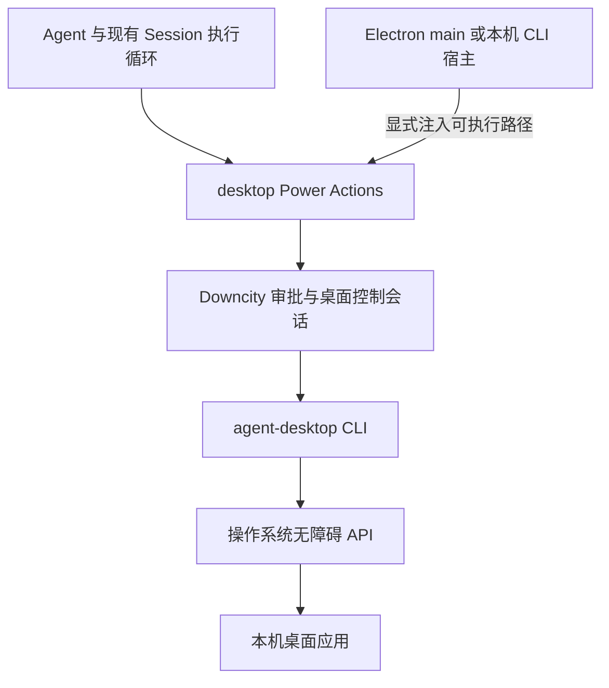

# agent-desktop 融入 Downcity 的设计提案

状态：待用户确认；仅完成代码与上游文档调研，尚未安装依赖、修改运行配置或操作桌面。

## 产品目标与结论

让已获授权的 Downcity Agent 观察并操作当前电脑上的桌面应用，任务规划和完成判断继续使用现有 Agent 执行循环。

建议增加独立的 `DesktopPower`，以 `desktop` 作为模型工具名。第一版由本机宿主提供 agent-desktop CLI 的绝对路径，通过结构化参数调用；上游负责无障碍树、元素身份校验和系统动作，Downcity 负责调用身份、授权、会话归属、并发协调、产物与资源生命周期。

MCP 可用于独立试用，但不作为这次正式集成的必经层。第一版不引入 FFI，不新增 Agent 推理循环，也不为尚不存在的第二个实现设计通用设备框架。

## 调研依据

当前 Downcity 已有的相关实现：

- `public/packages/implementations/powers/src/web/Power.ts`：独立 Power、结构化动作、provider 生命周期与作用域管理。
- `public/packages/implementations/powers/src/builtin/BuiltinPowerTypes.ts`：City 持有官方 Power 唯一实例。
- `public/packages/city/src/power/types/PowerRuntime.ts`：Action 支持 schema、超时、读写声明和独立的 `approval` 声明。
- `public/packages/city/src/power/core/PowerActionApproval.ts`：统一审批，绑定真实工具调用；缺失审批端口或工具调用身份时拒绝。
- `public/packages/implementations/powers/src/mcp/runtime/McpRuntime.ts`：SkillPower 管理 MCP Server、Agent 分配和连接；目前 `skill.call` 设置 `approval: false`。
- `public/packages/implementations/powers/src/mcp/runtime/Transport.ts`：stdio Server 在 City 所在进程的机器上通过 Node spawn 启动。
- `private/apps/desktop/src/main/agent/DesktopAgentAssembly.ts`：Electron main 是本机 Power 与 Workspace 的装配入口。
- `private/apps/desktop/electron-builder.yml`：已有 extraResources 原生资源分发入口，但当前未配置 agent-desktop。

上游 README 与 CONCEPTS.md 声明的能力：

- CLI、stdio MCP、C 库共享 Rust core；支持 macOS AX、Windows UI Automation、Linux AT-SPI。
- 使用携带 snapshot ID 的 ref；执行前校验元素身份，失效或歧义时拒绝。
- 默认 headless 通过无障碍语义操作；`--headed` 显式允许相应焦点和物理输入行为。headless 不表示没有桌面会话，也不等于所有操作都能在后台完成。
- `AGENT_DESKTOP_HOME` 可设置私有状态根；`--session` 隔离快照命名空间。
- session start 返回 ID，并不会自动使后续命令进入该 session。
- interaction lease 串行化单次输入分发，不保证多个 Agent 的整个任务互不干扰。
- 错误包含动作送达及重试语义，不能只看退出码判断是否重试。

这些结论来自源码阅读与上游文档，尚未在 Downcity 打包应用内实测。

## 领域职责与依赖

`DesktopPower` 属于 `@downcity/powers`，公开入口建议为 `@downcity/powers/desktop`。Electron main 只负责装配、分发资源与展示状态，不承担业务执行。普通 Agent SDK 不依赖这个原生程序。

本机桌面是 City 宿主拥有的资源；Workspace 是项目资源。切换项目目录、使用 SSH Workspace 或远程 Sandbox，不会改变桌面操作发生的电脑。

第一版明确只支持 Power 执行进程所在机器的交互桌面。远程 City 如需操作用户电脑，需要额外的本地执行端与连接协议，超出本方案。

WebPower 继续负责网页搜索、阅读、DOM/CDP 浏览器操作。DesktopPower 负责桌面应用和系统窗口。Agent 优先选择已有结构化 API 或网页工具，桌面交互用于确实需要操作应用界面的任务。

## 最小公开动作

| 动作 | 用途 | 首版建议 |
| --- | --- | --- |
| `status` | 返回工具版本、所在机器标识、平台、权限及可用原因 | 只读；不自动触发系统权限引导 |
| `list_apps` | 列出本机可观察应用 | 只读 |
| `list_windows` | 列出指定应用窗口 | 只读 |
| `open_session` | 为指定应用/窗口创建桌面控制会话 | 占用控制权；返回真实目标 |
| `snapshot` | 读取窗口或指定 ref 子树 | 保留上游 snapshot ID、完整性和 ref |
| `act` | 执行有类型的点击、设置值、输入、选择、滚动等动作 | 默认 headless；声明写入和审批 |
| `screenshot` | 显式取得指定目标的截图 | 独立调用；返回受控产物 |
| `close_session` | 结束控制会话、释放控制权 | 不关闭用户应用 |

`act` 使用有限的 discriminated union，逐项校验参数，不接受任意命令字符串。第一版优先覆盖完成常见任务所需的动作，不逐个包装上游全部命令。

物理键鼠输入建议作为后续单独动作加入，以静态声明其审批要求；第一版不在 `act` 中悄悄降级为物理输入。

不提供一个把自然语言交给另一套模型独立完成任务的 `run_task`。Agent 继续执行“观察—动作—验证”的现有循环。

## 会话、身份与并发

1. Downcity 桌面控制会话绑定 City、Agent、真实 Session 身份、应用进程及窗口。身份由运行上下文读取，模型不能自报 Agent ID 获取其他会话。
2. agent-desktop 原生 session ID 由运行时持有，每次 CLI 调用都显式传入。返回给模型的控制会话标识与底层 session 建立唯一映射。
3. agent-desktop 状态根放在 Power 私有存储中，不使用用户的全局默认目录，不复制快照映射成为第二套事实源。
4. 首版同一桌面只允许一个活跃的自动控制 Session。其他 Session 获得明确的占用状态；用户可停止当前控制，再交给另一 Session。
5. 控制权覆盖一个连续操作过程，且包含明确释放、取消释放和有期限的闲置回收。不能只在单条 click 外加锁，因为另一个任务仍可能在“输入文本”和“点击发送”之间改变窗口状态。
6. 下游元素身份检查继续交给上游。Downcity 必须确认 ref 来自当前控制会话且目标属于授权应用/窗口，不能接受其他原生 session 或其他应用的 ref。
7. 首版不开放可切换到任意应用的全局快捷键、剪贴板及批量任意命令。跨应用任务需要后续显式设计授权目标集合。

应用/窗口范围是 Downcity 的调用约束，不能将它描述成操作系统级隔离。初期允许可信 Agent 使用本机能力这一前提必须在启用时明确。

## 审批与失败语义

Agent 分配遵循现有 Power 机制，本机 DesktopPower 默认不自动向所有 Agent 开放。启用能力、确认系统无障碍权限和实际工具动作审批是不同步骤。

第一版写动作使用现有 `approval` 执行链，遵守当前会话审批模式；不另建一套审批系统，也不把一轮任务中的自然语言许可默认转成永久授权。减少逐步审批打断，需要后续单独设计有明确范围和期限的授权能力，不能靠 prompt 约定代替。

保留上游错误码、送达状态与重试建议：

- 失效或歧义的 ref：重新观察，重新选择目标。
- 明确未送达且允许重试：按上游提示处理。
- 可能送达或已送达但未验证：先观察实际结果，不重复点击或输入。
- 超时或取消：停止后续分发、结束自己持有的子进程并释放控制权；已经发给应用的动作无法撤销，也不能保证进程终止会撤销已排队的系统事件。

只重读界面可以验证可见状态；外部提交是否真正完成仍须检查应用给出的证据。

## CLI 执行与生命周期

使用 `spawn(binary_path, args, { shell: false })` 或同等的无 Shell 调用，参数由 schema 转换。可执行文件路径由宿主提供，模型不能修改路径、状态目录或原始全局参数。

由 DesktopPower 持有子进程与控制会话；由 City 负责 Power dispose。取消信号、超时、stdout/stderr 上限、JSON 解析错误、进程退出均需有明确结果。dispose 只清理 Downcity 创建的资源，不终止用户桌面应用。

文本通过 stdin 传给支持 `--stdin` 的上游命令，减少进程参数暴露。首版不额外承诺密码输入能力；现有秘密输入引用不能自动用于新工具，需要另行接入私有值通道或由用户完成登录。

保留上游 envelope，向 Power 结果映射时保留关键错误字段。大快照优先用交互元素、skeleton 和子树读取控制规模；截断或不完整必须明确报告，不能返回一个看似完整的树。

## 用户体验与分发

Desktop 设置页先提供简洁状态：未安装、版本不匹配、缺少权限、可用、正在被某 Session 控制；展示正在操作的电脑和应用，以及停止控制入口。

系统权限引导必须由用户显式触发。macOS 发布包需要实测 Downcity 签名、原生 helper、TCC 无障碍授权、重启及升级后的行为；截图权限与无障碍权限分别验证，不能假设安装 CLI 即可使用。

开发验证先使用显式配置的已安装二进制。正式发布锁定上游版本，随平台架构打包官方二进制与必要 helper，放在可执行的应用资源目录而非 ASAR 内；接入现有构建、签名与许可证声明流程。不能在用户首次调用工具时隐式安装或升级。

截图和 trace 存入 Power 私有产物目录，通过宿主授权的图片/文件通道展示。默认不主动采集截图、不打开完整截图 trace。返回的界面文字仍会进入模型上下文和会话历史，不能把“不额外写日志”等同于内容完全不留存。

## 为什么首版选择 Power + CLI

| 接入方式 | 适用场景 | 本次判断 |
| --- | --- | --- |
| Skill + Shell | 开发者快速试用 | 可独立验证上游，但参数约束、会话归属和产品状态不统一 |
| SkillPower 的通用 MCP | 用户自选第三方桌面工具 | 可以使用；现有分配粒度为 Server，工具调用本身不走 Power 写动作审批 |
| DesktopPower + CLI | Downcity 官方桌面能力 | 建议；复用 Power 治理，子进程取消和错误归属清楚，按需执行 |
| DesktopPower + 内部 MCP 客户端 | 需要持续连接或经验证存在启动开销问题 | 后续有测量证据再选择，当前无需重复搭建 transport |
| C 库 / FFI | 有明确性能需求的深度嵌入 | 引入 ABI 和原生崩溃边界成本，首版收益未验证 |

CLI 按需启动是否存在显著性能开销需要实测，本提案不预设它快于 MCP。

## 实施范围与验收

建议先交付 macOS 最小闭环，再按平台实际验证扩展：

1. 受控验证：指定版本二进制，在用户指定应用中验证快照、动作、过期 ref、重复控件及取消行为。安装和实际桌面操作须另获用户确认。
2. 官方能力：实现独立 DesktopPower、宿主路径注入、控制会话、审批和上游错误映射；通过现有 TypeScript 与相关构建检查。
3. Desktop 产品接线：设置状态、权限引导、占用提示、停止入口、受控截图展示及发布资源配置。
4. 文档：同步 homepage 适用的中英文文档、Power readme、平台要求和权限说明。

验收重点是实际应用行为：标准控件操作成功；同名控件或 UI 变化时拒绝错误定位；两个 Agent 无法交错接管；取消后不再分发后续动作；关闭控制会话不关闭用户应用；缺权限清楚返回；打包应用可完成授权和调用。

本提案批准只代表可以开始实现相应代码。安装原生程序、运行真实桌面动作、启动实例、重启及发布仍分别遵循用户的明确授权。
