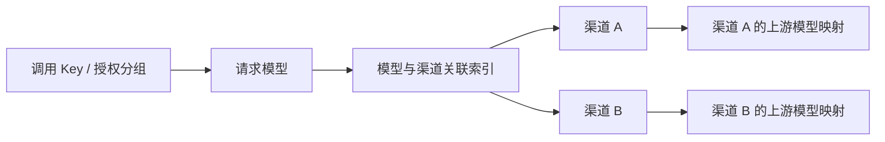

# Magpie、New API、sub2api 对比与 Federation SDK 建议

> 日期：2026-11-06。
> 状态：调研与待确认建议，未实施。
> 依据：三个项目当前 main 的文档与下述相关源码；没有部署或做性能比较，也没有完整审计。链接指向会变化的 main，实施前应固定 commit 复核。

## 1. 结论

对当前 Downcity，建议采用 New API 的渠道接入与模型映射方式，吸收 Magpie 的稳定聚合入口、手动切换和会话亲和，并参考 sub2api 对执行账号可用性、并发及续接归属的处理。

公开模型是 Federation 对 City 的承诺。渠道独立维护可提供的模型及上游映射，AIService 据此建立内部候选索引。SDK 不要求用户手动注册 Deployment 对象，也不要求把完整渠道连接反复嵌入各模型。

三个项目主要是网关产品，不是可直接比较的 TypeScript SDK。本文建议的 SDK 是根据领域所有权推导的接口草案，不能作为这些项目已经提供的 API。

## 2. New API：围绕渠道提供模型

源码 `model/channel.go` 的 Channel 持有类型、地址、Key、Models、Group、ModelMapping、Priority、Weight、启用状态，以及多 Key 配置。

`model/ability.go` 的 Ability 关联 group、model、channel_id。渠道保存后依据其模型和分组生成对应关联；同一个 model 可以关联多条渠道，公开模型查询使用 distinct model 去重。数据库查询路径先按组和请求模型筛选，再按优先级层和权重选择渠道；重试可以进入后续优先级层。项目还存在缓存和额外过滤路径，不能把这一函数当成全部运行行为。

关键关系是：



适合借鉴：管理员先接入一个渠道，然后一次配置它承载的多个模型；用户继续提交公开模型名。增加服务商时无需逐一修改每个客户端。

不建议直接照搬：Models、Group 的逗号字符串以及多处 JSON 字符串配置不适合作为我们新的强类型 SDK 接口。分组授权也不应与选哪个实际渠道混成同一个概念。公开模型能力和价格仍需单独的权威定义。

来源：

- https://github.com/QuantumNous/new-api/blob/main/model/channel.go
- https://github.com/QuantumNous/new-api/blob/main/model/ability.go
- https://github.com/QuantumNous/new-api/blob/main/README.md

## 3. sub2api：围绕账号池调度

`backend/internal/service/account.go` 的 Account 持有 Platform、Type、Credentials、Concurrency、Priority、状态、过期时间、限流重置和临时不可调度状态；账号可以属于分组，并有模型映射。

普通 Group 可以配置请求模型匹配到优先账号列表。Composite Group 则在账号选择之前，把公开模型解析到具体平台和 upstream_model；其显式规则包括 public_model、match_type、target_platform、upstream_model、endpoint、priority 和 enabled。

Composite 文档明确区分公开名称与上游映射，且说明该层不自动生成模型元信息、价格或能力记录。它也不等同于在多个服务商之间自动选最优模型。

OpenAI 账号调度源码中有 previous_response_id、guardian_parent、session_hash 和 load_balance 等选择层，并在请求中传入所需模型、传输和能力。说明账号选择不仅是随机挑 Key，还要处理已有响应/会话的执行归属与兼容性。不同平台路径和开关可能采用不同调度流程，不能推广为所有请求都严格经过同一条链。

适合借鉴：先判断能否执行，再调度；缓存亲和与必须回原账号的状态续接需要区分；限流、过期、并发和临时故障是动态状态，不能等同于管理员永久停用配置。

当前不需要提前引入完整 OAuth 账号池、订阅套餐和窗口调度。现阶段单凭据渠道已经能满足主要上游接入，后续需要账号池时再扩展凭据生命周期。

来源：

- https://github.com/Wei-Shaw/sub2api/blob/main/backend/internal/service/account.go
- https://github.com/Wei-Shaw/sub2api/blob/main/backend/internal/service/group.go
- https://github.com/Wei-Shaw/sub2api/blob/main/backend/internal/service/openai_account_scheduler.go
- https://github.com/Wei-Shaw/sub2api/blob/main/docs/COMPOSITE_GROUPS.md

## 4. Magpie：Provider 模型与聚合入口并存

Magpie 默认对用户暴露 `provider/model`。Provider 持有多协议地址、Key 或账号及模型目录，路由组通过 Members 引用 `provider/model` 或其他 group。用户可以用 `group/<id>` 作为稳定入口。

同名模型可以自动形成路由组；文档也提供只列出组、隐藏组成员模型的设置，以及 Provider 只通过路由组使用的选项。`bare.go` 提供不带 provider 的模型 ID 列表开关，默认关闭；打开后会附加去重的裸模型条目，原 provider/model 条目仍保留。

`group.go` 的 manual 策略只路由到选定成员。其他策略包括顺序、权重、轮换、用量、额度窗口和速度。文档中的 stays 支持 auto、session、turn、off、strict；strict 不允许为了可用性随意换账号。

适合借鉴：把一组上游挂到稳定入口，管理员在入口内切换；渠道与账号独立维护；会话亲和优先保留缓存与续接能力。

不能直接照搬其默认目录语义：Downcity 已明确 City 不看 provider，不能同时把所有 provider/model 和聚合组都列给 City。Magpie 的同名自动归组适合其个人聚合场景；Federation 发布一个确定模型时应显式确认映射，不能通过归一化名字或去除日期后缀证明版本相同。

Magpie 文档也有首输出超时后换成员等可用性策略。尚未向客户端输出并不代表上游未执行，Federation 仍需自行明确未知结果和重复生成成本，不能据此承诺安全重试。

来源：

- https://github.com/yetone/magpie/blob/main/internal/provider/provider.go
- https://github.com/yetone/magpie/blob/main/internal/provider/group.go
- https://github.com/yetone/magpie/blob/main/internal/provider/bare.go
- https://github.com/yetone/magpie/blob/main/docs/reference.md#routing-groups

## 5. 对 Downcity 最合适的结构

| 部分 | 所有权 | 关键规则 |
| --- | --- | --- |
| 公开模型目录 | AIService 的可运营配置 | 稳定 ID、版本、能力、公开描述和售价；只列已授权公开模型 |
| 上游渠道 | AIService 的可运营配置 | 地址、凭据引用、适配器、该渠道可提供的模型及映射；连接只配置一次 |
| 模型与渠道关联 | 渠道中的模型映射声明 | 每个关联只声明一次；模型视角的候选集合由关联生成 |
| 路由策略 | AIService | 默认优先级与权重；模型可覆写为指定渠道；策略只引用映射，不重复保存候选集合 |
| 执行适配器 | SDK 代码 | 转换标准请求/事件/用量/错误；不拥有用户售价 |
| 调度状态 | 运行存储 | 冷却、并发租约、会话亲和；不回写为新的模型配置 |

内部可以继续保存稳定的映射标识和执行快照来关联任务与日志，但 SDK 不需要单独创建一个 Deployment 实例。映射身份由 channel_id 与公开 model_id 确定，内部使用明确的复合身份或无歧义编码。

一个渠道对同一公开模型若有多个不同上游版本，需要先确认它们是否满足同一公开承诺；确有不同连接或执行策略需求时可以建立独立渠道配置。不要为了表面上少一个对象而丢失执行归属。

模型目录不能完全从渠道推导：当全部上游暂时不可用时，公开模型身份、能力和价格仍然存在。渠道可发现新模型，但需经过公开目录映射与发布后才进入 City。

## 6. 建议的服务端 SDK 形状

以下是待实现 API 草案。示例中的地址和凭据名由宿主配置提供，模型价格与能力定义省略；协议适配器按 SDK 代码注册目录解析。内置适配器可直接使用其稳定 ID，自定义适配器通过代码扩展同一个执行注册表。

```ts
/** Federation 初始 AI 目录配置示意。 */
const ai = new AIService({
  credits,
  catalog: {
    models: {
      "deepseek-v4-flash": deepseek_flash_descriptor,
      "deepseek-v4-pro": deepseek_pro_descriptor,
    },
    channels: {
      apimart: {
        adapter: "openai_chat_completions",
        base_url: apimart_base_url,
        credential_env: "APIMART_API_KEY",
        models: {
          "deepseek-v4-flash": {
            upstream_model: "deepseek-v4-flash",
            priority: 100,
          },
          "deepseek-v4-pro": {
            upstream_model: "deepseek-v4-pro",
          },
        },
      },
      inferai: {
        adapter: "openai_chat_completions",
        base_url: inferai_base_url,
        credential_env: "INFERAI_API_KEY",
        models: {
          "deepseek-v4-flash": {
            upstream_model: "deepseek-v4-flash",
            priority: 50,
          },
        },
      },
    },
  },
});
```

优先级与权重默认值统一由 schema 归一化，不要求每项显式重复。公开 descriptor 不包含 provider 字段；每条 Channel 的 models 只保存该渠道的执行映射和差异。

这个结构同时满足两个日常操作：添加渠道时批量声明它承载的模型；在管理端打开模型时查看从全部渠道映射生成的候选列表。两种界面读同一份事实，不能各自维护一套关联。

同型号模型的路由配置归公开模型的内部配置，公开 descriptor 投影时不包含它。默认策略从候选关联优先级与权重选择；固定策略只引用一个现有 channel_id，发布时必须验证该渠道确实映射此模型。

代码配置用于显式首次初始化或导入。数据库作为已发布目录的唯一权威；Fedman 和管理 SDK 更新同一个带 revision 的配置，不在运行中同时保留代码目录和数据库目录两套互相覆盖的状态。

## 7. City SDK 保持不变

```ts
/** City 按 Federation 的公开模型身份取得可执行模型。 */
const model = embassy.user.ai.model("deepseek-v4-flash");
const stream = await model.stream(call);
```

City 可以提交正常业务参数和用于连续会话的通用上下文标识，但不能提交渠道选择参数。若引入会话亲和，Federation 负责按调用主体命名空间记录并选择渠道，City 不保存 provider 身份。

指定模型只在同型号的合格渠道之间选择。跨型号的自动选模将来应由明确的独立入口表达，不混在当前渠道切换内。

## 8. 执行内核的边界

处理流程保持为：公开模型解析和授权 → 校验业务能力 → 固定目录与价格快照 → 根据原执行归属或会话亲和选择候选 → 动态可用性筛选及优先级/权重选择 → 适配器执行 → 统一结果与计量 → 幂等结算。

执行选择阶段返回本次不可变的内部执行目标，不通过反复改写模型对象来假装模型已变成某个 Channel。公开模型与实际执行身份分别记录在一次请求的执行上下文中。

图片等异步任务必须保存实际映射归属、上游任务号、适配器配置版本及价格快照，抓取结果时不重新调度。已有响应引用或不可移植的推理签名也需要明确的内部执行归属。

首批实现固定渠道、优先级与权重、冷却和必要的执行归属。速度或成本自适应策略应在获得可信观测与评估后再引入；完整 OAuth 账号池按实际需求单独设计。

## 9. 对此前方案的修正

此前公开模型、渠道、部署的领域区分仍成立，但领域对象不要求一一变成 SDK 注册方法或公共构造类。把渠道数组放进每个模型只改变了写法，没有解决共享连接与映射的所有权。

本建议将执行映射放到渠道，以声明式、可序列化目录配置表达；公开模型持有自身承诺及内部路由策略，AIService 编译出所需的候选索引和执行目标。这一方案作为下一轮确认依据，替代此前聊天中的服务端 SDK 示例。当前没有修改任何业务代码或启动、部署服务。
