# Federation AI Gateway 设计

> 面向 Federation AI Services 的 AI 中转网关设计。
>
> 文档状态：设计稿
>
> 目标：将 Federation AI Services 设计为面向应用、Agent 和团队的统一 AI 中转层，集中管理上游模型接入、协议转换、模型路由、访问控制、限流、额度、Usage、价格和结算。

## 1. 设计目标

Federation AI Services 对外提供一个稳定的模型服务入口，对内连接多个授权的 AI Provider。调用方只需要知道 Federation 的地址、访问 Key 和公开模型 ID，不需要分别配置每个上游供应商。

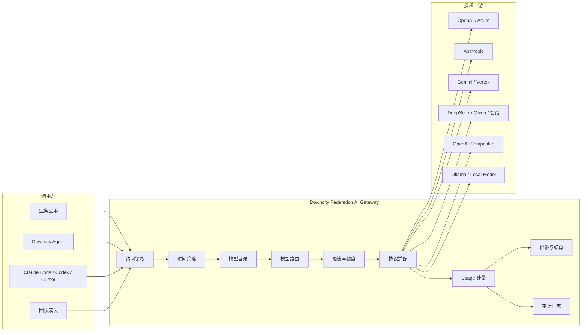

设计目标包括：

- 对外暴露稳定的公开模型身份。
- 对内支持多个 Provider、多个渠道和多个凭据。
- 将下游协议转换为 Downcity Model Protocol，再转换为上游原生协议。
- 支持模型映射、模型组、优先级、权重和故障转移。
- 支持用户、Bureau、Agent、应用和 AccessKey 维度的访问控制。
- 支持 RPM、TPM、并发、周期额度和费用预算。
- 记录一次调用的执行、尝试、渠道、上游模型和实际用量。
- 让技术用量、供应成本、客户价格和客户结算保持独立。
- 允许后续增加模型发现、健康检查、额度读取和凭据刷新。

## 2. 非目标

第一阶段不把以下内容作为核心路径：

- 基于另一个 LLM 的意图路由。
- 任意 JavaScript 请求中间件。
- 自动将所有上游模型直接公开给客户端。
- 依赖供应商订阅账户的非标准桥接。
- 跨所有 Federation 副本的全局限流。
- WebSocket Realtime 和所有厂商的实时协议。
- 插件市场及其完整生命周期。

这些能力可以在核心执行边界稳定后按实际需求增加。

## 3. 对外使用方式

调用方使用 Federation 地址和 Federation 签发的下游 API Key：

```bash
export OPENAI_BASE_URL=https://federation.example.com/v1
export OPENAI_API_KEY=dc_user_key
```

调用方请求公开模型：

```json
{
  "model": "coding-default",
  "messages": [
    {
      "role": "user",
      "content": "检查这段代码"
    }
  ],
  "stream": true
}
```

调用方不需要知道：

- 上游 API Key。
- 上游 Base URL。
- 真实上游模型 ID。
- 请求实际使用的渠道。
- 渠道是否发生了故障转移。
- 上游成本和 Federation 客户价格的计算方式。

服务端可以在审计和管理视图中展示实际渠道，但不应默认将凭据、内部地址或敏感配置返回给调用方。

## 4. 核心对象

Federation AI Gateway 使用四层核心对象：

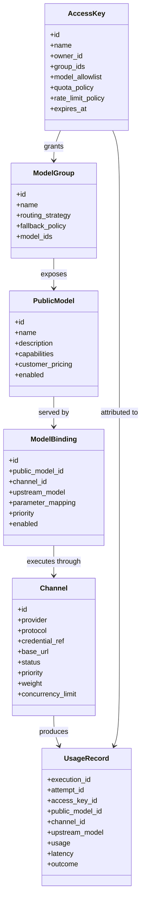

### 4.1 AccessKey

AccessKey 是调用方使用的下游凭据，与上游 Provider 凭据完全分离。

AccessKey 需要能够表达：

- 所属用户、Bureau、Agent 或应用。
- 可访问的模型和模型组。
- RPM、TPM 和并发限制。
- 每日、每月 Token 额度。
- 每日、每月费用预算。
- 是否允许访问图片、音频、视频等能力。
- 创建时间、过期时间和禁用状态。
- 来源标识，例如 `agent`、`console`、`ci`。

上游密钥只通过服务端凭据引用获取：

```text
credential_ref = secret://openai/team-a/key-1
```

真实上游密钥不进入公开模型目录、普通日志、Usage 记录或客户端响应。

### 4.2 PublicModel

PublicModel 是客户端可以选择的稳定模型身份，例如：

```text
coding-default
fast
reasoning
vision
claude-sonnet
```

PublicModel 负责表达 Federation 对客户的服务承诺：

- 公开模型 ID。
- 展示名称和说明。
- 支持的模态和输入类型。
- 工具调用、JSON 和 JSON Schema 能力。
- reasoning 档位。
- 上下文和最大输出限制。
- 对客户公开的价格方案。
- 是否允许流式调用。
- 是否允许公开访问。

PublicModel 不直接暴露以下内容：

```text
上游地址
上游真实模型 ID
上游 API Key
上游内部参数
```

### 4.3 Channel

Channel 是一个可执行的上游供应来源，例如：

```text
channel-openai-main
channel-openai-backup
channel-deepseek-team
channel-azure-prod
channel-local-ollama
```

Channel 负责：

- Provider 类型。
- 上游协议。
- Base URL。
- 凭据引用。
- 代理配置。
- 渠道健康状态。
- 并发限制。
- 渠道级优先级和权重。
- 上游错误策略。
- 供应商额度状态。

Channel 不直接决定客户端看到的模型名称。

### 4.4 ModelBinding

ModelBinding 描述一个公开模型如何在某个 Channel 上执行：

```text
PublicModel: coding-default

Binding A:
  channel: channel-deepseek-team
  upstream_model: deepseek-chat
  priority: 1

Binding B:
  channel: channel-openrouter-backup
  upstream_model: deepseek/deepseek-chat
  priority: 2
```

Binding 负责：

- 公开模型与 Channel 的关联。
- 上游真实模型 ID。
- 上游协议参数映射。
- reasoning 参数映射。
- 渠道能力覆盖。
- 优先级、权重和启用状态。
- 是否允许作为 fallback。
- 是否具有渠道亲和性。

同一个公开模型可以拥有多个 Binding；同一个 Channel 也可以绑定多个公开模型。

### 4.5 ModelGroup

ModelGroup 为多个模型或 Binding 提供一个逻辑入口，例如：

```text
coding-default
budget
reasoning
vision
fast
```

ModelGroup 可以配置：

- 成员模型。
- 成员 Binding。
- 路由策略。
- fallback 策略。
- 能力约束。
- 价格约束。
- 访问控制。

ModelGroup 适合承载“按能力选择模型”的需求；具体模型 ID 适合承载稳定的兼容入口。

## 5. 统一请求链路

多个下游协议最终都应进入同一个内部执行流程。

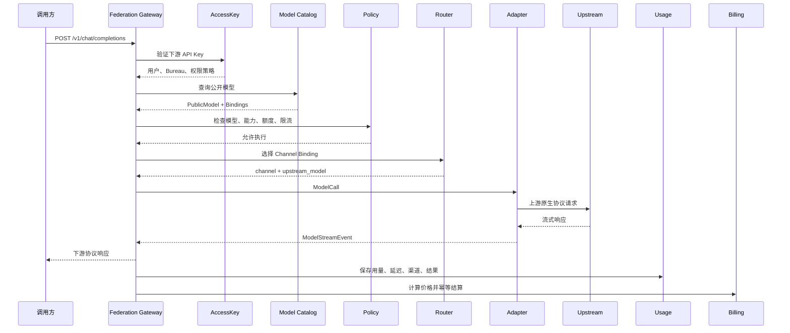

统一执行流程：

```text
入站协议解码
  → 下游身份鉴权
  → 模型与策略解析
  → ModelCall 校验
  → 显式模型 fallback
  → 能力校验
  → RPM / TPM / 并发 / 额度检查
  → ModelBinding 选择
  → 上游执行
  → ModelStreamEvent 校验
  → 入站协议编码
  → Usage 记录
  → 客户价格计算
  → 幂等结算
```

入站协议只负责解码和编码；模型目录、策略、路由、执行、计量和结算由统一执行器负责。

## 6. 协议适配框架

Downcity Model Protocol 是 Federation 内部的稳定协议边界。

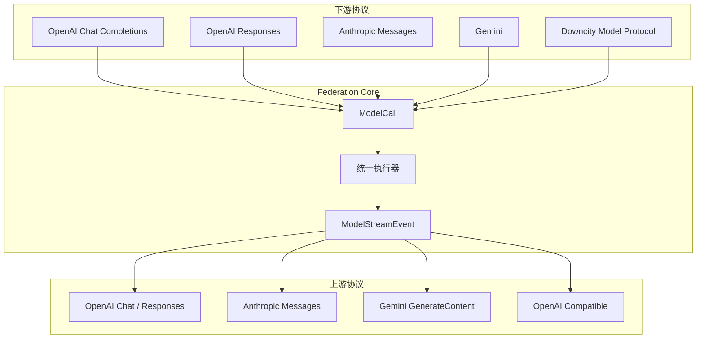

每个上游 Adapter 负责：

- 将 `ModelCall` 编码为上游请求。
- 注入上游认证和服务端配置。
- 解码上游流事件。
- 归一化工具调用。
- 归一化 reasoning。
- 归一化 usage 和 finish reason。
- 归一化上游错误。
- 传播请求取消。
- 返回上游 request ID 和安全审计信息。

需要覆盖的语义：

- 普通文本增量。
- reasoning 增量和签名。
- 工具声明。
- 工具调用增量。
- 工具结果。
- 图片和文件输入。
- JSON 和 JSON Schema 输出。
- 流式 usage。
- finish reason。
- 请求取消。
- 上游连接中断。

当某个协议无法支持调用方显式要求的能力时，应返回明确错误：

```json
{
  "error": {
    "type": "unsupported_capability",
    "message": "The selected channel does not support response_format=json_schema",
    "param": "response_format"
  }
}
```

不应静默删除调用方显式指定的参数。

## 7. 模型映射

### 7.1 同模型多渠道

客户端请求一个公开模型：

```json
{
  "model": "gpt-4o"
}
```

Federation 可以映射到多个授权上游：

```text
gpt-4o
  → OpenAI: gpt-4o
  → Azure: deployment-gpt-4o
  → OpenRouter: openai/gpt-4o
```

这属于同一公开模型的渠道切换，默认可以自动 fallback。

### 7.2 跨模型模型组

一个能力组可以包含不同模型：

```text
coding-default
  → claude-sonnet
  → gpt-5
  → deepseek-chat
```

跨模型切换可能改变能力、输出风格、延迟和费用，必须通过显式 ModelGroup 策略启用，不能与同模型换渠道混为一谈。

### 7.3 参数映射

参数映射按以下顺序生效：

```text
调用方参数
    ↓
公开模型默认参数
    ↓
ModelBinding 参数映射
    ↓
上游协议 Adapter 转换
```

允许映射的内容包括：

- 上游模型 ID。
- reasoning effort。
- Provider 特有采样参数。
- 输出格式映射。
- 工具调用格式映射。
- 上游请求头中的非敏感标识。

以下字段属于受保护字段，不允许被普通模型映射覆盖：

- `Authorization`。
- Federation AccessKey。
- Usage 追踪字段。
- `execution_id` 和 `attempt_id`。
- 流控制字段。
- 取消信号。

## 8. 路由策略

第一阶段建议支持确定性路由：

| 策略 | 预期逻辑 |
| --- | --- |
| `priority` | 选择优先级最高的可用 Binding |
| `weighted` | 按权重在可用 Binding 中分配请求 |
| `round_robin` | 在可用 Binding 中轮询 |
| `fallback` | 当前 Binding 失败后按顺序选择下一个 |
| `least_used` | 选择当前使用量较低的 Binding |
| `lowest_cost` | 选择预计客户成本或供应成本较低的 Binding |

路由流程：

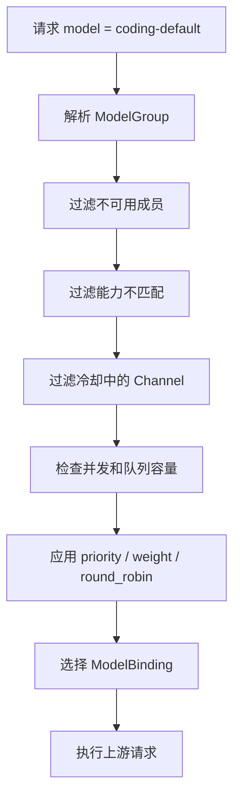

第一阶段不建议实现基于 LLM 的意图路由。它会增加额外模型调用，使延迟、成本和决策行为变得不可预测。

## 9. 故障转移与重试

### 9.1 可重试错误

可以进入故障转移流程的错误包括：

- HTTP 429。
- HTTP 500、502、503、504。
- 上游连接建立失败。
- 上游连接超时。
- 上游在输出提交前断开连接。
- Provider 明确返回可恢复错误。

默认不可自动切换的错误包括：

- 调用方请求格式错误。
- 模型能力不支持。
- 工具 Schema 无效。
- JSON Schema 无效。
- 认证配置永久无效。
- 明确的内容策略拒绝。

### 9.2 输出提交边界

自动切换的边界是标准模型事件已经提交给客户端之前。

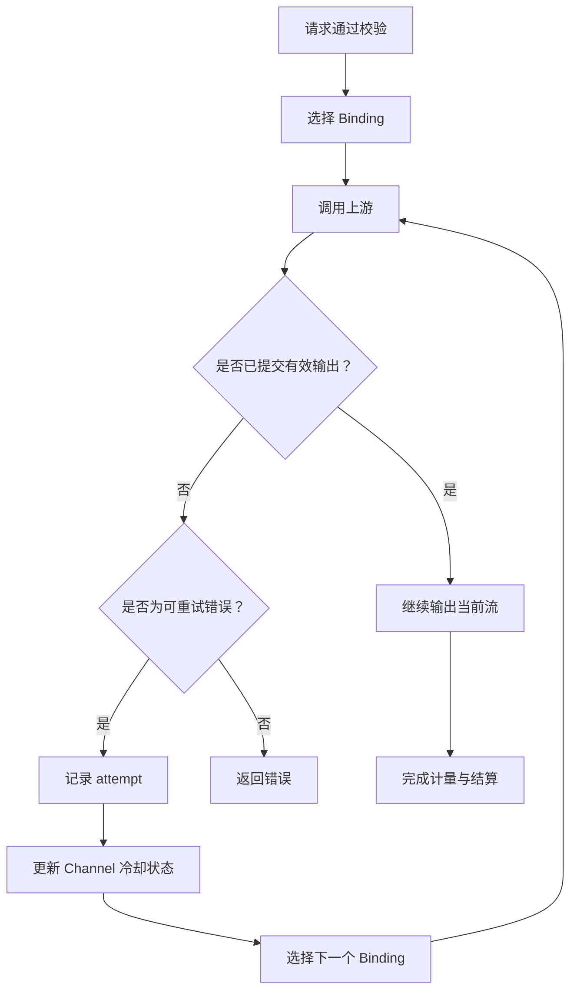

已经提交文本、reasoning 或工具调用后，即使后续连接失败，也不能把另一个渠道的响应拼接到当前流中。

### 9.3 冷却与健康状态

Channel 或 Credential 需要维护运行状态：

```text
healthy
cooling_down
credential_error
capacity_full
disabled
unknown
```

冷却时间可以由以下信息决定：

- 上游 `Retry-After`。
- 错误类型。
- 连续失败次数。
- 指数退避上限。
- 管理员手工配置。

第一阶段的冷却和并发状态按单个 Federation 运行实例生效。不能把单实例状态描述成跨副本的全局保证。

## 10. 多凭据池

一个 Channel 可以包含多个上游凭据：

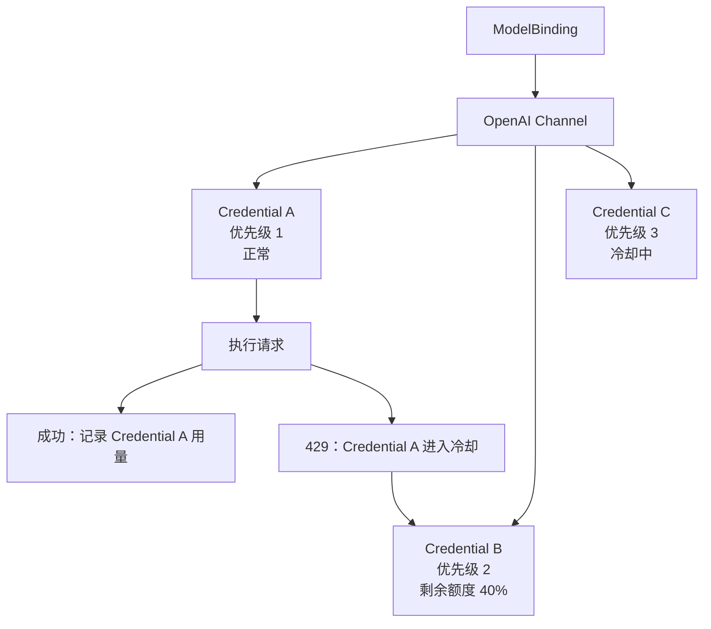

Credential 需要单独维护：

- 凭据引用。
- OAuth Token 或 API Key 类型。
- 代理配置。
- 并发限制。
- 供应商额度。
- 最近使用时间。
- 冷却状态。
- 认证错误状态。
- Usage 统计。

多个请求同时触发凭据刷新时，需要合并刷新操作，避免并发刷新造成 Token 覆盖或重复失效。

## 11. 并发、排队和限流

AI Gateway 的限制需要区分请求数、Token、并发、周期额度和费用预算。

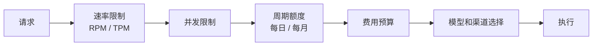

| 概念 | 解决的问题 |
| --- | --- |
| Rate Limit | 短时间请求太多 |
| Concurrency | 同时运行的请求太多 |
| Quota | 一个周期内允许消耗多少 Token |
| Budget | 一个周期内最多花多少钱 |
| Permission | 是否可以访问某个模型 |

渠道并发流程：

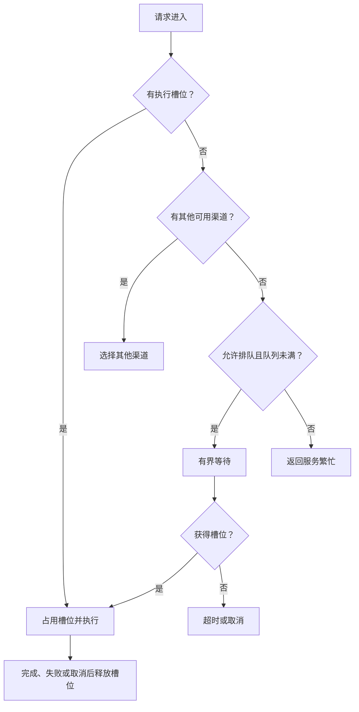

流式请求的预算处理：

1. 请求开始时按输入 Token 和最大输出 Token 做预算预占。
2. 请求完成后按实际 Usage 重新计算。
3. 未使用的预占额度释放。
4. 请求取消时按已产生的实际用量处理。
5. 无法获得真实 Token 用量时标记为未知，不记成零消耗。

## 12. 用户、Bureau、Agent 和 AccessKey 策略

模型可见性和用量限制应当按调用身份计算：

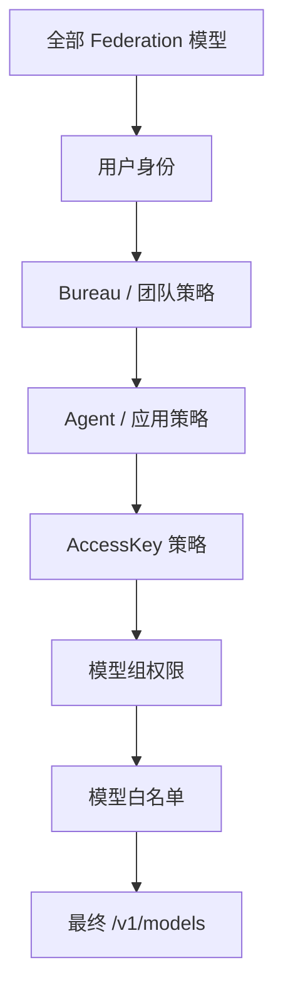

普通用户请求 `/v1/models` 时，只返回当前 AccessKey 实际可以调用的公开模型。

策略可以表达：

- 允许或拒绝某个模型。
- 允许或拒绝某个模型组。
- 允许或拒绝某种输入模态。
- 允许或拒绝工具调用。
- 最大上下文长度。
- 最大输出 Token。
- 最大单次费用。
- 每日和每月预算。
- RPM、TPM 和并发上限。

管理员可以查看系统级模型和渠道；普通调用方只能看到公开且授权的模型。

## 13. Usage、供应成本和客户结算

一次客户端请求可能对应多次上游尝试，因此需要拆分执行标识：

```text
execution_id：一次客户端请求
attempt_id：一次实际的上游尝试
usage_id：一次技术用量和结算生命周期
```

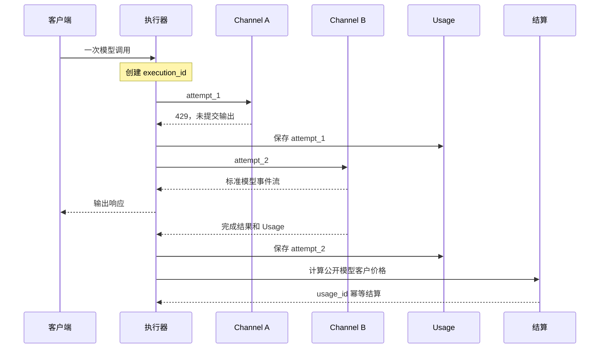

### 13.1 技术用量

技术用量记录实际发生的服务调用：

- 输入 Token。
- 未命中缓存的输入 Token。
- 命中缓存的输入 Token。
- 输出 Token。
- reasoning Token。
- 图片数量。
- 音频时长。
- 视频时长。
- 上游请求数量。
- 首 Token 时间。
- 总耗时。
- Channel。
- Credential。
- 上游模型。
- 尝试结果。

### 13.2 供应成本

供应成本反映 Federation 向上游供应商承担的成本，可以包含：

- 上游输入成本。
- 上游输出成本。
- Cache Read 成本。
- 订阅额度消耗。
- 请求次数成本。
- 图片、音频和视频成本。

### 13.3 客户价格

客户价格由公开模型和客户价格组决定，可以与供应成本不同：

```text
供应成本：
  input  = $1 / 1M tokens
  output = $5 / 1M tokens

客户价格：
  input  = $2 / 1M tokens
  output = $8 / 1M tokens
```

价格应绑定版本：

```text
pricing_version = pricing-2026-10-01
```

历史账单使用当时的价格版本，价格更新不能改变历史账单。

### 13.4 结算规则

- Usage 是技术事实。
- 供应成本是服务方成本事实。
- 客户价格是客户侧计费规则。
- Credits Charge 是账务事实。
- Usage 与 Charge 通过 `usage_id` 关联。
- 所有结算必须使用幂等键。
- 失败尝试保留技术用量。
- 上游未报告用量时标记为未知。
- 自动 fallback 的额外供应成本不应自动转嫁给客户，除非价格策略明确规定。

## 14. 模型能力和目录

同一个上游模型在不同 Channel 上的能力可能不同：

```text
gpt-4o
  OpenAI：text · image · tools · json_schema
  Azure：text · tools · json_schema
  备用渠道：text
```

如果这些渠道共同作为同一个公开模型的自动 fallback，公开能力只能声明所有渠道都支持的交集：

```text
text · tools
```

能力目录流程：

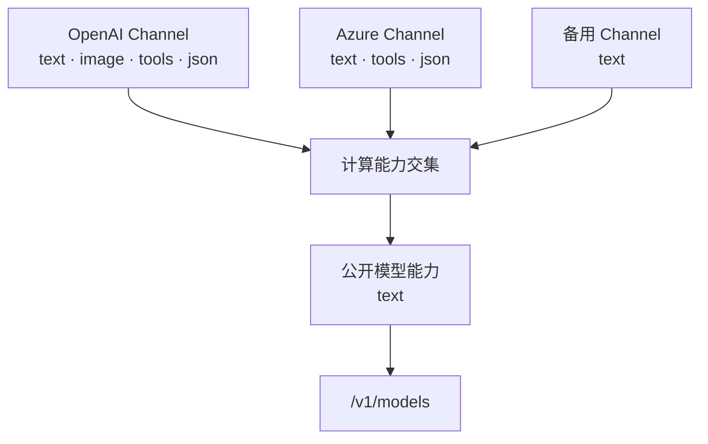

如果能力差异无法接受，应拆成不同的公开模型：

```text
coding-text
coding-vision
coding-fallback
```

模型注册时需要校验：

- PublicModel 的能力是否有对应执行入口。
- 所有自动 fallback Binding 是否满足公开能力。
- 模型上下文和最大输出配置是否有效。
- reasoning 档位是否能映射到至少一个候选 Channel。
- 价格是否完整且为非负值。

## 15. 模型目录发现与渠道管理

Provider 可以实现可选的管理接口：

- 模型发现。
- 健康检查。
- 凭据刷新。
- 供应商额度查询。
- 供应商能力查询。
- Channel 测试。

模型发现只生成候选目录，不直接自动公开模型：

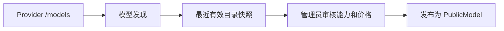

刷新失败时保留最近有效目录，并记录刷新状态。管理员需要能区分：

- 供应商当前返回的模型。
- 最近一次成功发现时间。
- 当前公开的模型。
- 公开模型的能力和价格来源。

### 15.1 Channel 测试

新增 Channel 后，管理员可以执行探测请求：

```text
POST /admin/ai/channels/:id/test
GET  /admin/ai/channels/:id/health
POST /admin/ai/channels/:id/models/refresh
```

测试流程：

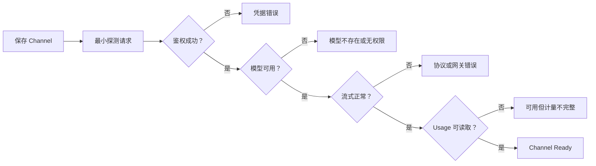

探测请求必须标记为 `is_probe = true`，不应进入普通客户统计，也不应产生客户账单。

## 16. 审计和可观测性

管理员需要能够回答：

- 谁调用了哪个公开模型？
- 使用了哪个 AccessKey？
- 实际使用了哪个 Channel？
- 是否发生 fallback？
- 每次尝试为什么结束？
- 请求首 Token 和总耗时是多少？
- 使用了多少 Token？
- 客户被扣了多少钱？
- 上游 request ID 是什么？

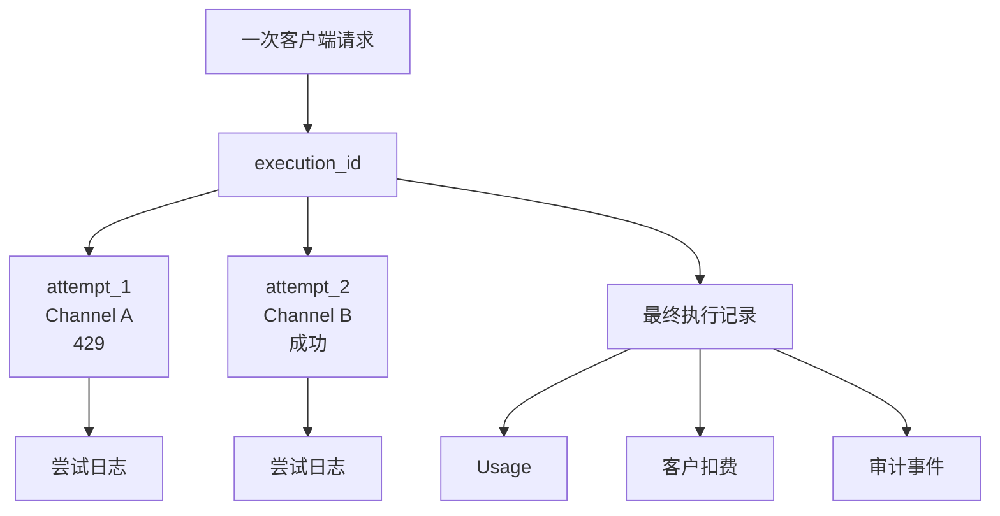

建议保存的安全字段：

- `execution_id`。
- `attempt_id`。
- `usage_id`。
- `access_key_id`。
- 用户、Bureau、Agent 或应用 ID。
- 公开模型 ID。
- ModelBinding ID。
- Channel ID。
- Credential ID，不保存凭据内容。
- 上游模型 ID。
- 上游 request ID。
- 请求协议和上游协议。
- 选择和 fallback 原因。
- 首 Token 时间。
- 总耗时。
- Usage。
- 结果和错误分类。
- 结算状态。

默认不记录：

- 上游 Authorization Header。
- 真实 API Key。
- 完整 Prompt。
- 未脱敏的文件内容。

## 17. 异步模型和任务 API

图片、视频、音频和其他异步 Provider 能力沿用 Federation 的 Async Job 和 Settlement Job。

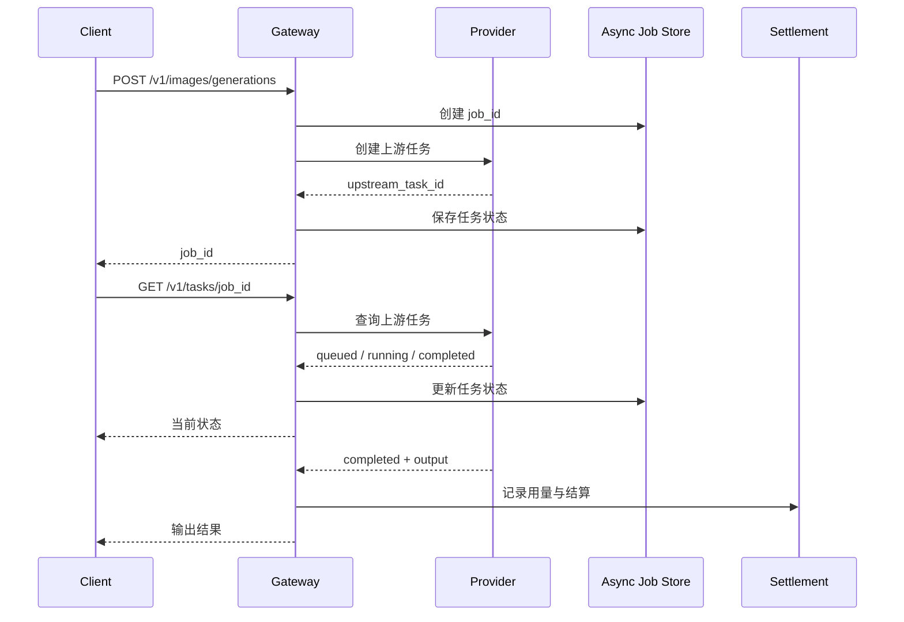

可以统一支持：

```text
image
video
audio
embedding_batch
provider_custom_task
```

任务插件可以后续开放，但任务状态、权限、用量和结算必须由 Federation 统一管理。

## 18. 管理面

管理面需要围绕“配置、测试、发布、观察”组织，而不是只提供 Provider 表单。

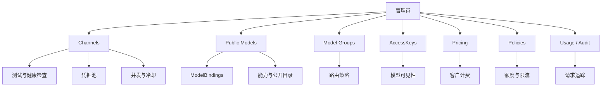

管理面至少需要支持：

- Channel 创建、编辑、禁用和删除。
- Channel 测试和健康检查。
- Credential 池管理。
- Provider 模型刷新。
- PublicModel 发布和下线。
- ModelBinding 配置。
- ModelGroup 配置。
- 路由策略配置。
- AccessKey 创建和撤销。
- 模型白名单配置。
- 限流、额度和预算配置。
- Usage、成本和客户账单查询。
- 单次请求的执行链路查询。

## 19. API 边界

### 19.1 面向客户端的 API

```text
GET  /v1/models
POST /v1/chat/completions
POST /v1/responses
POST /v1/messages
POST /v1beta/models/{model}:generateContent
POST /v1/images/generations
POST /v1/audio/speech
POST /v1/audio/transcriptions
```

具体协议是否开放，由 Federation 的入站 Adapter 决定。

### 19.2 面向管理员的 API

```text
GET    /admin/ai/channels
POST   /admin/ai/channels
PATCH  /admin/ai/channels/:id
POST   /admin/ai/channels/:id/test
POST   /admin/ai/channels/:id/models/refresh
GET    /admin/ai/channels/:id/health

GET    /admin/ai/models
POST   /admin/ai/models
PATCH  /admin/ai/models/:id
POST   /admin/ai/models/:id/publish
POST   /admin/ai/models/:id/disable

GET    /admin/ai/bindings
POST   /admin/ai/bindings
PATCH  /admin/ai/bindings/:id

GET    /admin/ai/groups
POST   /admin/ai/groups
PATCH  /admin/ai/groups/:id

GET    /admin/ai/keys
POST   /admin/ai/keys
POST   /admin/ai/keys/:id/revoke

GET    /admin/ai/usage
GET    /admin/ai/audit
GET    /admin/ai/executions/:id
```

## 20. 推荐内部模块

Federation AI Services 可以按以下模块组织：

```text
packages/federation/src/service/ai/
├── ai-service.ts                    # AI Service 入口与 action 注册
├── gateway/
│   ├── inbound-protocol.ts          # 入站协议边界
│   ├── language-executor.ts         # 统一语言模型执行器
│   ├── execution-context.ts         # execution / attempt 上下文
│   └── response-encoder.ts          # 下游响应编码
├── catalog/
│   ├── public-model-registry.ts     # 公开模型注册
│   ├── model-group-registry.ts      # 模型组注册
│   ├── model-binding-registry.ts    # 模型绑定注册
│   └── capability-validator.ts      # 能力一致性校验
├── routing/
│   ├── router.ts                    # Binding 选择
│   ├── routing-strategy.ts          # priority / weighted 等策略
│   ├── channel-state.ts             # 健康、冷却和容量状态
│   └── affinity.ts                  # 可选渠道亲和性
├── traffic/
│   ├── rate-limiter.ts              # RPM / TPM
│   ├── concurrency-limiter.ts       # 并发槽位
│   ├── quota-guard.ts               # 周期额度
│   └── budget-guard.ts              # 费用预算
├── channels/
│   ├── ai-channel.ts                # Channel 执行边界
│   ├── credential-pool.ts           # 多凭据池
│   └── provider-management.ts       # 发现、健康与刷新
├── adapters/
│   ├── openai-chat.ts               # OpenAI Chat
│   ├── openai-responses.ts          # OpenAI Responses
│   ├── anthropic-messages.ts        # Anthropic Messages
│   ├── gemini.ts                    # Gemini
│   └── openai-compatible.ts         # OpenAI Compatible
├── usage/
│   ├── usage-record.ts              # 技术用量
│   ├── provider-cost.ts             # 供应成本
│   ├── customer-pricing.ts          # 客户价格
│   └── settlement.ts                # 幂等结算
└── audit/
    ├── execution-log.ts             # 执行日志
    └── audit-event.ts               # 审计事件
```

模块职责需要保持单向依赖：

```text
入站协议
  → 执行器
    → 目录 / 策略 / 路由
      → Channel / Adapter
        → Usage / Pricing / Settlement
```

Adapter 不负责权限和计费；Router 不负责协议编码；计量和结算不读取上游凭据。

## 21. 第一阶段交付

第一阶段目标是形成可用的中转站骨架：

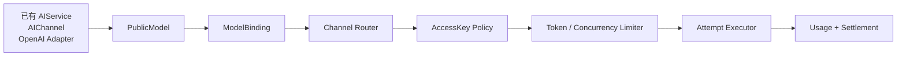

第一阶段交付内容：

1. `PublicModel`、`ModelBinding`、`Channel` 三层模型。
2. 一个公开模型绑定多个上游渠道。
3. 模型别名和模型组。
4. 渠道优先级。
5. 429、5xx、超时的有限 fallback。
6. AccessKey 模型白名单。
7. RPM、TPM 和并发限制。
8. `execution_id + attempt_id`。
9. 实际 Channel、上游模型和 fallback 原因进入 Usage。
10. 现有 OpenAI-compatible Adapter 接入统一执行器。
11. `/v1/models` 按 AccessKey 返回可见模型。

第一阶段暂不交付：

- 基于 LLM 的意图路由。
- 任意 JavaScript 请求中间件。
- 自动公开模型发现。
- 多副本全局限流。
- 复杂订阅账号桥接。
- WebSocket Realtime。
- 复杂插件市场。

## 22. 分阶段路线

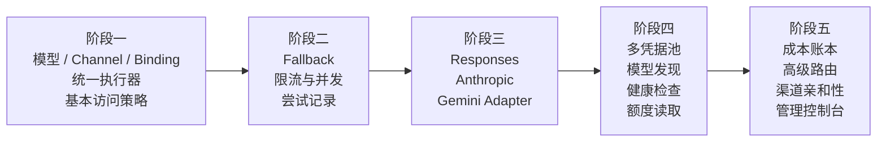

### 阶段一：中转骨架

- 拆分公开模型、Channel 和 Binding。
- 建立统一执行器。
- 保持现有 OpenAI-compatible 调用能力。
- 建立模型访问策略。

### 阶段二：可靠路由

- 增加执行尝试记录。
- 增加有限 fallback。
- 增加渠道冷却。
- 增加 RPM、TPM 和并发控制。
- 完善取消和超时传播。

### 阶段三：原生协议

- OpenAI Responses。
- Anthropic Messages。
- Gemini GenerateContent。
- 针对工具、reasoning、usage 和错误做协议验证。

### 阶段四：供应管理

- 多凭据池。
- 凭据刷新。
- 模型发现。
- 健康检查。
- 上游额度读取。
- 最近有效目录快照。

### 阶段五：运营能力

- 供应成本账本。
- 客户价格组。
- 高级权重路由。
- 渠道亲和性。
- 管理控制台。
- 请求级链路和成本分析。

## 23. 成功标准

Federation AI Gateway 达到第一阶段目标后，应满足：

```text
客户端只配置一个 Federation 地址和一个下游 Key

客户端只依赖公开模型 ID

一个公开模型可以绑定多个上游渠道

渠道不可用时可以在输出提交前有限切换

客户端请求经过统一的权限、能力、限流和额度检查

OpenAI-compatible 请求可以进入统一 ModelCall 执行链路

Usage 能够区分一次执行和多次上游尝试

管理员可以看到公开模型、实际渠道、上游模型和失败原因

客户账单可以通过 usage_id 幂等结算
```

最终调用链如下：

```text
客户端
  ↓
Federation AccessKey
  ↓
模型权限与额度
  ↓
PublicModel
  ↓
ModelGroup / ModelBinding
  ↓
Channel Router
  ↓
Rate Limit / Concurrency
  ↓
Attempt Executor
  ↓
Downcity Model Protocol
  ↓
Provider Adapter
  ↓
上游 API
  ↓
Usage / Cost / Settlement
```

这个设计让 Federation 从“若干 Provider Adapter 的集合”扩展为真正的 AI 中转服务：下游配置稳定、上游可以替换，模型和渠道可以独立运营，调用可以被限流、计量、审计和结算。
