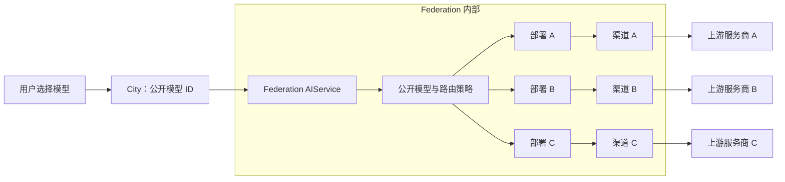
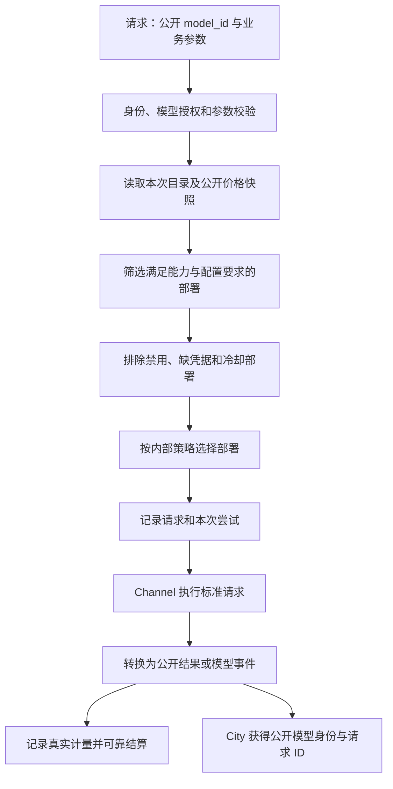

# Federation AI 公开模型与执行渠道边界设计

> 状态：待确认方案，尚未实施。
> 日期：2026-11-06。
> 范围：AIService、Federation 管理端、City 模型协议、私有 Federation 模型配置。

## 1. 产品目标

用户选择稳定的模型，City 按公开模型协议调用，Federation 管理实际执行渠道。同一模型接入多个服务商时，用户目录只出现一个模型；管理员切换渠道后，City 的模型配置继续有效。

模型开发商是模型身份的一部分，例如 DeepSeek、Anthropic；本次请求实际经过的供应商、渠道、凭据和上游映射属于 Federation 管理信息。

## 2. 当前实现与问题

| 位置 | 当前事实 | 对设计的影响 |
| --- | --- | --- |
| `service/ai/AIChannel.ts` 的 `model()` | 返回的模型定义同时含公开描述、固定上游模型、渠道、runtime 和 bill | 模型产品与执行部署共用一个对象 |
| `service/ai/model-registry.ts` | 以公开 ID 注册唯一模型，重复 ID 报错 | 不支持多个 Channel 直接注册同一个公开模型 |
| `service/relay/catalog.ts` | 已有 models、channels、deployments、routes，支持数据库配置版本 | 可以沿用目录版本与路由机制的思路 |
| 同文件的 registered 部署校验 | runtime ID 必须等于模型 template ID，渠道与上游映射也必须匹配该 runtime | 多个原生 runtime 无法共享同一公开模型模板 |
| `service/ai/ai-service.ts` | Relay 可选，只接管语言模型入口；其他能力仍直接查原生注册表 | 语言、图片、音频的模型解析规则不同 |
| `service/relay/runtime.ts` | 用户调用日志返回渠道和上游模型；用户可查询 attempts | 管理信息进入公开接口 |
| `types/CityModel.ts` | 公共 descriptor 含管理员环境需求，meta 的注释允许 provider 信息 | 公共协议与管理协议没有彻底分开 |
| `private/services/local-node/src/models.ts` | 相同 DeepSeek 型号以不同渠道前缀分别注册，名称、描述、标签也包含服务商 | 去掉某个 provider 字段无法消除重复和渠道暴露 |
| `private/services/local-node/src/federation.ts` | 本机 AIService 未启用 Relay | 当前本机目录直接反映渠道模型声明 |
| `service/ai/AIImageJobRuntime.ts` | 后续抓取按 job.model_id 重新查模型，创建结果和任务状态携带 Channel metadata | 多渠道下需要固定任务执行归属并规范公开结果 |
| `private/apps/desktop` 的模型装配、聊天选择器和设置详情 | 直接消费目录名称、描述、ID、标签，没有独立 provider/channel 选择控件 | 需要修正 Federation 目录来源，Desktop 核对消费结果 |
| `private/apps/fedman/src/pages/RelayPage.tsx` 与 `RelayEditor.tsx` | 已支持模型、渠道、部署、路由的创建、编辑、启停和删除，编辑器也有 registered 模板绑定限制 | 复用管理能力，调整领域组织和校验规则 |
| `private/apps/homepage` 的 `relay-pages.ts` 与 `relay-request-detail.tsx` | 用户 BFF 保留内部字段，调用详情展示渠道、上游模型和上游尝试 | 后端响应、BFF 类型与用户页面需要一起收口 |
| `packages/cli/src/federation/admin/commands/models.ts` | TUI 模型菜单只查看注册模型、就绪状态和缺失环境变量 | Web 管理端与 TUI 当前能力不同，不能视为已经统一 |

以上是源码事实，不代表对正在运行的实例、数据库或服务商能力做过核验。

## 3. 最小领域模型

保留三个核心对象：公开模型、渠道、部署。路由策略属于公开模型的内部配置。首批不新增独立 Provider 数据表，也不公开可调用的渠道路由 ID。

| 对象 | 唯一职责 | 主要内容 | 可见范围 |
| --- | --- | --- | --- |
| Model | 用户购买和调用的模型承诺 | 稳定 ID、名称、版本、能力、上下文、reasoning、公开价格、发布状态 | 公开部分供 City 使用 |
| Channel | 一条实际的上游连接 | 内部 ID、服务商名称、适配器、地址、凭据引用、期限、启用状态 | Federation 管理端 |
| Deployment | 某个模型在某条渠道的执行绑定 | 内部 ID、model_id、channel_id、upstream_model、服务端参数、兼容约束、优先级、权重、供应成本 | Federation 管理端 |

同一服务商使用不同协议、地域或凭据时可以有多条 Channel。服务商名称是管理属性；只有后续出现独立的供应商合同或账户管理需求时，才需要独立 Provider 实体。

示例：`deepseek-v4-flash` 是一个公开模型；`apimart/deepseek-v4-flash`、`inferai/deepseek-v4-flash`、`huiqing/deepseek-v4-flash` 是三个内部部署。公开模型描述由 Federation 单独维护，不从某一个渠道复制。

## 4. 公开契约与执行契约

### 4.1 City 的模型契约

公开 descriptor 只包含模型 ID、名称、说明、类别、能力、上下文、reasoning、公开标签和售价。若保留公开 meta，内容必须显式来自公开模型配置，不能拼入内部配置。

`env_requirements`、channel_id、deployment_id、upstream_model、供应成本和服务端参数进入独立的管理员契约。普通模型列表不再根据 admin 身份改变对象结构；管理员通过管理端接口查看内部信息。

公开模型 ID 在一个 Federation 内稳定。City 跨 Federation 保存引用时保留 Federation 身份和 model_id，不按照名称自动合并不同 Federation 的目录。

请求仍提交公开模型 ID 和业务参数。调用方不能提交 provider、channel、deployment 或上游私有参数来影响路由。参数适配由服务端部署和 Channel 完成。

### 4.2 Channel 的执行契约

Channel 声明可执行的操作，并接收本次已解析的部署输入。输入包含公开模型身份、真实 upstream_model、标准业务请求、服务端参数和取消信号。

移除“Channel.model() 同时创建公开模型、固定执行闭包和账单”的所有权混合。Channel 注册执行能力，Model 注册公开承诺，Deployment 连接二者；公开 Model 不持有某个 Channel 的 runtime。

代码中的适配器是执行协议的事实源。可运营目录是模型发布、渠道配置、部署和路由策略的事实源。配置发布必须验证适配器存在、操作受支持、引用完整、凭据引用合法以及能力约束满足。

不通过字符串前缀或名称相似度自动判断两个模型相同。模型版本、视觉/文件输入、工具调用、上下文、reasoning 和任务参数需要明确对齐；不能满足公开承诺的部署不得加入该模型的路由集合。兼容性需要适配器声明、配置审核及必要的上游验证，不能仅靠目录校验推断服务商实际行为。

## 5. 统一请求执行流程

所有语言、图片、语音、视频及 decision 入口共享模型解析和部署选择。不同模态继续保留各自的执行及结果处理，避免制造一个包办流、二进制和异步任务的万能运行时。

路由策略首批支持两种管理意图：固定部署，以及按优先级和权重自动选择。固定模式只使用指定部署；切换到固定模式是管理员明确选择，失败时不隐式绕到其他部署。自动模式优先使用最高优先级，在同级按权重分配，符合安全条件时才尝试后备部署。

请求开始后固定目录版本、公开价格和候选部署配置；管理员修改影响后续请求。已有缓存机制意味着多实例更新存在传播时间，管理端应明确显示保存的版本及传播语义，不能承诺所有实例瞬间切换。

模型目录按发布和授权规则保持稳定；临时冷却不删除公开模型。全部部署暂不可用时，调用返回统一的暂不可用错误。管理员显式下架才改变发布状态；已被 Agent 选择的模型不能因此在 City 自动替换为其他型号。

## 6. 切换与失败语义

人工切换作用于后续请求，不中断当前流，不迁移已有任务。

自动切换沿用当前保守规则：只有适配器能够确认请求尚未开始生成且允许重试时，才在同一逻辑请求中尝试其他部署。网络超时、5xx 和断流可能对应上游已执行，不能直接重新生成。

流产生内容后不能拼接另一渠道的输出。客户端取消时中止当前执行。每个尝试独立记录；一个逻辑请求通过稳定 usage_id 执行幂等结算。

同一型号也可能存在渠道相关的缓存、reasoning 签名或续接状态。协议将必要续接信息视为不透明状态；Federation 和适配器负责判断跨渠道能否使用，不能把识别渠道或修复签名的职责交给 City。若某个能力依赖渠道状态，则需要内部执行亲和性，或在明确安全时去除不可移植状态后重新传入完整标准上下文。

跨型号的媒体 fallback 与同型号的渠道切换分别处理。默认按所选模型公开能力校验输入；确需跨型号路由的产品能力应单独定义，不能作为 provider 切换的隐含行为。

## 7. 异步任务的执行归属

图片创建时生成 Federation 自己的公开 job_id，内部保存 upstream_job_id、deployment_id、适配器执行信息、目录版本和计费快照。后续轮询通过任务记录找到原部署，不重新按当前模型路由。

渠道被停用后禁止新任务；已有任务仍允许通过原执行配置抓取结果。被进行中任务引用的配置不能直接物理删除，需要保留可恢复的内部执行引用或配置快照，凭据继续通过受控引用读取。

公开任务结果通过字段白名单构造，只返回公开 job_id、状态、规范化进度、文件或业务结果和统一错误。Provider metadata、上游任务号和内部异常留在 Federation；不能通过简单过滤字段前缀来定义公开边界。

## 8. 计费与可观测性

公开售价由 Model 决定，供应成本由 Deployment 决定。切换渠道不改变该次调用的公开计价规则，供应成本不得代替用户售价。

Channel 返回标准输出与真实用量。公开费用由统一计费流程按请求开始时的模型价格计算；移除 Channel 对用户 charge 的直接决定权。现有可靠结算任务和幂等扣费机制继续作为账务基础。

价格含条件时，固定价格规则快照，完成后根据实际计量选择适用项。缺少可信用量时明确记录计量不可用，不猜测 token，不把配置切换后的价格用于旧请求或旧任务。

用户日志返回请求 ID、公开模型、状态、耗时、用量和实际费用。管理员日志在此基础上读取渠道、部署、尝试、上游请求 ID、配置版本、内部错误和成本信息。两者使用独立响应类型及显式投影。

还需检查 Credits 交易 metadata、错误消息、模型事件和媒体任务结果，确保内部归因信息没有经其他用户接口再次暴露。内部审计保留完整归因，公开响应只返回业务所需字段。

## 9. 管理端与 City 的交互

Fedman 已经具备模型、渠道、部署和路由的基本编辑操作，可复用现有页面及通过 `FederationWebServer.ts` 接入的 BFF。调整现有编辑器中的模板绑定，并将内部路由策略纳入模型详情。现有健康信息只是共享冷却快照；主动连接检查是本方案建议增加的能力。

Federation 管理端围绕三个入口组织：

- 模型：管理公开描述、能力、价格、发布状态；展开查看该模型的各渠道部署，设置固定或自动策略。
- 渠道：管理服务商名称、地址、适配器、凭据引用、启用状态及连接检查；展示该渠道承载的模型。
- 调用：按公开模型和内部渠道排查请求，查看每次尝试、用量、成本与结算。

切换一个模型的渠道在模型详情中完成；停用某渠道影响该渠道承载的全部模型。管理端应在提交前显示受影响范围。

City 继续使用模型目录和公开 ID，展示模型名称、能力、价格及不可用提示。公开描述、标签和搜索项均从公开 Model 获取，不从部署或 Channel 元数据生成；无需保留 provider 下拉框。

## 10. 存储和发布所有权

可运营目录由 AIService 管理，数据库保存校验后的版本化快照，并通过 revision 避免并发覆盖。可以沿用现有原子 JSON 目录存储机制，不为本次改造先增加多张关联表。

SDK 配置作为显式导入或初始化的来源；每次启动不得用代码默认值覆盖管理员已经发布的目录。配置中的适配器引用必须能在当前代码运行时解析，否则启动或发布校验明确失败。

路由成为 AIService 的基础能力，登录用户、City 原生调用和 OpenAI 兼容调用共享模型身份与部署选择。独立调用 Key 的签发和鉴权仍可选，不再用 `relay` 一个开关同时决定认证产品与核心路由规则。

## 11. 实施范围与验证

1. 调整 Federation 领域类型和 Channel 契约，明确 Model、Channel、Deployment 以及独立公开/管理视图。
2. 合并模型目录与解析路径，复用现有目录版本、健康冷却、尝试日志和可靠结算；移除模板绑定及公开 route 入口的依赖。
3. 将图片任务固定到创建时的部署，补齐内部上游任务映射和价格快照；让其他模态共享部署解析。
4. 改造本机与 edge Federation 的模型声明，将已核对为同一模型的各渠道注册合并，清理公开 ID、名称、描述和标签中的渠道信息。
5. 同步 Fedman 编辑器及 CLI Web BFF、City 公共类型、Homepage 用户日志后端/BFF/页面以及相关 homepage 中英文文档。Desktop 核对目录消费、模型选择器和详情展示；用户文档直接描述当前行为。

需要验证的场景：同一模型多渠道只公开一次；不同版本不会错误合并；人工切换后 City ID 不变；语言与其他模态遵循同一模型解析规则；能力不满足的部署不能发布；安全重试、取消和断流的语义正确；图片任务不随路由修改换渠道；用户日志及账单不泄漏内部字段；结算幂等且价格固定；目录并发更新不会互相覆盖。

公开 ID 调整前需要盘点已有 Agent 配置、默认模型和已保存的引用，明确一次性更新范围。历史用量保留原始审计事实，不批量改写为新模型；进行中任务必须保留可恢复的原执行归属。

本方案确认后再实施业务代码、配置和用户文档变更。部署及服务重启需要另行明确确认。
