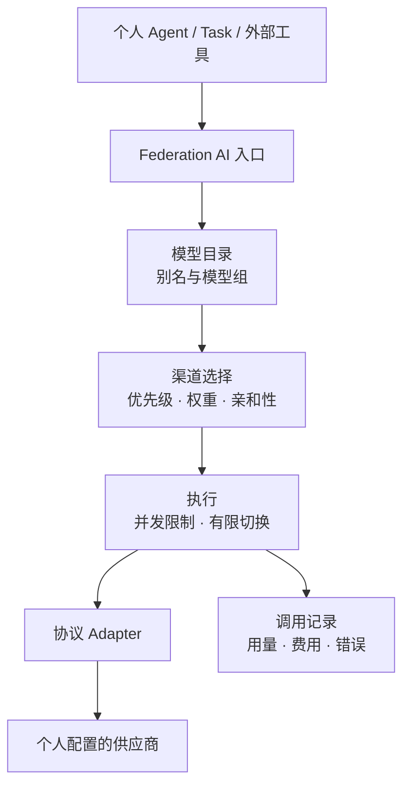
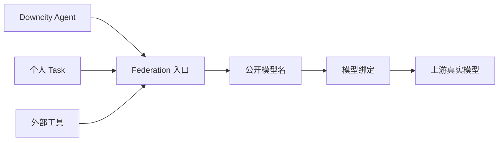
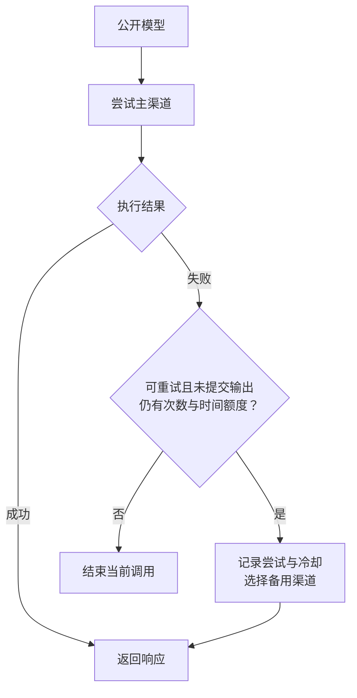
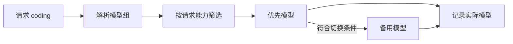
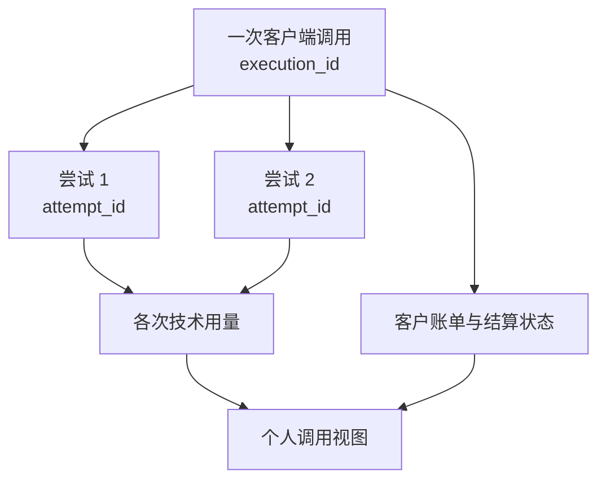
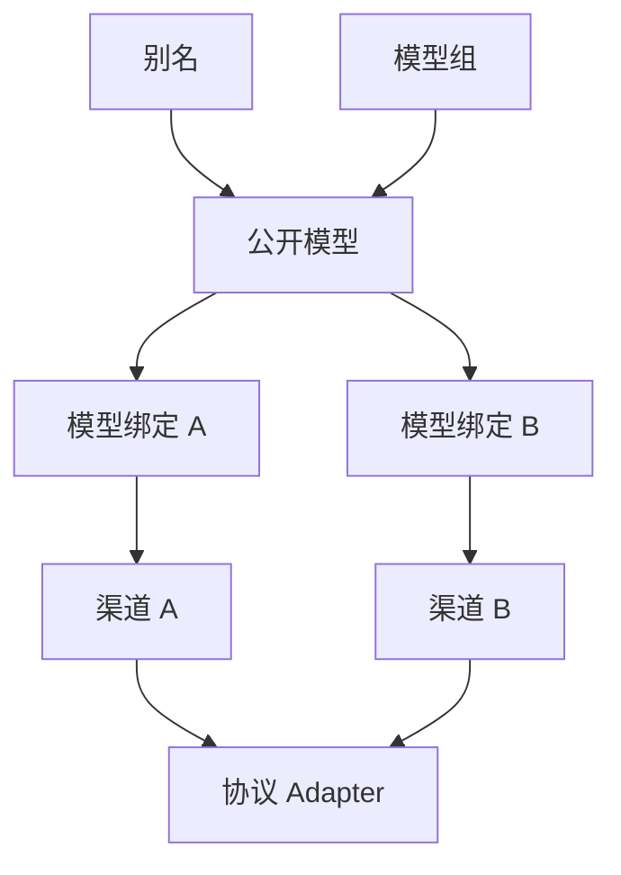

# Federation AI 个人网关设计

> 文档状态：设计稿，尚未实施。
>
> 本文以个人使用为主，描述 Downcity Federation AI Services 可以借鉴 New API 和 Magpie 的场景、功能与执行逻辑。本文是功能设计建议，不表示相关能力已经实现，也不构成代码实施授权。
>
> 范围：个人 Agent、个人 Task 和个人外部工具共用模型供应。组织、团队、多租户运营不在本轮范围内。

## 1. 目标

个人可能同时使用多个模型供应商，希望通过一个 Federation 入口管理模型，让 Downcity Agent、后台任务和外部工具复用这些供应来源。

核心体验：配置供应商，选择常用模型入口，必要时切换备用渠道，并查看每次调用的模型、用量、费用和错误。

## 2. 借鉴方向

| 来源 | 适合个人场景的特性 | 在 Downcity 中的用途 |
| --- | --- | --- |
| New API | 渠道管理与测试 | 添加、启用、禁用和检查供应来源 |
| New API | 模型映射 | 将稳定的公开模型名映射到上游模型名 |
| New API | 优先级、权重与故障切换 | 选择主备渠道，分配同级渠道流量 |
| New API | 调用日志与消费管理 | 查看实际渠道、用量、错误与费用 |
| Magpie | Provider 接入体验 | 通过协议预设减少配置工作 |
| Magpie | 模型分组 | 为日常、编程、低成本等用途配置入口 |
| Magpie | 多协议适配 | 连接不同供应商和外部工具 |
| Magpie | 渠道亲和性 | 连续调用优先复用供应来源，保留缓存价值 |

上述条目是设计借鉴方向，不代表复制对应项目的实现，也不保证所有上游具有相同能力。

## 3. 当前基础

当前仓库已有可复用的实现：

- `AIService`：原生模型流、OpenAI Chat Completions、模型目录和多模态 action。
- `AIChannel`：上游执行边界、环境凭据读取、地址和 Provider 配置。
- `ModelCall`、`ModelStreamEvent`：内部模型请求和流事件协议。
- 模型注册：上下文、reasoning、价格和执行入口校验。
- 公开模型 ID 与上游模型 ID 的映射。
- OpenAI-compatible 上游适配。
- 私有本地服务中的 Anthropic 原生 Channel，可作为后续公共适配器的基础。
- 媒体需求触发的模型 fallback。
- Federation 身份鉴权。
- AI Usage、Credits 桥接和可靠幂等结算。
- 图片异步任务运行时。

主要缺口：公开模型仍绑定单个渠道；语言模型入站接口仍分别编排执行；缺少通用多渠道选择、上游故障切换、模型组、渠道运营管理和尝试级记录。

当前媒体 fallback 处理输入能力需求；当前结算重试处理扣费任务。二者均不能直接视为上游故障切换。

## 4. 场景一：多个供应商统一接入

### 场景

个人持有 OpenAI、Anthropic、DeepSeek 和其他 OpenAI-compatible 服务的凭据，希望统一配置后供不同 Agent 使用。

### 需要的功能

- Provider 或协议预设。
- 渠道配置：地址、凭据引用、协议和启用状态。
- 手动添加模型，可选的模型发现。
- 最小调用测试，显示连接、模型、流式输出和计量状态。

### 预期逻辑

1. 选择已有协议 Adapter，并填写供应配置。
2. 凭据通过 Env 或所属配置界面维护，渠道只引用凭据来源。
3. 手动声明模型，或从上游发现候选模型。
4. 测试连接、鉴权、模型响应、流式生命周期和用量。
5. 显示各项测试结果，由用户决定是否启用。
6. 模型发现失败时保留已有配置；发现结果需要确认后发布。

测试会产生实际供应消耗，应独立标记，避免混入普通 Agent 调用统计或客户账单。测试成功只证明被测试的行为，不自动证明所有模型能力可用。

## 5. 场景二：Agent 和外部工具使用一个入口

### 场景

个人 Agent、后台任务和 IDE 使用同一个 Federation 地址，选择公开模型名调用。

### 需要的功能

- Downcity 原生模型接口。
- OpenAI Chat Completions 兼容接口。
- 公开模型目录和模型名称映射。
- 按实际客户端需求补充 Responses、Anthropic Messages 等协议。
- 复用现有 Federation 身份认证。

### 预期逻辑

1. 调用方配置 Federation 地址和适用的访问凭据。
2. 入站请求转换为统一 `ModelCall`。
3. 解析公开模型名，检查请求能力。
4. 统一执行器选择供应来源并执行。
5. 标准流事件由入站编码器转换为客户端需要的响应。

入站协议与上游协议分别适配。新协议按实际使用需求增加。外部工具是否支持现有凭据和接口，需要针对该工具验证。

## 6. 场景三：同一个模型有主渠道和备用渠道

### 场景

同一个公开模型同时有官方渠道和备用中转渠道。主渠道限流或临时故障时，希望尝试备用渠道。

### 需要的功能

- 一个公开模型绑定多个渠道。
- 绑定优先级。
- 同优先级的可选权重分配。
- 错误分类、冷却与恢复。
- 最大尝试次数和总执行时限。
- 输出提交状态。
- 各次尝试的独立记录。

### 预期逻辑

1. 过滤被禁用、缺少凭据、冷却中或能力不匹配的绑定。
2. 优先选择高优先级绑定；同级可按权重选择。
3. 遇到限流、临时服务错误或符合规则的连接错误，记录尝试并更新状态。
4. 在次数和时间限制内，选择尚可执行的备用绑定。
5. 文本、reasoning 或工具调用等标准输出提交后，停止自动切换。
6. 用户取消时停止排队、上游请求和后续尝试。

开头的少量元信息可在有界缓冲中暂存；缓冲提交后采用同样的停止切换规则。

同一公开模型的绑定应满足公开能力承诺。跨模型切换由场景四单独声明。

网关负责一次模型调用的供应恢复；整个 Task 是否重跑由 Task 运行器决定，避免重复执行已经发生的工具操作。

## 7. 场景四：选择日常、编程或低成本入口

### 场景

个人希望给 Agent 配置用途明确的模型入口，减少逐个选择供应商模型的工作。

| 入口示例 | 用途 | 建议配置 |
| --- | --- | --- |
| `daily` | 日常聊天和整理 | 指向一个默认模型 |
| `coding` | 编程和复杂任务 | 主模型与显式备用模型 |
| `cheap` | 简单或批量任务 | 指向低成本模型 |
| `vision` | 图片理解 | 只包含支持图片输入的模型 |

### 需要的功能

- 模型别名。
- 模型组与固定候选顺序。
- 公开能力约束。
- 明确的跨模型 fallback 开关。
- 实际模型记录。

### 预期逻辑

- 别名指向一个公开模型，只解决命名和配置复用。
- 模型组包含多个候选公开模型，表达允许的跨模型选择。
- 请求检查工具、图片、输出格式和 reasoning 等能力。
- 候选模型满足模型组对外承诺的能力。
- 首版按固定顺序选择；更复杂的成本或意图路由需要另行设计。
- 客户端使用入口名，记录中同时保存入口名与实际模型。

模型组需要明确计费规则。建议以最终选中模型的价格版本计费，并在目录及记录中清楚展示；实施前确认这一规则。

## 8. 场景五：连续聊天复用渠道，后台任务控制并发

### 场景

长会话希望保留缓存价值；多个后台任务同时运行时，希望避免上游并发超限。

### 需要的功能

- 可选的会话渠道亲和性。
- 有期限的最近成功绑定记录。
- 简单的渠道并发上限。
- 有界等待队列、等待超时和取消。

### 预期逻辑

1. 同一可信会话上下文优先复用最近成功的渠道。
2. 渠道故障、冷却或能力不匹配时重新选择。
3. 目标渠道满载时，选择有容量的备用或进入有界队列。
4. 完成、失败和取消时释放执行槽位。
5. 亲和性到期后自动失效。

亲和性是选择偏好，不阻止故障切换。缓存收益依赖上游机制，不保证所有渠道均可获得。

厂商专属 reasoning、签名或续传信息需要检查目标渠道是否兼容；没有安全转换方式时返回明确错误。

并发控制首版按 Federation 运行实例生效。多副本共享限流不属于本轮设计范围。

## 9. 场景六：查看模型、费用和失败原因

### 场景

个人希望知道 Agent 调用了什么、实际走哪个渠道、花了多少，以及为什么慢或失败。

### 需要的功能

| 信息 | 用途 |
| --- | --- |
| 请求入口、最终公开模型、上游模型 | 解释别名和模型组选择 |
| 实际渠道和切换原因 | 排查供应问题 |
| 执行标识与尝试标识 | 区分一次请求和多次上游执行 |
| Token、缓存用量与计量状态 | 展示已知消耗和未知用量 |
| 排队、首响应和总耗时 | 区分容量等待与生成速度 |
| 成功、失败和取消状态 | 查看运行结果 |
| 费用与结算状态 | 核对实际扣费 |
| 可用的 Session、Task 关联 | 从 Downcity 运行记录定位调用 |

### 预期逻辑

- 各次上游尝试独立记录，未报告用量时标记未知。
- 复用现有 Usage 和可靠幂等结算。
- 自动切换产生的额外供应成本建议由服务方承担。
- 部分输出后失败的计费规则需要在实施前确认。
- 日志默认记录安全元信息，不保存凭据、认证头或完整正文。
- 上游请求 ID 与错误信息经过安全处理后用于诊断。

可选的个人日/月消费上限放在后续阶段。严格消费上限需要保守预占、明确输出上限、实际结算和异常回收；仅在执行后累计费用无法防止并发超支。

## 10. 最小对象与职责

| 对象或模块 | 职责 |
| --- | --- |
| 公开模型 | 稳定模型身份、能力和公开价格 |
| 渠道 | 上游地址、协议、凭据引用、启用状态和执行限制 |
| 模型绑定 | 公开模型在某渠道的上游模型名、供应约束和优先级 |
| 别名 | 常用名称指向一个公开模型 |
| 模型组 | 明确的跨模型候选、顺序与公开承诺 |
| 统一执行器 | 请求校验、选择、调用、取消、尝试生命周期及完成结果 |
| 协议 Adapter | 请求编码、流解码、错误和用量转换 |
| 调用记录与结算 | 保存执行事实，按确定规则幂等结算 |

核心关系：

## 11. 建议实施顺序

本文仅记录建议顺序，当前不启动实施。

### 首批

1. 公开模型与渠道绑定分离。
2. 统一语言模型执行流程，复用现有入站与出站适配。
3. 模型别名，以及按固定顺序选择的模型组。
4. 主备渠道、错误分类、冷却和输出前有限切换。
5. Provider 配置与最小测试。
6. 调用记录显示实际模型、渠道、各次尝试、用量和费用。

### 后续

- 同优先级权重分配。
- 会话渠道亲和性。
- 渠道并发限制与有界队列。
- 模型发现。
- 根据客户端需要增加协议 Adapter。
- 个人日/月消费上限。
- 有明确需求时增加多凭据池。

## 12. 首批验收场景

个人配置两个提供同一模型的渠道，为 Agent 设置稳定的公开模型入口。主渠道在输出提交前发生可重试错误后，网关尝试备用渠道并返回完整响应。调用记录显示两次尝试及实际用量，客户费用按明确的最终结果策略幂等结算。

另一个验收场景是配置 `coding` 模型组：入口明确列出主模型和备用模型，能力检查生效，跨模型切换经过显式配置，调用记录可查看最终模型。

## 13. 实施前待确认

- 模型组采用最终选中模型定价，还是独立入口定价。
- 部分输出后失败、取消和未知用量的收费规则。
- 首批需要支持的外部客户端及对应入站协议。
- 渠道配置的管理入口，以及哪些配置需要持久化编辑。

## 14. 与完整网关设计的关系

本文是当前个人场景的收敛方案。此前的 [完整 Federation AI Gateway 设计](./federation-ai-gateway-design.md) 保留为扩展参考，其中组织权限、团队配额、多租户运营和复杂管理能力不属于本轮范围。

后续实施需另行确认方案和范围，再修改代码。
