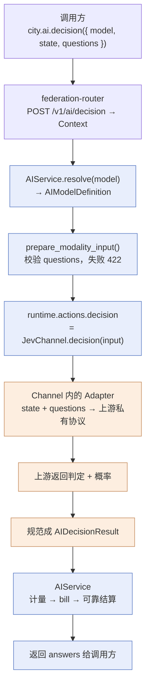

# Federation System One（决策）模型支持 PRD

> 状态：待评审（只做设计，不落地实现）
>
> 适用范围：`@downcity/type`（仅目录字段）、`@downcity/federation`、homepage city-sdk 文档、`packages/cli` 与 `private/apps/desktop` 的模型目录消费端
>
> 关联输入：`docs/city-ai-channel-city-model-prd.md`、`docs/downcity-model-protocol.md`
>
> 结论：System One 模型不是第二套模型协议，而是 AIService 下一个新的**非语言模型能力**，与 image / tts / asr 同级。它复用已有的注册表、目录、鉴权、precheck、计量、`bill` 和可靠结算，只在协议层新增一个「结构化决策」的载荷形状，并在公开模型信息上补一个展示用的模型类别字段。
>
> 修订记录：v2 修正了三处放置错误 —— 协议类型改放联邦内部（而非 `@downcity/type`）、删除 `DecisionClient` 客户端对象、明确 `model_type` 只用于展示。

---

## 1. 背景

TypeSafe AI 的 Jev 定义了一类叫 **System One Model** 的模型：输入是 unstructured state 加一组 typed questions，输出是带校准概率的 typed decisions。它非自回归、不生成字符串，定位是「给自动化代码用的快速决策函数」，而不是聊天模型。

它和现有 Federation 语言模型能力的差别是结构性的，不是参数级的：

| 维度 | 语言模型（`AIChannel.stream`） | System One 决策模型 |
| --- | --- | --- |
| 输入 | `ModelCall`（messages / tools / 采样参数） | 原始 state + typed questions |
| 输出 | `ModelStreamEvent` 事件流（增量文本、推理、工具调用） | 一次返回的 answers + probability |
| 生成方式 | 自回归逐 token | 非自回归，直接给判定 |
| 用途 | Agent 对话、工具调用 | 分类、路由、打分、分支判断 |
| 流式 | 是 | 否 |

现状里没有任何一类模型能表达「不生成文本、只给带概率的判定」。图像、视频、TTS、ASR 这些非语言能力都已经通过 modality action 表达，System One 属于同一层级，缺的是这一项。

## 2. 现状架构与差距

现有链路是单向且清晰的：

```text
AIChannel 子类实现能力
  -> Channel.model(spec) 生成 AIModelDefinition（runtime.stream / runtime.actions）
  -> AIModelRegistry 注册并校验
  -> AIService 按 modality 注册 /v1/ai/{modality} 路由
  -> AIService.getModelModalities() 从 runtime 能力反推 modalities
  -> AIModelRegistry.list_public() 投影成 CityModelDescriptor
  -> AIInvoker.catalog() / CityModel 客户端消费
```

具体事实（均为当前代码）：

- `AIChannel` 只声明 `stream()` 加 `image_create / image_fetch / image_result / video / tts / asr`；`AIModelActions` 有 `[modality: string]` 索引签名，扩展新 action 不需要改接口形态。
- `AIService` 在构造函数里遍历 `MODALITIES = ["video", "tts", "asr"]` 注册 action，每个都可复用 `handleModality()` 的「解析模型 → 执行 → 计量 → 结算」编排。
- `CityModelDescriptor.modalities` 是能力投影，消费端靠它判断「这个模型能不能当对话模型」：`packages/cli` 的 `is_city_ai_execution_model` 与 `private/apps/desktop` 的 `is_text_model` 都只认 `text | stream | openai`。
- `AIModelSpec` 目前没有任何字段表达「这是哪一类模型」。非语言能力的载荷类型（`AIImageCreateResult`、`AIActionMessage`）都住在联邦内部的 `types/AI.ts`。

差距有三处：

1. `CityModelDescriptor` 没有稳定的模型类别字段，消费端只能字符串匹配 `modalities` 来猜用途。加决策能力后 `modalities` 会更杂，靠子串判断越来越脆。
2. 决策调用没有载荷类型。用 `ModelCall` 硬塞 questions 会污染纯语言协议；用 `ModelStreamEvent` 表达答案则丢掉了概率与结构化取值。
3. 服务端与客户端都没有决策入口。

## 3. 设计原则

**决策模型是能力，不是协议。** Downcity Model Protocol 描述的是语言模型的流式执行；决策模型和图像、语音一样，是 AIService 下的一个非语言 action。因此不新增 `ModelClient` 的执行方法，不改 `ModelStreamEvent`，只新增决策自己的载荷类型与一个 `AIChannel` action。

**不新增客户端对象。** 非语言能力在客户端一直是普通方法（`ai.tts()` / `ai.asr()`），模型 ID 就在入参里。决策没有跨调用需要持有的状态，因此只加一个方法，不引入新的可执行客户端类型。

**协议类型跟着同类住。** 语言协议（`ModelCall` / `ModelStreamEvent`）住在 `@downcity/type`，因为它被 Agent SDK 和 City SDK 跨进程消费、且带 `MODEL_PROTOCOL_VERSION`。决策是普通 action 载荷，同类是 `AIImageCreateResult`，因此住在联邦内部并从根入口导出。

**单一事实源。** 模型能做什么由 runtime 能力决定（`runtime.stream` 与 `runtime.actions`）。`modalities` 和 `model_type` 都从它推导，不引入第二个需要人工维护、可能与能力漂移的字段。

**复用已有编排。** 决策走 `handleModality()`，因此 credits 前置检查、usage 记录、可靠结算、`bill` 计费全部自动继承，不新增计费路径。

**不参与 Agent 对话。** 决策模型没有 `stream()`，`modalities` 不含 `text / stream / openai`，现有消费端过滤逻辑天然把它排除在对话模型选择器之外，这是期望行为，不是遗漏。

## 4. 关键决策

### 4.1 模型类别字段命名为 `model_type`，不用 `kind`

`@downcity/type` 的 `CityModel` 已经定义了：

```ts
export const CITY_MODEL_KIND = "downcity.city-model" as const;

export type CityModel = CityModelDescriptor & ModelClient & {
  /** City model 协议标识。 */
  readonly kind: typeof CITY_MODEL_KIND;
};
```

`kind` 在这个体系里专指「实现的是 Downcity Model Protocol 客户端」这个协议标识。如果在 `CityModelDescriptor` 上再加一个 `kind: "language" | "decision" | ...`，同一个对象会同时存在两个 `kind`：一个是协议标识，一个是模型类别，语义直接冲突，类型上也会撞成不可赋值。

因此模型类别字段定为 `model_type`，取值集合是：

```ts
/** 公开模型信息中的模型类别。 */
export type CityModelType =
  | "language"
  | "decision"
  | "image"
  | "sound"
  | "video";
```

### 4.2 `model_type` 是展示字段，不是承重结构

需要说清楚它的地位：让决策模型真正跑起来的是那个 action 加上 `decision` 这个 modality，`modalities` 已经能回答「这个模型能做什么」。

`model_type` 回答的是另一个问题——「它是什么」——它服务于两类场景：UI 需要按类别分组展示模型；部署者需要一种显式方式确认注册结果符合预期。

因此它是**可砍的**：如果评审认为 `modalities` 已经够用，去掉它不影响决策能力的任何一条链路。反之，保留它的成本也很低，因为它不新增可写字段（见 4.3）。

### 4.3 `model_type` 由 AIService 推导，不由 Channel 手写

`modalities` 已经是推导出来的（`getModelModalities()` 读 `runtime`）。如果 `model_type` 改成 Channel 在 `AIModelSpec` 里手写，就会出现两个都在描述「这个模型是什么」的字段，且没有任何机制保证它们一致。

推荐做法：在 AIService 里新增一个与 `getModelModalities()` 并列的推导函数，按能力的固定优先级给出唯一类别：

```ts
/**
 * 从 runtime 能力推导模型类别。
 *
 * 关键点（中文）
 * - 与 getModelModalities() 同源，都只读 runtime，避免出现第二个可写事实源。
 * - 一个模型同时具备多种能力时按固定优先级取主类别；当前没有这种模型，
 *   优先级只是为了让结果确定而非抛错。
 */
private getModelType(model: AIModelDefinition): CityModelType {
  if (model.runtime.stream) return "language";
  if (model.runtime.actions.decision) return "decision";
  if (model.runtime.actions.image_create) return "image";
  if (model.runtime.actions.tts || model.runtime.actions.asr) return "sound";
  if (model.runtime.actions.video) return "video";
  // 没有任何可执行能力属于注册错误，应在注册阶段就被拒绝。
  throw new Error(`Model ${model.id} has no executable capability`);
}
```

同时在 `AIModelRegistry.register()` 里补一条校验：模型必须至少有一个可执行能力（`runtime.stream` 或任一非空 action）。现在注册一个空 runtime 的模型是允许的，它只会在请求时才暴露问题；提前拒绝更符合「注册即校验」的现有做法。

优先级顺序说明：`stream` 优先，因此未来出现「既能对话又能决策」的混合模型时，它对外仍是 `language`，与消费端「能当对话模型」的判断保持一致。

**备选方案**：`AIModelSpec.model_type` 手写 + 注册期与 runtime 交叉校验。它多一处可写字段，但能表达优先级无法覆盖的意图。评审时若倾向显式声明，可用这个方案；差异仅在于推导函数换成校验函数。

### 4.4 协议类型放联邦内部，不放 `@downcity/type`

`@downcity/type` 里的是**版本化的语言协议**：`ModelCall`、`ModelStreamEvent`、`ModelStreamEnvelope` 都带 `MODEL_PROTOCOL_VERSION`，由 Agent SDK、City SDK、Federation 三方跨进程消费。

决策载荷不是协议，是 action body。它的同类是联邦 `types/AI.ts` 里的 `AIImageCreateResult`、`AIActionMessage`、`AIModelActions`，这些都从 `@downcity/federation` 根入口导出，供部署者编写 Channel 时使用。

另一个佐证是 City 侧的既有先例：City 加 image / sound 能力时**没有** import 联邦类型，而是自定义了窄接口（`ImageAiService`、`ImageCreateInput`）。决策照此办理，联邦之外没有任何 package 需要决策载荷类型。

因此 `@downcity/type` 只加目录需要的两处：`CityModelType` 与 `CityModelDescriptor.model_type`。

## 5. 协议设计（联邦 `types/AI.ts`）

新增类型放进 `packages/federation/src/types/AI.ts`，与其他非语言能力载荷并列，并从根入口导出。校验逻辑另起 `service/ai/decision-validation.ts`，与 `model-routing.ts`、`reasoning.ts`、`model-context-window.ts` 的「一文件一关注点」保持一致。

### 5.1 输入状态

```ts
/** 决策模型输入的状态，描述模型需要判断的原始事实。 */
export type AIDecisionState =
  | {
      /** 状态判别字段，纯文本。 */
      type: "text";
      /** 供模型判定的纯文本状态。 */
      text: string;
    }
  | {
      /** 状态判别字段，结构化数据。 */
      type: "json";
      /** 供模型判定的 JSON 可序列化状态。 */
      data: ModelJsonValue;
    };
```

`text` 与 `json` 覆盖 Jev 的 unstructured state 语义。Jev 还接受 messages 作为 state，v1 不引入：messages 会把 Agent 会话语义带进一条纯判定调用，而 messages 在 Downcity 里的规范形式是 `ModelMessage`，属于语言协议，混用会让边界模糊。见第 12 节开放问题。

### 5.2 问题定义

```ts
/** 单个决策问题的类型。 */
export type AIDecisionQuestionType = "boolean" | "choice" | "score";

/** 单个决策问题，描述一次需要模型给出的判定。 */
export interface AIDecisionQuestion {
  /** 问题唯一 ID，用于把答案关联回问题。 */
  id: string;
  /** 问题类型，决定答案的取值范围与结果字段。 */
  type: AIDecisionQuestionType;
  /** 给模型的自然语言判定说明，例如 “这条消息是否表达紧急”。 */
  instructions: string;
  /** choice 类型的候选取值，顺序即展示顺序；其它类型必须省略。 */
  options?: string[];
  /** score 类型取值的下界，默认 0。 */
  min?: number;
  /** score 类型取值的上界，默认 1。 */
  max?: number;
}
```

三种类型对应 Jev 的核心能力（bool / 有限选项 / 打分），都不产生自由文本。v1 不提供 extraction 类问题：它逼近生成能力，与 Jev「不生成字符串、不会幻觉」的定位冲突，需要单独论证。

### 5.3 请求与结果

```ts
/** 决策模型单次调用请求。 */
export interface AIDecisionRequest {
  /** 判定依据的原始状态。 */
  state: AIDecisionState;
  /** 本次需要模型判定的全部问题。 */
  questions: AIDecisionQuestion[];
}

/** 单个问题的判定结果。 */
export interface AIDecisionAnswer {
  /** 对应问题的 ID。 */
  question_id: string;
  /** 判定取值，类型与问题类型一致：boolean 为布尔、choice 为候选字符串、score 为数值。 */
  value: boolean | string | number;
  /** 模型对本次判定的校准概率，取值 0 到 1；上游未返回时省略。 */
  probability?: number;
  /** choice 类型的完整概率分布，键为候选取值；其它类型省略。 */
  distribution?: Record<string, number>;
}

/** 决策模型单次调用结果。 */
export interface AIDecisionResult {
  /** 判定结果，与请求 questions 一一对应且顺序一致。 */
  answers: AIDecisionAnswer[];
  /** 上游计量信息，供 Federation 计费与用量统计使用。 */
  usage?: ModelUsage;
}
```

`questions` 用数组而非 Jev 的对象映射形式，理由有两点：答案需要能稳定地与问题顺序对应；显式 `id` 让重复检测和缺答检测都变成一次校验，而不是依赖对象键的隐式约束。

### 5.4 校验规则

放在 `service/ai/decision-validation.ts`，请求校验以 422 失败：

- `state.text` 非空白，`state.data` 为合法 JSON 值。
- `questions` 非空，`id` 非空白且互不重复。
- `type: "choice"` 必须带 `options`，长度 1 到 255，取值非空白且互不重复；`type` 为 `boolean` 或 `score` 时不得带 `options`。
- `type: "score"` 的 `min < max`；`boolean` 与 `choice` 不得带 `min` / `max`。
- 结果必须覆盖全部问题 ID，且 `value` 与问题类型匹配；`distribution` 的键必须落在 `options` 内，概率之和允许有浮点误差。

255 这个上限来自 Jev 自己的 cardinality 约束，属于上游事实，写进校验而不是留成注释，避免上游静默截断。

结果校验（`AIDecisionResult`）同样放在本模块，用于拦住行为异常的自研 Channel，与 `isImageChannelResult` 校验图片结果的用意一致。

## 6. Federation 服务端设计

### 6.1 AIChannel 新增决策 action

`packages/federation/src/service/ai/AIChannel.ts`：

```ts
/** 结构化决策 action，用于 System One 类模型。 */
decision?(input: AIChannelActionInput): Promise<AIChargedResult<AIDecisionResult>>;
```

并在 `model()` 的 modality 列表里加入 `"decision"`，让它和现有 action 一样被绑定进 `runtime.actions`。`AIModelActions` 同步补一个显式字段：

```ts
/** 结构化决策 action。 */
decision?: ActionFn;
```

Channel 实现只负责把 `input.input` 里的决策请求发给上游、把上游响应规范成 `AIDecisionResult`。与语言模型一致，上游密钥、base URL、协议细节都留在 Channel，AIService 不知道上游形态。返回 `AIChargedResult` 而非裸结果，与 `video` / `tts` / `asr` 一致，给 Channel 留出按 usage 现算扣费的位置。

### 6.2 AIService 注册决策路由

`packages/federation/src/service/ai/ai-service.ts`：

- `MODALITIES` 增加 `"decision"`，于是自动获得 `POST /v1/ai/decision`，并复用 `handleModality()` 的完整编排（precheck → 解析模型 → 执行 → 计量 → 计费 → 可靠结算）。
- 目录投影函数 `listModels()` 增加 `model_type`，与 `modalities` 同源推导。
- `getModelModalities()` 无需改动，`decision` 会自然出现在结果里。

请求体结构为 `{ model: string, ...AIDecisionRequest }`，与 `image/create`、`asr` 等 action 一致：`model` 是 AIService 的通用字段，其余字段属于该能力。

### 6.3 校验挂载点

`handleModality()` 现在是「解析 → 执行 → 计量 → 计费 → 结算」，中间没有校验步骤——tts / asr 的 payload 是厂商形状的透传，确实没什么可校验的。但决策协议是闭合且带类型的（question 有 type、choice 有 options、score 有区间），和语言路径一样值得在服务端校验；`decode_city_language_model_request()` 就是先例。

因此加一个按 modality 分派的校验入口，在 `resolved.action(ctx)` 之前、`ensure_usage_id()` 之前调用：

```ts
/** 各 modality 进入 Channel 前的协议校验；没有校验的能力原样通过。 */
private prepare_modality_input(modality: Modality, ctx: Context): void {
  if (modality === "decision") validate_ai_decision_request(ctx.input);
}
```

位置与 `resolve()` 的失败路径一致：校验失败抛 `httpError(422)`，在创建 usage 记录之前生效，因此被拒绝的请求不会留下用量事实。

### 6.4 顺带清理

这两处不是我引入的问题，但复用的正是这条路径，一起收敛更省事：

- `MODALITIES` 这个名字现在就不准（它其实指「共用 `handleModality()` 的请求-响应型能力」），加上 decision 之后更不准，可改为 `CAPABILITY_ACTIONS`。
- `handleModality()` 里 `fallback_from` / `fallback_reason` / `fallback_media_type` / `reasoning` 四个局部变量恒为 `undefined`，只有 `handleLanguageModelStream()` 的 `plan_text_execution()` 路径才有真实值，属于死代码，应当删除。

### 6.5 计量与计费

决策执行完成后返回 `AIChargedResult<AIDecisionResult>`。`resolve_channel_output()` 拆出 output，`attach_output_metering()` 通过 `extractUsage()` 读取顶层 `usage` 字段，`request_count` 由 `attachResolvedModel()` 默认置 1，`bill` 走与其它模型相同的 `AIBill` 通道。

因此 v1 的定价天然是「按次」，目录里写成：

```ts
pricing: {
  currency: "USD",
  unit: "request",
  rates: { request: 0.0004 },
}
```

`select_model_pricing` / `calculate_model_price` 无需改动。

是否需要「按问题数」计费是开放问题（第 12 节）：若要支持，需要在 `RuntimeMetering` 增加 `decision_count`，并在 `service_ai_usage_records` 增加对应数值列。当前不建议提前加列。

### 6.6 调用链



分界线是 `runtime.actions.decision` 那一步：往左 AIService 不认识上游协议，往右 Channel 不参与路由、目录和计费。

`decision` 不进入 `plan_text_execution()`，因此不参与媒体 fallback 与 reasoning 校验，这与它没有 messages 和 reasoning 能力的事实一致。

## 7. 客户端 SDK 设计（`@downcity/federation`）

### 7.1 AIInvoker：只加一个方法

决策在客户端是普通方法，与 `image_create` / `video` / `tts` / `asr` 同级：

```ts
/** 结构化决策调用。 */
decision(input: UserDecisionInput): Promise<UserDecisionResult> {
  return this.post<UserDecisionResult>("/decision", input);
}
```

不引入 `DecisionClient` / `CityDecisionModel`。`CityModel` 之所以是一个对象，是因为 AI SDK 需要一个实现 `LanguageModelV3` 的实例，那是语言模型独有的互操作需求；决策没有需要持有的状态，也就没有理由成为对象。

`ModelCatalog` 因此保持同构，不需要按类型分派构造。若要按类型筛选，加一个读取 `model_type` 的便捷方法即可。

### 7.2 客户端载荷类型

`packages/federation/src/pact/user/types.ts` 按现有命名补充：

```ts
/** 决策调用输入。 */
export interface UserDecisionInput extends FederationActionInput {
  /** 判定依据的原始状态。 */
  state: AIDecisionState;
  /** 本次需要模型判定的全部问题。 */
  questions: AIDecisionQuestion[];
}

/** 决策调用结果。 */
export type UserDecisionResult = AIDecisionResult;
```

与 `UserImageInput`、`UserAsrInput` 保持同一形态：`model` 来自 `FederationActionInput`，其余字段属于该能力。

`AIInvoker.resolve_model()` 目前会为纯字符串模型 ID 造一个 `modalities: ["text", "stream"]` 的兜底描述符，该兜底需要补 `model_type: "language"`。决策模型必须先有目录项，字符串 ID 兜底不支持决策，这里显式抛错比静默构造更清楚。

## 8. 消费端影响

`model_type` 是新增的必填目录字段，描述符的构造点需要同步。因为类型由服务端返回，实际要改的是「本地构造描述符」的位置和「本地视图类型」：

| 位置 | 变化 |
| --- | --- |
| `@downcity/type` `CityModelDescriptor` | 新增 `model_type` |
| `AIInvoker.resolve_model()` 兜底描述符 | 补 `model_type: "language"` |
| `packages/cli` `AgentChatModel` / `AgentChatRemote` | 视图类型补字段，过滤逻辑保持只看 `modalities` |
| `private/apps/desktop` `DesktopModelSummary` / `DesktopAgentAssembly` | 同上 |
| 测试里的描述符字面量 | 补字段 |

CLI 与 Desktop 的对话模型过滤**保持现有行为**：继续用 `text / stream / openai` 匹配 `modalities`。决策模型既不带这些 modality，也不实现 `stream()`，因此天然不在候选里。

City `ai` power（新增 `decision` 动作组）与真实 Jev/TypeSafe Channel 适配不在本次范围，见第 12 节。

## 9. 文件与模块边界

新增：

- `packages/federation/src/service/ai/decision-validation.ts`：决策请求与结果的校验。

修改：

- `packages/type/src/types/CityModel.ts`：新增 `CityModelType`，`CityModelDescriptor` 增 `model_type`。
- `packages/type/src/index.ts`：导出 `CityModelType`。
- `packages/federation/src/types/AI.ts`：`AIDecisionState` / `AIDecisionQuestion` / `AIDecisionRequest` / `AIDecisionAnswer` / `AIDecisionResult`，以及 `AIModelActions.decision`。
- `packages/federation/src/service/ai/AIChannel.ts`：`decision()` 与 modality 列表。
- `packages/federation/src/service/ai/ai-service.ts`：`MODALITIES` 增加 `decision`（并重命名）、新增 `prepare_modality_input()` 与 `getModelType()`、目录投影带 `model_type`、删除 `handleModality()` 内的死代码。
- `packages/federation/src/service/ai/model-registry.ts`：注册期校验可执行能力；目录投影带 `model_type`。
- `packages/federation/src/pact/invoker/ai/index.ts`：`decision()`、目录兜底补 `model_type`。
- `packages/federation/src/pact/user/types.ts`：`UserDecisionInput` / `UserDecisionResult`。
- `packages/federation/src/index.ts`：导出决策相关公开类型。

不新增文件到 `@downcity/type` 的 `types/model/`：决策载荷不是语言协议，不属于那里。

## 10. 迁移

不保留向后兼容。`model_type` 是必填字段，一次性把所有描述符构造点补齐即可；决策能力是纯新增，不影响既有模型的行为。

`model_type` 由 AIService 推导，所以 Federation 模板（`templates/localfed`、`templates/edgefed`、`templates/agent/server`）与 homepage 里的 Channel 示例**不需要**改代码，除非选择第 4.3 节的备选方案。

## 11. 测试要求

不新增无关测试，但以下行为需要有断言：

- 校验：重复 question id、choice 缺 options、options 超 255、score 区间非法、答案缺项、`distribution` 键越界，均返回 422，且不产生 usage 记录。
- 推导：实现 `decision()` 的模型 `model_type` 为 `decision`、`modalities` 含 `decision` 且不含 `stream`；空 runtime 的模型在注册期被拒绝。
- 路由：`POST /v1/ai/decision` 命中 `runtime.actions.decision`，且不经过 media fallback 与 reasoning 校验。
- 计量与计费：一次决策调用产生一条 `request_count = 1` 的 usage 记录，`bill` 被调用一次。
- 目录：`modalities` 不含 `text / stream / openai`，因此 CLI/Desktop 的对话模型过滤不选中决策模型。

## 12. 非目标与开放问题

非目标：

- 真实 Jev / TypeSafe 上游 Channel 实现。
- City `ai` power 的 `decision` 动作组。
- 决策结果的流式返回。
- 用决策模型承载 Agent 对话。
- extraction 类问题（自由文本抽取）。

开放问题：

1. `state` 是否要支持 messages。支持会让它对 Agent 更顺手，但会把 `ModelMessage` 带进一条非语言调用。
2. 是否需要按问题数计费。需要则在 `RuntimeMetering` 与 `service_ai_usage_records` 增加 `decision_count`。
3. `model_type` 是否需要手写覆盖（第 4.3 节备选方案），以及它是否值得保留（第 4.2 节）。
4. 是否要暴露 question 级别的上游耗时/成本，用于自动化代码做预算控制。

## 13. 文档更新

`@downcity/federation` 与 `@downcity/type` 的能力在本 PRD 落地后属于用户可见更新，homepage 需要同步：

- `city-sdk-docs/{en,zh}/service/ai/provider.mdx`：新增决策 Channel 的注册与实现示例。
- `city-sdk-docs/{en,zh}/service/ai/calling.mdx`：`city.ai.decision()` 的调用示例与结果解读。
- `city-sdk-docs/{en,zh}/reference/http-api.mdx`：`POST /v1/ai/decision`。
- `city-sdk-docs/{en,zh}/concepts/product-model.mdx`：`model_type` 与 `modalities` 的关系。
- `docs/downcity-model-protocol.md`：说明决策能力不属于 Model Protocol，而是并列的非语言 action。

## 14. 验收标准

- `CityModelDescriptor` 有稳定的 `model_type`，一个模型只有一个类别，且与 runtime 能力一致。
- 注册一个只实现 `decision()` 的模型后，目录返回 `model_type: "decision"`、`modalities: ["decision"]`。
- `city.ai.decision({ model, state, questions })` 返回与请求问题一一对应、带概率的答案。
- 决策调用产生与其它模型一致的 usage 记录与 credits 结算。
- 决策模型不出现在 CLI / Desktop 的对话模型选择器里。
- 语言模型（`stream()`）行为与目录输出除新增 `model_type` 外无任何变化。
