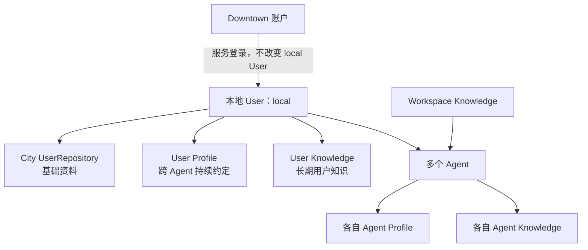
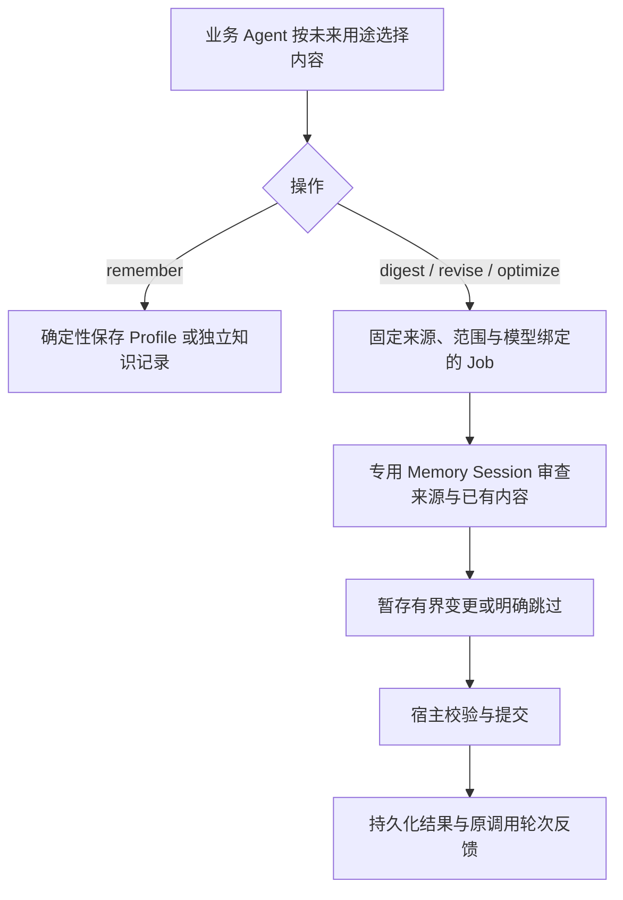

# Memory 当前设计说明

> 一份平台数据根对应一个本地使用者；User / Agent Profile 保存持续约定，知识按需检索。语义处理通过有界 Memory Job 和专用 Session 完成；后台知识整理按范围显式启用，默认关闭。
>
> 本文说明当前职责与边界。工具参数、宿主 actions 和配置详见 [Memory README](../packages/implementations/powers/readmes/memory.readme.md)。

## 1. 身份与全局用户中心

City 的 UserRepository 管理唯一使用者，稳定 user_id 为 local。基础资料位于 user/user.json，包含 display_name、created_at、updated_at。Desktop 启动和 MemoryPower 初始化都可确保该记录存在；同平台根共享一个文件。

本地 User 独立于 Downtown 账户：退出、切换模型服务账号不会改变记忆，也不要求在线登录。外部渠道沿用宿主授权；本设计不提供多租户隔离，获准使用本地 Agent 的渠道具有同一本地使用者的 Memory 范围。

全局用户中心由基础资料仓储与 Memory 服务组合，不把账号凭据保存进 Memory。基础资料管理接口委托 City 仓储，记忆正文由 MemoryPower 维护。

## 2. 归属与上下文

| target | profile | knowledge |
| --- | --- | --- |
| user | 跨 Agent 的持续偏好与约定 | 用户长期目标、事实与历史知识 |
| agent | 当前 Agent 专属约定 | 私有经验和知识 |
| current_workspace | 不支持 | 当前项目事实、决策与流程 |

作用域由可信调用上下文解析，不接受调用方文件路径，也不在失败后静默改换 target。Agent 知识不跨 Agent 读取，Workspace 知识不跨项目读取。User / Agent 知识管理无需 Workspace；项目写入要求 Workspace。

首次组装和 syncshot 读取完整 User / Agent Profile 并冻结到 system 快照。Agent Profile 紧随 Agent Identity / Instruction；User Profile 独立位于 Session 信息之前。每轮比较冻结版本与当前版本，变化通过有界本轮参考更正提供，不改写快照或 canonical 消息；新 Session 和 syncshot 读取完整当前内容。

Profile 是历史偏好和持续约定，不构成本轮新任务或新授权。当前请求与系统权限优先，冲突按约定的适用范围处理。知识通过 search / read 按需读取，作为参考数据使用。SOUL.md 由 Agent 配置管理，Memory 不负责修改。

## 3. 选择原则与验证职责

记忆是对未来用途的判断。优先保存能改变未来相似任务决策、避免重复探索的长期目标、稳定约束、决策理由、策略和已验证规律。跳过流水账、临时进度、易从当前环境重新读取的状态；短期 next steps 留在 Task 或 Session。Profile 聚焦简洁持续约定，详细经验与项目知识放入可检索的 knowledge。

业务 Agent 从成功或失败中总结经验时，区分观察、解释和已验证规则，在有权限且合理可行时验证解释，再保存规则、验证依据、适用条件与限制。成功重试、人工验收或原句引用本身不足以证明因果；重复引用不是新证据。未经验证不能升格为确定经验；明确有未来价值的观察或未决事项可以标注后保留，避免堆积猜测。用户明确表达的偏好和约定不要求实验验证。

专用 Memory Session 只审查提供来源对结论及验证声明的支持程度，不承担业务实验。证据不足时缩小表述或 skip，保留反证和不确定性。既有记忆用于核对与去重，不构成独立佐证。原句校验与事务提交保障可追溯性和保存一致性，不能证明语义真实。

## 4. 写入与语义处理

remember 直接保存提交正文，调用业务 Agent 负责内容选择与表述。Profile 立即追加，返回 profile_id、status=saved、activation=next_turn_or_new_session。knowledge 创建独立版本记录，保留请求来源，返回 memory_id、version、status=created、activation=on_recall。topic 是组织提示，不是覆盖地址；显式请求不能假称用户原话。

digest 从明确指定的 chat / work Session 提炼知识；默认最近 30 条，最多 100 条、读取预算 256,000 字节，并限制来源正文合计 64,000 字符。输入只包含 user / agent 的 text Part，不包含工具 Part，不代表完整实验记录。Memory Session 历史不能再次作为来源，来源会话受 Agent / Workspace 校验。

revise 绑定单条记忆，以提交的 instruction / evidence 为来源。optimize 显式整理 User 或 Agent Profile，仅合并重复及应用已有明确更正，不推断新偏好；来源是固定 Profile 版本，不是对历史事实的独立证明。相同来源和策略在同一请求范围内用于幂等归并。

三者返回异步 Job。只有 succeeded 表示提交成功；skipped 表示无需变更，queued / running / failed 都不表示已保存。job_detail 返回固定 before / after、实际读取版本、来源原句与可用角色和消息定位，不用当前内容重建历史。失败请求可显式 retry，不扩大原范围或来源。

原调用 Session / Turn 订阅最终结果；可接收时注入不含来源正文的完成摘要，轮次结束后仅保留处理记录，不自动新开轮次。投递与记忆提交分别记录，delivery_status=saved 不表示记忆已保存。

## 5. 模块与提交边界

| 模块 | 职责 |
| --- | --- |
| MemoryPower / AccessResolver | 生命周期、工具与宿主 actions 装配、可信范围解析 |
| SystemProvider | 业务 Agent 的选择、验证和调用原则 |
| MemoryService / MemorySources | 显式写入、Job 请求及有界 canonical 来源读取 |
| MemoryCoordinator / MemoryJobStore / MemoryDelivery | 执行、恢复、固定输入、处理状态与可靠结果反馈 |
| MemorySession / MemorySessionTools | 专用指令、受限来源/检索/暂存工具及实际 Session 绑定 |
| MemoryProfile | User / Agent Profile 版本化追加、精确编辑、删除及可恢复提交 |
| BuiltinMemoryProvider / 知识事务存储 | 记录、有效性、来源、范围版本和原子提交回执 |
| MemorySignalIntake / MemoryDreamPlanner | 可信后台材料接收、有界选材、额度与冷却 |

专用 Session 不继承业务指令、Skills 或 Workspace 工具；来源、既有记忆和 Job instruction 都是待审查数据，不能授予新权限。先读取来源，创建前检索去重，修改前读取完整记录与版本；每条变更引用授权原始来源。暂存不等于提交，宿主完成校验和提交后才报告成功。

Profile 编辑要求读取版本、old_text 唯一匹配和互不重叠区域；保留来源标记及所有仍适用约定，不能为缩短而整篇替换或静默跨模式迁移。Profile 与知识是独立事务。当前没有 Profile 硬预算或自动截断；简洁性依赖选择与显式整理。

## 6. 后台知识整理

后台整理默认关闭，按 Agent、Workspace 上下文和目标范围显式启用。可信材料仅来自明确纠错及受信 Task accept / 带明确反馈的 revise 事实；执行成功、打开结果或 Turn 结束不是人工验收。Task 事实保留当时输出、角色、指纹和有界读取区间，默认进入原 Agent 私有范围；项目共享需要明确授权。

自动批次只写 Agent 私有知识或获准共享的 Workspace 知识，不写 Profile 或 User knowledge，不扫描私人 Session 历史。Memory Session、生成变更与完成反馈不能再次成为原始来源。

维护每五分钟检查，即使关闭自动计算也可接收事实与核对既有提交回执。每批最多 4 个事实、16 个来源、32,000 字符；同范围每日按 UTC 最多 2 次计算，含重试，间隔至少十分钟。常规尝试限 120 秒、每 Job 最多 3 次。空队列不调用模型，显式请求在 Job 边界优先。失败批次需显式重试，仍受开关、额度和冷却约束。

只有有提交回执的 succeeded 或明确 skipped 才推进已处理状态；来源错误、失败和延期保留待处理输入。自动批次没有聊天接收方。共享平台账本去重事件与批次，批次始终绑定原 City 的私有 Job，不由另一 City 接管。

## 7. 存储、模型与限制

| 数据 | 位置 |
| --- | --- |
| 本地用户基础资料 | `<platform-root>/user/user.json` |
| User Profile | `<platform-root>/user/PROFILE.md` |
| Agent Profile | `<platform-root>/agents/<agent_id>/PROFILE.md` |
| User 知识 manifest | `<platform-root>/user/memory/runtime/knowledge/current.json` |
| Agent 知识 manifest | `<platform-root>/agents/<agent_id>/memory/runtime/knowledge/current.json` |
| Workspace 知识 manifest | `<shared-memory-root>/workspaces/<encoded-id>/runtime/knowledge/current.json` |
| 后台范围账本 | `<platform-root>/memory/dreaming/scopes/<scope-hash>.json` |

Memory ID 是逻辑引用，不应解析为物理路径。知识事务在同一范围 manifest 中发布记录、有效性和回执；删除后正常 read / list / search 不再返回内容，并通过归一化正文指纹抑制相同内容重建。该抑制不保证阻止语义改写。forget 不删除原 Session、Job 来源副本或全部保留历史。

新 Memory Session 使用显式确认的结构化 model 与 binding_id，或所属 Agent 的默认模型；执行时固定模型与授权身份。切换服务账户不改写已提交 Job 的绑定，重试不得静默换账户计费。

不得在未经明确授权时保存秘密或敏感个人数据。来源读取有界，可能缺少较早记录或工具输出；整理器不能替来源补做实验。模型仍可能漏记、漏查或误判语义支持程度，真实质量需要在获准的隔离环境中评估。
