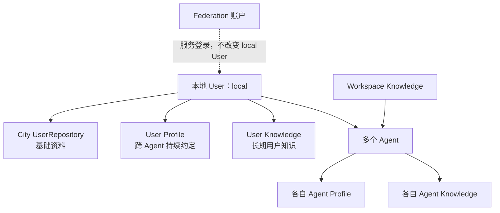
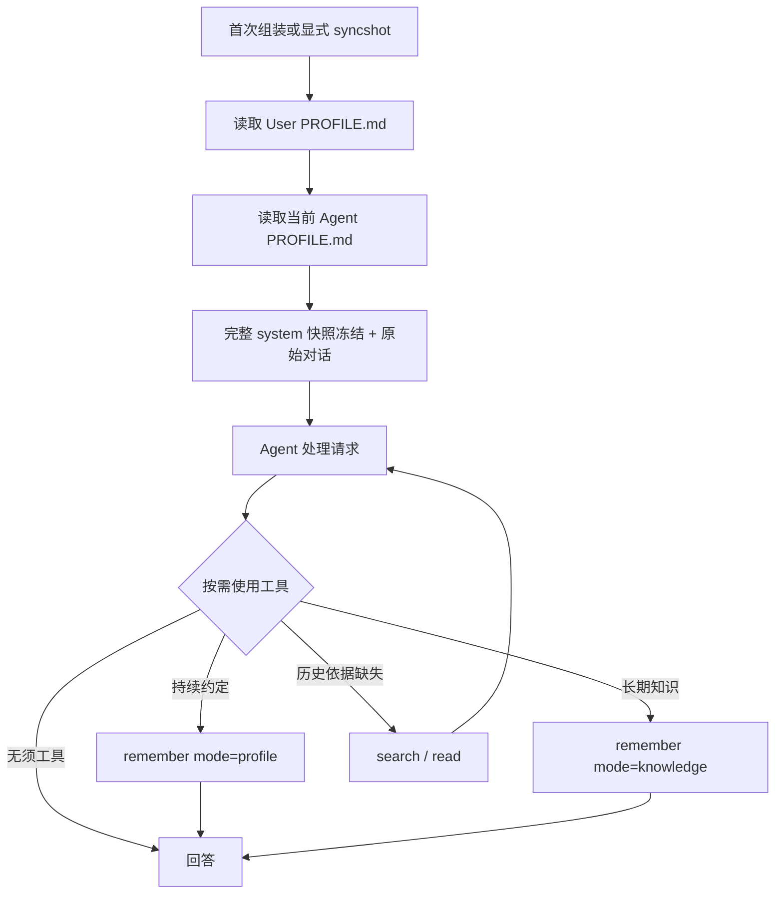
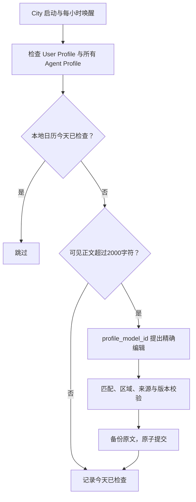

# Memory 当前设计说明：单用户与两级 Profile

> 当前架构：一份平台数据根对应一个本地使用者；User / Agent 两级 Profile 常驻，长期知识按需检索。不使用 Jev，也不周期性提取 Session。
>
> 本文替代旧消息判定 PRD。旧缓存文件保留但不再消费，不自动迁移原多用户记忆。

## 1. 身份与全局用户中心

City 的 UserRepository 管理唯一使用者，稳定 user_id 为 local。基础资料位于 user/user.json，包含 display_name、created_at、updated_at。Desktop 启动和 MemoryPower 初始化都可确保该记录存在；同平台根共享一个文件。

本地 User 独立于 Federation 账户：退出、切换模型服务账号不会改变记忆，也不要求在线登录。外部渠道沿用宿主授权；本设计不提供多租户隔离，获准使用本地 Agent 的渠道具有同一本地使用者的 Memory 范围。

全局用户中心由基础资料仓储与 Memory 服务组合，不把账号凭据保存进 Memory。基础资料管理接口委托 City 仓储，记忆正文由 MemoryPower 维护。



## 2. Session system 快照与消息处理



没有 memory/decision block、入口模型调用、回复后自动采集或 30 分钟形成任务。聊天模型自己选择工具，因此会不会漏记或漏查需要实际评估。

## 3. 模块职责

| 模块 | 职责 |
| --- | --- |
| City UserRepository | 唯一本地身份和基础资料，排他创建与原子更新 |
| DesktopLocalData.users | 将本地用户仓储组合到 Desktop 宿主数据入口 |
| MemoryPower | 生命周期、工具、宿主 actions 和通用 Session hook 装配 |
| MemoryProfile | 统一 User / Agent Profile 的追加、读取、精确编辑、删除与每日优化 |
| ProfileScope | user 或 agent + agent_id；不接受调用方文件路径 |
| AccessResolver / MemoryAddress | 固定本地 User、当前 Agent、当前 Workspace 的可读写范围 |
| BuiltinMemoryProvider | 知识的保存、检索、读取、修订与删除 |
| Router / FileAdapter | 独立存储路径、逻辑地址映射、文件原子持久化 |
| MemoryModel | Profile 优化的 JSON 文本模型调用 |

Profile 和知识共用持久化原语，但互不依赖检索。Session 核心只提供通用 hook。SOUL.md 仍由 Agent 配置管理，不由 Memory 修改。

## 4. 归属与使用方式

| target | mode | 语义 |
| --- | --- | --- |
| user | profile | 用户通用偏好与持续约定，各 Agent 新 Session 或 syncshot 时读取 |
| agent | profile | 仅当前 Agent 生效的专属约定 |
| user | knowledge | 关于使用者的事实、目标、历史信息，跨 Agent 查询 |
| agent | knowledge | 当前 Agent 私有经验和知识 |
| current_workspace | knowledge | 当前项目事实、决策与流程，项目内共享 |

current_workspace + profile 明确拒绝，不回退到其他范围。旧 City 知识可继续显式访问，不作为新的 User 范围。

## 5. remember 参数

| 参数 | 类型 | 行为 |
| --- | --- | --- |
| content | string | 必填非空正文 |
| target | user / agent / current_workspace | 必填归属 |
| mode | profile / knowledge | 默认 knowledge |
| topic | string | knowledge 主题，默认 inbox |
| memory_type | fact / preference / decision / episode / procedure / document | knowledge 默认 fact |
| source | string | knowledge 证据说明 |

### User Profile

```json
{"target":"user","mode":"profile","content":"主回答前提醒我使用英语；我写英语时简要纠正表达。"}
```

立即追加 user/PROFILE.md，无篇幅上限，无需模型或身份回调。成功返回 target=user、profile_id=user/local/profile、status=saved、mode=profile、activation=new_session_or_syncshot、location=PROFILE.md。

### Agent Profile

```json
{"target":"agent","mode":"profile","content":"修改多个模块前先提出方案并等待确认。"}
```

追加 agents/<agent_id>/PROFILE.md，成功返回 agent/<agent_id>/profile。topic、memory_type、source 不参与 Profile 追加。

### 长期知识

```json
{"target":"user","mode":"knowledge","content":"用户正在准备英语考试。","topic":"learning","memory_type":"fact"}
```

Provider 保存 evidence，然后创建或追加 wiki/<topic>。默认是确定性追加，不自动语义融合；返回 target、mode=knowledge、status=created/updated、memory_id、evidence_id、activation=on_recall、location=wiki。

User 知识逻辑前缀仍为 user/<hex-local-id>，物理上统一进入 user/memory。调用方原样使用返回 ID，不解析目录。不同平台数据根物理隔离，即使逻辑用户标识相同也不会共享文件。

## 6. 两级上下文

Identity 与 Instruction 合并为一条 Agent system，Agent Profile 紧随其后；User Profile 保持独立，位于 Session 信息之前。不再将 Profile 注入 User 消息：

```text
system: Agent Identity + Instruction（SOUL）
system: Agent Profile
system: SDK 规则
system: Power 使用说明
system: User Profile
system: Session 信息
历史 user / assistant / tool 消息
user: 当前原始请求
```

Profile 明确标注为历史偏好和持续约定，只影响适用行为，不是新请求，也不能充当“上文”等任务指代的对象。

两者保留 User / Agent 标题，去掉来源幂等 HTML 注释，不写回 canonical 消息。Profile 与 Instruction 一起参与完整 system 的首次组装和冻结。文件更新、删除和每日优化均不改变已有 Session；新 Session 使用最新文件，已有 Session 执行 syncshot 后整体刷新。snapshot 持久化当前快照，恢复沿用现有 Instruction 快照机制。

当前请求和系统权限优先。Agent Profile 是更具体范围；两者对同事项不同要求时，按其适用范围处理。代码不合并改写用户正文，也不假定靠位置就能保证模型正确处理冲突。

单份 Profile 读取失败只跳过该范围，另一份仍可加载。不存在是正常空态。

## 7. Profile 文档维护

- 新内容无上限追加，按来源幂等；相同文本在不同来源出现可能暂时重复。
- User 和每个 Agent 有各自的串行提交队列、profile-state.json 和上一版备份。
- 读取返回 content 与 SHA-256 version；编辑要求版本相同、old_text 唯一匹配且区域不重叠。
- 删除整份 Profile 也要求 version，保存备份，保留旧来源幂等账本防止同来源重放恢复。
- 普通知识 read/revise/forget 不接受 profile_id；通过专用宿主 Profile actions 管理。



字符按 Unicode code point 计数，去除来源标记但包含标题。2,000 是触发阈值和目标，不是写入或加载硬上限。优化最多32处编辑，不允许模型整篇替换或丢弃来源标记。有效语义是否完整保留仍依赖模型质量，代码不能证明语义无损。

普通优化失败记录当天已检查并保留原文，通常次日再试；并发版本变化不覆盖新内容，可下次小时扫描重算。无模型时读写仍可用。City 离线不执行。

## 8. 宿主管理 actions

| action | 输入 / 输出 |
| --- | --- |
| memory.user_read | 返回 City 仓储中的唯一使用者基础资料 |
| memory.user_update | display_name；只更新基础资料，不能换 user_id |
| memory.profile_read | target=user，或 target=agent + agent_id；返回 content/version |
| memory.profile_edit | 相同范围 + version + edits(old_text/new_text) |
| memory.profile_delete | 相同范围 + version；删除整份 Profile并备份 |
| memory.profile_status | 相同范围；返回字符数、检查日期、错误 |

Agent 目标必须是宿主登记的 Agent。User / Agent 知识管理和 Provider 状态读取无需存在 Workspace；只有项目写入要求 Workspace。工具和管理 action 使用相同领域服务，不另外实现文件操作。现有 Desktop User/Agent Profile 专属界面尚未增加，本次提供仓储和宿主 API。

## 9. 工具与检索

知识工具保留 status、list、search、read、remember、digest、revise、forget。search 默认最多6个片段、最低0.35评分，使用 Intl.Segmenter 分词与确定性文本扫描，无 embedding。

同一 User 记录保存一次，所有本地 Agent 查询同份记录；Agent 私有范围不能跨 Agent 读，Workspace 范围不能跨项目读。默认 revise 追加修订说明；digest 默认归档最近30条消息，不是自动摘要。

## 10. 配置与路径

```ts
const memory_power = new MemoryPower({
  platform_root_path: "/absolute/platform-root",
  profile_model_id: "configured-text-model",
});
```

无 resolve_user、Jev 或启用判定开关。profile_model_id 只用于每日优化，也可由 Power 配置提供，修改后重启。

```text
平台数据根/
├── user/
│   ├── user.json                  # City 唯一本地用户
│   ├── PROFILE.md                 # User Core
│   └── memory/
│       ├── wiki/ 与 evidence/
│       ├── profile-state.json
│       └── profile-backup.md
├── agents/<agent_id>/
│   ├── SOUL.md
│   ├── PROFILE.md                 # Agent Core
│   └── memory/                    # Agent knowledge 与 Profile状态
└── powers/memory/
    ├── workspaces/<hex-id>/wiki/ 与 evidence/
    ├── wiki/ 与 evidence/          # 旧City内容
    └── runtime/                   # 如有旧判定文件，保留但不消费
```

不猜测旧 user ID 的记录属于谁，不自动迁移旧 users/<id> 内容；显式新写入使用唯一 User。旧 Agent wiki 偏好也不自动升级为 Profile。

## 11. 验证与限制

已运行 City/Powers 构建、15项 Memory 回归和 Desktop 类型检查。模拟运行验证了免登录 User写入、跨 Agent Profile/知识共享、Agent Profile隔离、版本化编辑、重启加载和版本化删除。

仍需明确：不包含多租户身份体系；被授权使用本地 Agent 的渠道共享本地 User，应由宿主渠道授权控制入口。Profile 专属 UI 和真实模型优化质量需后续验证。Agent 仍可能漏用工具，保存确认必须以工具结果为准。两级 Profile 无加载硬上限，token成本随内容增长。
