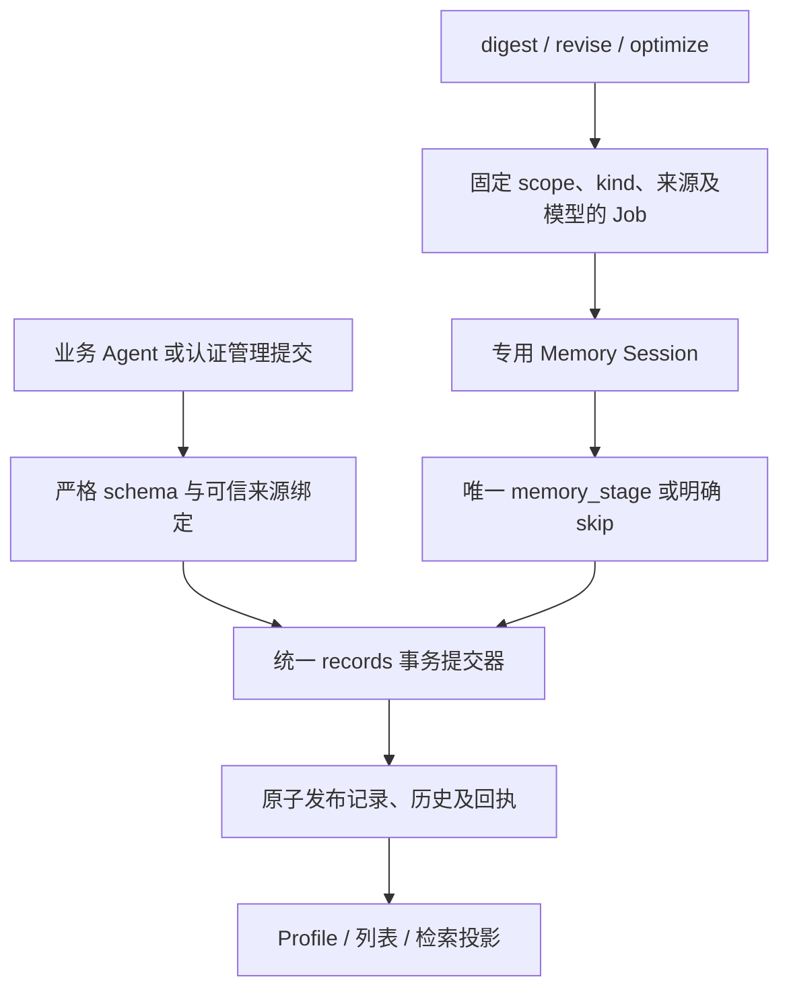

# Memory 当前设计说明

Memory 使用统一记录表达持续约定 Agreement 与知识 Knowledge。来源、版本、状态和提交由系统维护；Profile 是有效约定的上下文投影，不是第二份可编辑事实源。

## 1. 身份与全局用户中心

City 管理平台唯一 local User 的基础资料。MemoryPower 维护该 User、各 Agent 和 Workspace 范围内的记忆。服务账户不是记忆身份；切换 Downtown 账号不切换 User 数据。外部渠道沿用宿主授权，本地单用户产品边界不变。

MemoryPower 拥有内容语义、来源绑定和 Job 编排；Provider/Store 拥有授权范围内的查询和原子提交；Session 消费只读投影；renderer 消费公开记录与回执。所有持久化使用 City 分配的私有存储，不写项目目录。

## 2. 归属与上下文

| scope | Agreement | Knowledge |
| --- | --- | --- |
| user | 跨 Agent 的用户偏好和持续约定 | 用户事实、目标和历史知识 |
| agent | 当前 Agent 的专属约定 | 私有经验和知识 |
| workspace | 不支持 | 当前项目共享事实、决策与方法 |

输入 scope 是有限选择器，返回 scope 是宿主解析后的真实 type/id。不能传任意身份、文件路径或在失败后静默改换范围。约定只影响其适用行为，不构成本轮任务或授权；当前请求与系统权限优先。

User/Agent 的有效 Agreement 生成独立 Profile 投影。首次组装或 syncshot 加载完整投影，每轮以冻结版本为基线，提供完整当前约定及明确停用旧 ID/版本的更正。Knowledge 按需 search/read。完整约定不按相关性抽样或静默截断；缺必需范围、投影失败或无法容纳时明确阻止调用并在安全检查点处理。保存成功与上下文加载成功分别报告。

## 3. 选择原则与验证职责

记忆按未来用途选择，优先保存能改变未来决策、避免重复探索的长期目标、稳定约束、决策理由、策略和已验证经验。流水账、临时进度、可从环境重读的状态和短期 next steps 留在 Task/Session。

Agreement 是用户明确持续要求，正文含完整条件和例外，不另设标题。Knowledge 必须有独立 title 与 content，可用普通段落、列表和必要代码，不强制复杂模板。标题不作为分类或唯一键。

经验需要区分观察、解释与已验证规律。有权限且合理可行时先验证解释，保存依据、条件、限制和反证。重试成功、人工验收和原句引用本身不证明因果；重复引用不是新证据。明确有用但未验证的观察或问题可标注保留，避免堆积猜测。用户明确偏好无需实验。

业务 Agent 负责选择、验证与表述；Memory Session 审查已提供证据，不补做业务实验。宿主保证来源、范围、版本和提交一致性，不能通过结构字段证明语义真实。

## 4. 写入与语义处理

remember 创建对象，必填 scope、kind、content；Knowledge 另必填 title，Agreement 禁止 title。可选 source_refs 选择授权原始消息/Part，request_id 控制幂等。系统返回 memory_id、真实 scope、version、state、sources、created_at、updated_at。标题限 160 Unicode 码点，正文限 12,000，所有入口一致，超出拒绝而不截断。

update 使用 memory_id、expected_version 和完整正文，Knowledge 同时提供完整标题；不能修改 kind/scope。forget 同样要求读版本，选择 invalidated 或 deleted，默认 deleted。两种状态均退出召回和投影。完全重复可返回 unchanged，同名或相近内容不能确定性覆盖。

同步回执包含 status=committed/unchanged、operation、request_id、commit_id、committed_at 与 record。对象 state 不表达 verified，删除回执不回显正文。Agreement activation 为 next_turn_or_new_session，Knowledge 为 on_recall。

digest 从显式选定的有界 Session 材料提炼指定 kind，revise 绑定对象与读版本，optimize 整理一个 scope/kind。三者由专用 work/memory Session 执行，只提供受限来源、检索、记录读取与唯一 stage 工具。创建先检索，更新/失效先读完整记录及实际版本；不继承业务 Skills/Workspace 工具。

模型只暂存，宿主检验后一次提交。succeeded 必须有持久回执，skipped 表示不变；queued/running/failed 和详情中的计划不是保存成功。jobs/job_status 无原文，job_detail 固定前后快照、真实读版本与原始摘录；retry 保留原范围、模型和来源。

完成摘要仅在原调用轮次可接收时反馈，否则留在处理记录，不另开 turn。投递失败不改变提交结果，delivery_status 不表达记忆保存状态。

## 5. 模块与提交边界

`@downcity/powers/memory` 是公开聚合入口。内部依赖直接指向 `MemoryProtocol`、`MemoryTransaction`、`MemoryRecordStore`、`MemoryAgreementProjection`、`MemoryRecordTools`、`MemoryManagementActions` 与 `MemoryRecordsProvider`。范围枚举完整实际前缀，Workspace 仍映射到 `workspaces/<hex>` 物理目录；`city_memory_available` 控制执行期 Workspace 共享存储能力，scope 仅有 User、Agent、Workspace。

| 边界 | 职责 |
| --- | --- |
| 公开 schema / actions | 两种内容契约、统一字段与预算、严格拒绝非契约输入 |
| 来源绑定 | 固化真实 request、用户原话、认证管理输入或授权观察，校验摘录和位置 |
| 统一记录应用服务 | remember/update/forget、版本读取、归属与操作来源 |
| Provider / records Store | 同 scope 查询、不可变版本、历史、抑制和原子发布 |
| Memory Session / Coordinator | 固定输入、受限计算、暂存、检查、提交与恢复 |
| Profile 投影与上下文检查点 | 完整约定、版本替换、失效与加载失败阻断 |
| renderer | 一致 label、按条编辑、草稿与版本冲突处理 |

所有写入都保留真实请求 provenance。Agreement 新增或修改还须可追溯用户原话/认证管理提交；request 单独不足。宿主生成 source_id/role/定位/指纹/捕获时间，模型不能伪造身份。显式原文选择局限在已授权 canonical 材料；当前只支持文本 Part 和已披露的纯文本工具 model_output，不接受结构化折叠包、未披露完整 output、附件或二进制。读取边界、折叠和来源缺失必须如实表达。

一个 scope 一个 canonical manifest，同时持有 Agreement 和 Knowledge，引用不可变版本、证据、历史、抑制信息和回执。新版本先持久化，再原子发布 manifest。跨进程范围锁、记录版本和范围版本保证并发检查；固定回执支持恢复，不依赖模型最终文字。

Profile、列表摘要和搜索分片是可重建视图，不能作为写入旁路。Knowledge 搜索独立 title 和 content，引用正文保持原始行号与版本。Agreement 的展示摘要不改变注入正文。版本冲突必须重新读取判断，不能机械替换令牌后覆盖。

更新保留仍支撑新版本的依据，旧内容与旧依据留在历史；撤销/删除保留墓碑，普通查询不暴露历史正文。来源可追溯不等于结论真实，scope/kind 不可静默转换。

## 6. 后台知识整理

后台整理默认关闭，按 Agent、Workspace 上下文和目标范围显式启用。输入仅为可信明确纠错及带反馈的 Task 验收/修订事实；执行成功、打开结果或 turn 结束不等于人工验收。自动批次只写 Agent Knowledge 或获准共享的 Workspace Knowledge，不写 Agreement/User Knowledge，不扫描私人 Session 历史。

生成内容和处理反馈不是新的原始证据。维护每五分钟检查；每批最多四个事实、十六个来源和 32,000 字符。同范围每日按 UTC 最多两次计算（含重试）、至少间隔十分钟。尝试有 120 秒边界，每 Job 最多三次；空队列不调用模型。显式请求在 Job 边界优先。

失败或来源错误保留待处理材料，只有提交回执对应的 succeeded 或明确 skipped 推进处理水位。自动批次无聊天接收方。多 City 去重仍由共享范围账本控制，批次不因另一个 City 可见就被接管。

记录引用统一使用工具返回的规范 `memory_id`，结构为 `agent/<agent_id>/wiki/<opaque_id>`、`user/<hex_user_id>/wiki/<opaque_id>` 或 `workspace/<hex_workspace_id>/wiki/<opaque_id>`。完整保留 ID，不添加 URI 前缀、前导斜杠或空白；返回的 `memory:...@version#L...` 是正文引用，不能作为记录 ID。读取、更新、遗忘、修订与管理历史共用同一校验。

## 7. 存储、模型与限制

逻辑 memory_id 不对应可供调用者解析的物理路径。Builtin 通过私有 Adapter 路由 User、Agent 和 Workspace records 存储；范围激活状态和 canonical manifest 是有效集合的唯一依据。

迁移 SDK 提供 preview_memory_migration、memory_migration_preview_hash 和 publish_memory_migration，接收显式材料、人工候选、完整历史/抑制保全包与真实停写屏障，不自动采集运行数据根。生产迁移材料准备和窗口编排需要单独执行，不能将 SDK 发布函数描述为一键运行切换。

范围首次使用统一经过 `prepare_memory_scope`：地址由可信访问上下文解析；已存在 manifest 时严格读取，保持版本、来源和回执不变。缺少 manifest 时，在与 records commit 相同的跨进程范围锁内复查标记与材料，只有真正空范围才原子创建 `confirmed_empty`、scope version `0`。User、新 Agent、普通 Workspace 和内部主工作区遵循同一规则，不依赖注册列表或名称前缀豁免；每个必需范围独立检查。

空范围判断使用 Adapter 的 `has_entries` 元数据能力，覆盖范围完整物理前缀，包括临时文件、孤立版本、Markdown、历史、抑制和未知文件。宿主提供的定向领域探针额外覆盖外部 User/Agent `PROFILE.md`、普通 Agent 的 `powers/memory` 和 Workspace runtime 的已知 Memory 布局；来源账本和 Profile 备份在当前 memory 子树中检查。探针不读取正文，不扫描私人 Session 历史。链接、损坏 manifest、权限及其他读取错误均失败，不作为空证据；Adapter 根自身的 `.locks` 是唯一排除的内部锁目录。

有旧材料且无 manifest 时继续抛出 `MEMORY_MIGRATION_REQUIRED`，必需范围未就绪会阻止上下文加载。迁移须先固定旧材料、预览映射，核对全部有效约定及缺标题/来源不足条目，再确认范围切换。保留原文、历史时间语义、墓碑、旧 ID 映射和备份，不根据旧分类推断用户授权。运行时不自动转换已有材料，不提供双格式读取；迁移发布须隔离旧运行路径的写入。

删除只退出当前有效集合，精确正文抑制不保证阻止语义改写。forget 不擦除原 Session、Job 来源、历史或全部备份；重新记住被忘记内容需要当前用户的明确授权，不能由模型自行放宽。

Memory Job 固定模型和计费绑定，切换服务账户不会改变已有请求或静默改换重试账户。来源读取有预算，可能缺较早记录或不可读工具结果；整理器不能补造实验。模型仍可能漏记、漏查或误判支持程度，结构验证不构成质量百分比保证。

实现方案见 [Memory 对象与动作设计](../../docs/design/memory-records-and-actions.md)，公开参数和使用方式见 [Memory README](../packages/implementations/powers/readmes/memory.readme.md)。
