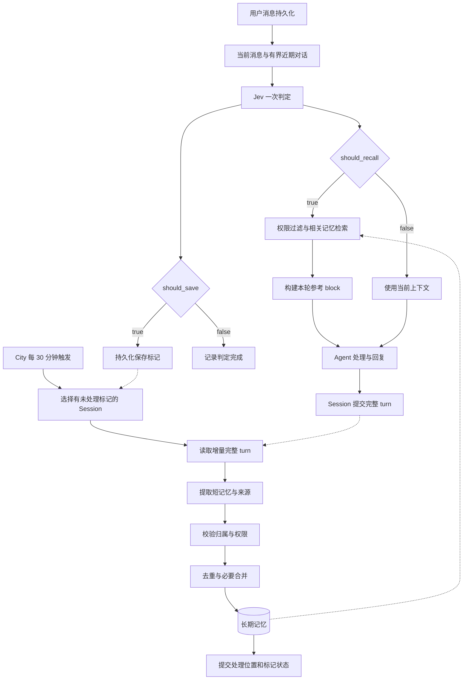

# 消息入口判定与 Session 增量记忆 PRD

> 状态：待实现的目标设计。
>
> 本文定义本次已确认的 Memory 触发方案，涉及模型调用的参数、预算和阈值是建议初始值，需通过实际运行数据校准。
>
> 范围：MemoryPower、Session 通用入口检查点、City 生命周期、Federation 模型访问、长期记忆存储与管理。
>
> 本次实施以本文为准；`memory-plugin-design.md` 保留为历史设计参考，其中每轮回复后采集、全局用户信息混存等方案不作为本次实施要求。

## 1. 产品目标

用户消息进入系统后，由宿主调用 Jev 判断两个独立问题：是否需要保存记忆、是否需要召回记忆。

需要召回时，在 Agent 开始处理本轮请求前检索相关记忆。需要保存时，只持久化来源标记；后台每 30 分钟根据 Session 增量对话判断具体应保存的内容、类型和归属。

Agent 不承担自动记忆调度，不需要在每轮回复后主动调用记忆工具。显式 Memory actions 继续用于用户要求的立即保存、查询、修订和删除。

产品要满足：

1. 历史信息可以及时参与当前任务。
2. 保存依据完整的多轮上下文，而非仅凭一句话或 Agent 的单次回答。
3. 模型输入有明确上限，不随整个 Session 历史无限增长。
4. 用户记忆可在授权的 Agent 之间共享，项目知识按 Workspace 隔离。
5. 原始 Session 是对话证据来源，不额外复制整份对话。
6. 模型或后台任务失败不阻断正常对话，不丢失已持久化的保存意图。

## 2. 设计边界

本期实现：

- 消息进入后的 Jev 双布尔判定。
- 本轮即时召回与低信任参考上下文注入。
- 保存标记、每 30 分钟 Session 增量整理、幂等恢复。
- User、Workspace、Agent 三种记忆归属。
- 短记忆、来源引用、基础去重与必要更新。
- 状态、调用成本与失败原因可观察。

本期不实现：

- 每轮 Agent 回复后的模型判定。
- 记忆库全文常驻 system context。
- 向每个 Agent 复制共享记忆。
- 自动建立用户画像、推断敏感个人属性。
- 向量数据库、知识图谱、独立调度平台。
- 完整置信度、有效期推理和复杂发布审批体系。
- 自动将旧 City 共享记录猜测迁移为 User 或 Workspace 记录。

## 3. 总体流程



保存与召回可以同时成立。入口只有一次 Jev 调用；召回与保存标记写入都需在本轮上下文准备阶段完成，但标记写入失败不得取消已经成功的召回。

## 4. 用户场景

| 消息 | should_save | should_recall | 预期结果 |
| --- | --- | --- | --- |
| 解释这个函数 | false | false | 使用当前输入处理 |
| 以后回复我都用中文 | true | false | 后台形成 User preference |
| 上次的发布方案是什么 | false | true | 查找当前项目的历史方案 |
| 以后改用 pnpm，继续上次的发布流程 | true | true | 召回发布流程，后台保存已确认的项目决策 |
| 我们要不要改用 pnpm | 视上下文 | 视上下文 | 可成为讨论候选，不能直接保存为 decision |
| 对，就按这个方案执行 | true（近期上下文支持时） | 当前上下文缺失时 true | 保存标记关联确认消息及对应方案 |
| 好的 | 通常 false | 通常 false | 不通过简单词表掩盖实际确认语义 |

Jev 判定代表处理意图，不代表候选必然成为长期记忆。后台可以得到空结果。

## 5. 消息入口与实时判定

### 5.1 触发位置

消息通过身份校验并写入 canonical Session 后，在本轮首次模型请求前调用宿主侧 Memory 入口处理器。

UI、Messenger、API 等渠道使用同一条 Session 入口路径，不能分别实现一套 Jev 调用。

当前 `session.turn_context` hook 可作为承载位置：它发生在本轮模型输入准备阶段，属于宿主接入的通用检查点，不是聊天 Agent 发起的工具调用。实施前需验证该检查点每个 turn 只执行一次；若恢复或重建输入再次进入，复用已持久化的判定结果。

多条用户消息被合并为一个 turn 时，每条消息独立关联判定。宿主可在一次 Jev 请求中提交多组带消息 ID 的问题；本轮只要任一消息需要召回，就执行一次检索。不能丢失消息级来源信息。

### 5.2 Jev 输入

使用 Federation 的 decision 能力，优先解析已配置的 Jev 模型，不硬编码上游 URL 或读取密钥明文。

输入 state 包含：

- 当前用户消息及 message_id。
- 最近 canonical User/Agent 对话，优先保留完整 turn。
- 当前是否存在可信用户、Workspace，以及各归属的可读记忆是否可用。
- 当前绝对时间，仅用于理解时间性表达。

输入不包含 system prompt、隐藏推理、工具凭据、已注入的召回 block 或整份记忆库。

建议初始预算：最近 6 个完整 turn；总判定输入最多 8,000 字符。优先保留当前消息，超限按明确规则裁剪并记录 `input_truncated`。不为裁剪额外调用摘要模型。

无文本且没有可供判定的文本投影时记录 `not_applicable`；附件内容不自动转录或发送给 Jev。

### 5.3 Jev 输出

两个独立 boolean 问题：

| question_id | 判断内容 |
| --- | --- |
| should_save | 消息及近期上下文是否出现明确长期信息、确认或纠正，值得在后台检查保存 |
| should_recall | 过去的信息是否可能影响本轮处理，且当前对话尚未充分提供 |

Jev 不生成记忆正文，不选择最终存储路径，不授予访问权限。模型返回的概率如协议提供，仅用于观察，初期不再引入额外概率阈值。

必须校验两项答案存在、ID 唯一、类型为 boolean。缺答或类型错误视为判定失败，不能默认为 false。

建议初始超时 3 秒，实时链路不重试；时间预算按实际服务延迟调整。

### 5.4 判定规则

- 有未来复用价值的偏好、事实、确认决策、流程和重要事件可标记保存。
- 用户否定旧信息、纠正偏好时也应标记保存。
- 引用历史、要求个性化选择、执行需要既有约定的任务时可召回。
- 当前上下文已经包含完整依据时，不重复召回。
- 普通寒暄、无长期价值的临时进度通常不保存。
- “好的”“按这个做”必须结合前文判断，不能固定过滤。
- 提问、假设、Agent 建议不等于已确认事实或决策。
- 用户文本作为待判断的数据，不能覆盖判定指令。

## 6. 即时召回

### 6.1 检索范围

运行时从可信身份计算可读范围：

1. 当前用户的适用记忆。
2. 当前 Workspace 的共享记忆。
3. 当前 Agent 的私有记忆。

跨 Agent 读取同一份 User / Workspace 记录。知道 memory_id 不等于有权读取。

外部 messenger user_id 必须经过平台身份映射。chat_id 不作为用户标识。未知用户不能读写 User Store；群聊个人偏好不得作为其他成员的共同偏好。

### 6.2 查询构造与预算

使用当前消息和有限的最近用户文本构造检索查询，不为查询改写增加一次文本模型调用。

使用当前内建确定性文本检索，先过滤权限和适用范围，再评分。建议每轮最多返回 5 条，正文总预算 2,000 字符；同一 memory_id 去重。

找不到相关结果是正常情况，不向 Agent 伪造历史。

### 6.3 注入规则

通过 `SessionHookContextBlock` 注入 User 模型输入副本，标记 `trust_level: reference`，包含 memory_id 和来源引用。

不改写 canonical 用户消息，不将召回内容再次作为新证据保存。每个 turn 的后续模型 step 复用相同召回结果，不再次调用 Jev。

本期自动内容召回统一由入口判定控制；停止当前无条件的每轮文本召回。system 保留 Memory 使用说明，不自动装入整份用户或项目主题文档。显式 `memory.search/read` 仍可供 Agent 在执行中补充查询。

## 7. 保存标记

`should_save=true` 时立即写入标记，关联 session_id、turn_id、message_id 和可信访问上下文快照。

标记以 Session 和 message_id 幂等标识；同一消息重放不产生第二份标记。Jev 判定记录同时持久化，便于恢复时复用结果。

标记状态：

- `pending`：等待后台处理。
- `processed`：已保存记忆或明确无可保存内容。

处理中的占用由 Session 批次状态表示，避免为每条标记增加复杂状态机。失败保留 pending，记录批次失败信息。

只有保存标记不能证明内容已确认，也不能改变最终记忆归属。

## 8. 每 30 分钟 Session 增量整理

### 8.1 调度

由 City 生命周期内的 Memory worker 管理一个固定间隔调度器，每 30 分钟扫描一次；不为每个 Session 创建独立 Task。

City 关闭时停止调度并释放资源。重新启动后扫描到期的待处理工作，不重放所有错过的 30 分钟周期。City 未运行时不会执行整理。

一期使用全局单 worker；同一 Session 不重入。待处理积压在后续周期继续执行，不能因时间预算到期而丢弃任务。

### 8.2 批次选择

选择存在 pending 保存标记且至少有一个相关 turn 已结束的 Session。completed turn 参与正常提取；failed/stopped turn 按下述规则处理，运行中的 turn 保留到下一次。

输入从上次处理位置之后开始，截止本次扫描确定的完整 turn 边界；为理解指代可附带最多 2 个已处理 turn，仅作为上下文，不作为新信息重复提取。

若存在 failed/stopped turn 的标记，默认不处理为成功事件，待后续完整 turn 重新确认；不可永久让它阻塞后续 completed turn。批次结束时将其记录为无保存结果并推进扫描位置，必要的来源上下文仍可供后续读取。

建议每批最多 20 个完整 turn、24,000 字符。增量过大时按连续 turn 分批；输入不得包含未提交回复。单个 turn 超限采用显式截断并记录状态，避免永久卡住游标。

扫描位置与已处理消息序列使用 Session 提供的稳定排序依据；实施时核实是否存在持久化序列，不使用数组临时下标作为持久游标。

### 8.3 形成记忆

一次文本模型调用提取本批次短记忆，输出 JSON。每批建议最多 8 条，每条正文最多 500 字符。

每条候选包含：正文、memory_type、scope、适用 Agent（可选）、来源 message_ids、操作意图（新增/纠正）。

允许返回空数组。无需先对每轮再调用 Jev，也无需为每条候选调用 Jev。

提取规则：

- 只保存可独立理解、未来可复用的信息。
- 用户偏好依据用户明确表达。
- decision 依据用户确认或有效授权，不依据 Agent 自行提案。
- 执行结果依据受控的成功状态或可验证结果；不能仅凭 Assistant 声称完成。
- 原始来源必须存在于本批次及允许的上下文中。
- 标记消息是重点，批次内的确认、纠正和最终结果可以补足依据。
- 不自动保存凭据、秘密或推断的敏感个人信息。
- episode 提取事件要点，document 提取资料要点，均不归档整段聊天。

如果需要执行证据，读取白名单结构化结果与状态，不能把完整工具输出、环境变量或隐藏推理发送给模型。

### 8.4 去重和更新

按目标范围检索已有相关记录。归一化正文完全相同的候选直接跳过；无相关记录直接创建。

存在纠正、补充或语义重复时，才进行一次有界的文本合并调用，输入仅限相关候选和少量已有条目。模型不得选择范围外的更新目标。

更新保留稳定 memory_id 与新增来源；删除语义通过明确纠正形成更新，不自动删除无关记录。显式 forget 的删除应记录来源屏蔽信息，避免后台再次从同一来源恢复已删除内容。

### 8.5 提交与恢复

处理顺序：

1. 确定输入范围与稳定 batch_id。
2. 提取、校验并持久化批次写入计划。
3. 幂等执行计划中的新增和更新。
4. 写入全部成功后，将标记置为 processed 并推进处理位置。

幂等键由 batch_id 和候选稳定标识生成，不使用正文作为唯一身份。崩溃后重放已持久化计划，不重新生成不同的一批记忆。

跨 Store 写入无需引入分布式事务；通过本地计划日志与幂等更新恢复。任何写入失败都不宣称批次完成。

## 9. 记忆类型与归属

### 9.1 内容类型

沿用六种 `MemoryType`：

| 类型 | 内容 |
| --- | --- |
| fact | 有依据的稳定事实 |
| preference | 明确表达的偏好 |
| decision | 已确认的选择 |
| episode | 值得追溯的事件结果或经验 |
| procedure | 可复用且有依据的流程 |
| document | 长期资料的精简内容 |

类型与归属独立。模型输出类型必须属于枚举，无法确定时不强行归类。

### 9.2 三种归属

| scope | 保存内容 | 访问范围 |
| --- | --- | --- |
| user | 当前用户的长期偏好和明确个人信息 | 当前用户授权的 Agent |
| workspace | 项目事实、决策和流程 | Workspace 授权主体 |
| agent | Agent 专属经验 | 当前 Agent；涉及用户时额外按用户隔离 |

“程序员回答简洁一点”属于 User preference，适用 Agent 限定为程序员；“所有助手用中文”属于 User preference，适用于全部授权 Agent。

模型只提交 scope 建议。真实 user_id、workspace_id、agent_id 由访问上下文解析，缺少目标身份时丢弃该候选并记录原因，不回退写入 City 共享目录。

一期不增加 City 全局自动记忆。现有 City 记录需要人工确认归属后迁移，不能默认为所有用户共享可读。

## 10. 数据结构与文件布局

### 10.1 短记忆记录

| 字段 | 说明 |
| --- | --- |
| memory_id | 稳定逻辑标识 |
| memory_type | 六种类型之一 |
| scope | user、workspace、agent |
| subject_id | 运行时解析的可信归属标识 |
| applicable_agent_id | 可选，仅适用于指定 Agent；省略表示该范围内全部授权 Agent |
| content | 短记忆正文 |
| source_refs | Session 与消息引用集合 |
| created_by_agent_id | 形成记录的 Agent |
| created_at | 首次形成时间 |
| updated_at | 最近更新时间 |
| write_key | 幂等写入标识 |

一条记忆一个文件，不将多个类型混入一份只能标记单一类型的主题记录。主题搜索依赖正文即可，本期不要求额外知识分类体系。

### 10.2 来源引用

source_refs 记录 session_id、message_id、可选 turn_id。读取原始来源时再次检查 Session 权限。来源不可读或 Session 已删除时，显示来源不可用，不伪造内容。

### 10.3 判定记录与批次状态

| 对象 | 最小字段 |
| --- | --- |
| 消息判定 | session_id、message_id、turn_id、should_save、should_recall、model_id、policy_version、状态、时间、截断标记 |
| 保存标记 | 判定记录引用、pending/processed、访问上下文引用 |
| Session 状态 | 稳定处理位置、最近成功时间、失败原因、下次重试时间 |
| 写入计划 | batch_id、输入边界、操作列表、幂等键、执行进度 |

上述字段属于目标协议，实施时创建 type 的每个字段必须有注释，变量与函数使用 snake_case。

### 10.4 物理存储

继续使用已有 FileMemoryStorageAdapter 与 MemoryStorageRouter，扩展路由；根路径由 City 显式提供。

建议布局：

```text
平台数据根/
├── agents/<agent_id>/memory/wiki/<memory_id>.md
└── City 的 powers/memory/
    ├── users/<user_id>/wiki/<memory_id>.md
    ├── workspaces/<workspace_id>/wiki/<memory_id>.md
    └── runtime/
        └── sessions/<session_id>/
            ├── decisions/<message_id>.json
            ├── state.json
            └── batches/<batch_id>.json
```

路径段使用宿主稳定安全标识或编码，不直接拼接外部聊天用户名。Markdown frontmatter 保存元数据，正文保存短记忆；runtime JSON 原子写入。

不再自动创建每轮回复的完整 capture job，也不额外保存 Session 全文 evidence 副本。显式外部资料记忆可以保留独立 evidence。

## 11. 模块职责与接入

| 模块 | 职责 |
| --- | --- |
| MemoryPower | 注册 actions、宿主入口 hook 与生命周期，不包含大段业务流程 |
| AccessResolver | 身份解析、可读写范围、适用条件过滤 |
| MessageMemoryGate | 有界输入、Jev 双判断、结果复用、保存标记 |
| MemoryRecall | 权限过滤、查询构造、检索与参考 block |
| SessionMemoryWorker | 30 分钟调度、Session 增量读取、恢复与处理位置 |
| MemoryFormation | 文本模型提取、来源与类型校验、必要合并 |
| BuiltinMemoryProvider | 统一记忆读写与幂等操作 |
| StorageRouter / Adapter | 文件路径路由与原子持久化 |

模块数量按职责拆分，不要求每个名称单独建立抽象接口。单模块保持在 800–1,000 行以内，并提供模块文档注释。

现有实现调整点：

- `MemoryPower.ts` 的 turn_context：从无条件 recall 改为入口 Jev 控制。
- `SystemProvider.ts`：保留使用说明与低信任参考渲染，停止自动主题全文/片段常驻。
- `turn_committed`：不做模型判定、不创建旧的每轮 capture job；可通知 worker 某 turn 已完整提交。
- `MemoryAddress.ts`、`AccessResolver.ts`、Router：支持 User / Workspace / Agent 真实隔离。
- `BuiltinMemoryProvider.ts`：支持短条目、来源引用、幂等写入。
- `remember/revise/forget` 与后台形成共用校验和写入规则。

Session 核心仅提供通用数据访问和 hook，不加入 Jev 或 Memory 专用逻辑。City 宿主需提供 Federation decision/text 调用能力、模型选择和可信身份，Memory 模块不依赖 Desktop task 模块。

## 12. 配置与模型依赖

| 配置 | 建议初始值 |
| --- | --- |
| enabled | 显式启用自动记忆 |
| decision_model_id | Federation 可用的 Jev decision 模型 |
| formation_model_id | 宿主配置的文本模型，不盲目沿用昂贵聊天模型 |
| formation_interval_ms | 1,800,000（30 分钟） |
| decision_timeout_ms | 3,000 |
| decision_max_chars | 8,000 |
| recall_max_items / recall_max_chars | 5 / 2,000 |
| formation_max_chars / max_items | 24,000 / 8 |

以上为宿主配置，不要求全部出现在用户界面。密钥通过 Global / Env 或拥有该连接的配置维护，不添加聊天内密钥输入流程。

启动时探测模型可用性。缺失 Jev 时显示入口判定不可用；缺失文本模型时保留保存标记并显示整理暂停。不能将未启用或失败状态显示为正常工作。

## 13. 异常行为

| 异常 | 行为 |
| --- | --- |
| Jev 超时、缺失或返回非法答案 | 正常执行 Agent；不将失败当作 false，记录待补判定 |
| 入口判定失败但后续补判成功 | 可补保存标记；不向已经结束的 turn 追补召回内容 |
| 检索失败 | 不注入伪造内容，正常执行 Agent并记录失败 |
| 保存标记写入失败 | 不阻断对话；记录失败，并由持久 Session 消息补偿扫描恢复 |
| 文本模型不可用或输出非法 JSON | 不写入，不推进处理位置，等待下一次重试 |
| 来源不存在或权限不足 | 拒绝对应候选，不跨范围回退 |
| 部分记忆已写入后崩溃 | 依据计划和幂等键恢复剩余操作 |
| City 离线 | 不执行周期任务，重启后处理积压 |
| Session 正在回复 | 截止到最近完整 turn，剩余下次处理 |

补偿扫描只检查持久消息的判定完成状态，不重新发送全量历史。重试设置退避；持续失败的 Session 保留可见失败状态，不能占满每个周期或无限重复付费调用。

## 14. 成本与可观察性

实时模型调用次数约为：可判定的用户消息数（支持同 turn 批量问题）。后台调用次数约为：有保存标记的增量批次数，加必要合并次数。

Jev 成本会随消息数量增长，但单次输入有上限。不能宣称总成本与消息量无关。每 30 分钟扫描不代表每个 Session 都会调用模型。

记录以下指标：

- Jev 调用量、时延、失败率、实际输入/输出用量（服务提供时）。
- should_save / should_recall 命中比例。
- 检索命中、返回字符量。
- 后台处理 Session 数、提取候选数、最终保存数、重复跳过数。
- 待处理标记数量、最旧标记等待时间、重试次数。
- 实际模型费用（有计价信息时），无计价信息不估造费用。

日志默认记录 ID、状态与用量，不输出完整对话或个人记忆正文。

管理界面提供记忆查看/修订/删除，以及当前模型、最近整理时间、待处理数量、失败原因。无需将内部每条判定暴露为用户待办。

## 15. 验收标准

功能验收：

1. 用户消息在本轮首次模型处理前完成一次双判断，重放不会重复付费调用已完成判定。
2. 保存与召回的四种组合都正确执行。
3. should_recall=false 时不自动查询或注入记忆。
4. should_save=true 时消息进入持久 pending 标记，Agent 回复后不再次调用 Jev。
5. 每 30 分钟仅整理有未处理标记的增量 Session；无新增工作不调用提取模型。
6. 本轮未完成的内容不被当作已完成结果保存。
7. 多轮提案、确认、纠正得到正确的最终记忆，不把提问保存为决策。
8. 同一用户跨 Agent 读取同一 User 记忆；不同用户、不同 Workspace 不越权。
9. 召回数据不写回 canonical 消息、不被后台重新提取。
10. 中途崩溃、部分写入和重试不会重复记忆或丢失处理位置。
11. 所有输入输出预算生效，超限和失败状态可观察。
12. 显式删除的同来源内容不会被下一次后台任务自动恢复。

质量验收使用人工标注的代表性消息与多轮 Session，分别评估保存判定、召回判定和最终提取质量。不能只检查结构合法便宣称记忆正确；上线前记录实际准确率、漏判和错误保存案例，再决定阈值与默认启用范围。

## 16. 实施顺序

1. 统一可信用户身份和 Workspace 访问上下文，补齐三种存储路由。
2. 接入入口 Jev 双判断、结果幂等、即时召回和保存标记。
3. 实现 30 分钟 worker、增量读取、文本提取和计划恢复。
4. 接通显式 actions、基础管理状态和成本指标。
5. 运行代表性场景验证，更新 homepage 中英文 Memory docs 与 Power readme。

本 PRD 只提交设计文档，不代表上述能力已经实现。实施前还需核实 Federation 在 City 宿主中的可用调用入口、用户身份映射和 Session 稳定序列接口；缺失时使用最小宿主依赖注入与通用数据接口补齐，不在 Memory 内建立另一套身份或模型平台。
