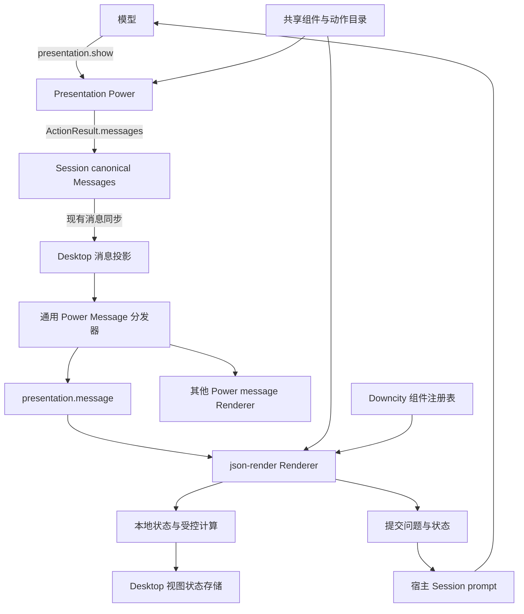

# Power 消息渲染与 Presentation PRD

> 状态：通用底座与首版已实施；Presentation 已确认切换 OpenUI。
> 当前 Presentation 协议、组件库、渐进预览与验收以 [OpenUI 迁移合同](presentation-openui-migration.md) 为准。下文 json-render 相关内容保留为首版设计背景，不再作为当前实现要求。
> 本文是通用 Power 消息渲染底座与 Presentation 首版的完整交付合同。
> 本文取代《Power Agent Message 渲染插口 PRD》中以 diagram / SeeCode 为首个实施对象的安排。diagram 是后续复用方，本期不集成 SeeCode。
> 本文描述目标行为，不代表相关能力已经实现。

## 1. 产品目标

让 Agent 在回复正文中生成可视化、可交互模块。用户可以直接调整参数、筛选数据、查看结果，并将当前状态提交给 Agent 继续讨论。

同时建立通用 Power 消息渲染插口：每个 Power 可以输出自己拥有的结构化内容，并注册消息渲染组件。宿主统一负责分发、容器、错误隔离和回退。

首版由 Presentation Power 验证完整链路，使用 json-render 实现声明式界面。未来 diagram 等 Power 复用同一插口。

核心体验：

```text
用户提出问题
 → Agent 调用 presentation.show
 → 当前回复正文出现交互模块
 → 用户本地调整参数，结果立即更新
 → 刷新后恢复可保存的操作状态
 → 用户提交当前参数与问题
 → Agent 基于当前状态继续回答
```

## 2. 已确认的架构决策

1. 新增 Agent 专属 `power` 内容与 canonical Part，不将 Presentation 放入 `data` 业务特例。
2. 复用 Power ActionResult.messages 输出，不增加独立消息发布工具或旁路内容通道。
3. 扩展现有 Power Renderer 的 `message` 插槽，官方 Power 与本地 Power 使用相同机制。
4. Presentation 是具体 Power；通用宿主不理解其 Spec、组件名称或计算函数。
5. Presentation 使用固定版本的 json-render Core / React Renderer；保留其许可，复用描述与绑定机制。
6. Session 保存输出内容，视图管理用户操作状态，业务 Power 拥有业务事实。
7. 首版完整 Spec 校验后发布。增量生成属于后续阶段。
8. 首版不执行模型生成的 JavaScript，不加载模型指定的任意 React 模块。

## 3. 当前基础与缺口

| 现有能力 | 当前事实 | 实施要求 |
| --- | --- | --- |
| SessionAgentContent | 支持 text、file、data | 增加 power 内容 |
| canonical Message | 已有 part_id、sequence、Message revision | 沿用身份、排序与同步 |
| Power ActionResult.messages | 支持 role=agent 与 Agent 内容 | 接通 Power Part 校验与追加 |
| SQLite 消息存储 | JSON 内容与类型、角色约束 | 升级约束、Codec 与原生迁移 |
| Power Renderer | 已有 sidebar、mainview、config | 增加 message 插槽 |
| Desktop 消息投影 | 最后一个活动块划分过程与正文 | 保证 Power 内容持续可见 |
| 文本渲染 | 使用 Streamdown | 保留文字路径，Power 独立分发 |
| Session Interaction | 属于 Tool 执行期间的等待响应 | 不承担长期界面生命周期 |

实际 Action 追加时机、消息 Mutation、本地 Renderer 加载及全部穷尽分支必须在实施中验证。

## 4. 范围

### 4.1 本期包含

- 通用 Power 内容、canonical Part、持久化与消息同步。
- Power message Renderer 注册、加载、分发及错误隔离。
- 正文可见性、历史恢复、复制、上下文与文本渠道回退。
- Presentation Power 的组件目录与 `show` 动作。
- 基于 json-render 的受控组件渲染、状态绑定与本地计算。
- Desktop 本地交互状态恢复。
- 向当前 Session 提交界面参数及问题。
- 三类验证模块：筛选表格、复利计算图、参数提交表单。
- 用户文档与 Power 开发文档。

### 4.2 后续范围

- Spec 增量生成与原 Part 更新。
- diagram / SeeCode 集成。
- MCP Apps iframe 宿主、A2UI 互操作。
- 任意代码小应用、通用界面编辑器。
- 跨设备同步用户视图状态。
- 任意 Power 动作代理及通用业务表单平台。
- HTML、图片、视频等导出能力。

## 5. 架构关系



### 5.1 职责归属

| 模块 | 拥有的职责 |
| --- | --- |
| @downcity/type | Power 内容封装、canonical Part 与必要的跨包协议 |
| @downcity/agent | 消息身份、顺序、持久化、上下文投影与同步 |
| @downcity/city | Renderer 插槽协议、注册与可信 Power 调用归属校验 |
| @downcity/powers | Presentation 目录、校验、show 动作与官方 Renderer 注册 |
| @downcity/ui | 可复用展示组件；具备真实复用价值的渲染适配 |
| Desktop | 通用消息容器、主题、错误边界、状态存储与 prompt 接入 |

Presentation 的服务端目录定义与浏览器组件实现必须分离。服务端不能因校验 Schema 加载 React 或浏览器模块。

首版不新建 package。类型进入对应模块的 types 目录，具体目录遵循已有 Power 与 Renderer 结构。避免同时在 powers 与 ui 维护两份 Catalog 或 Registry。

## 6. 通用 Power 内容协议

新增 SessionPowerContent，并加入 SessionAgentContent。User 内容集合不增加 power。

| 字段 | 约束与含义 |
| --- | --- |
| type | 固定 power |
| power_id | 内容所属 Power，也是 message Renderer 查找键 |
| schema_version | 所属 Power 数据协议正整数版本，由该 Power 解释 |
| data | JSON 可序列化业务内容 |
| fallback_text | 必填非空文本，用于缺少 Renderer、渠道回退、复制和上下文 |

持久化为 SessionAgentPowerPart，由 Session 增加 part_id、sequence、可选 step_id。Action 不指定 Part 身份、消息身份和顺序。

```json
{
  "type": "power",
  "power_id": "presentation",
  "schema_version": 1,
  "data": {
    "format": "json-render",
    "catalog_id": "downcity.standard",
    "catalog_version": 1,
    "spec": {}
  },
  "fallback_text": "可调整利率和年限的复利增长图。默认本金 10000，年利率 5%，年限 10 年。"
}
```

外壳 schema_version 表达所属 Power 的数据版本，不额外复制同义版本字段。catalog_version 表达组件、动作和计算函数契约。固定第三方依赖版本并记录该 data 版本支持的 Spec 格式。

缺少 Power、Renderer 或版本不支持时，保留内容，展示 fallback_text 与明确状态，不静默丢弃。

## 7. Action 输出与发布

使用现有 PowerActionResult 的 success、data、error、message、messages 字段；不混用其他 Action 层的 output 示例。

```json
{
  "success": true,
  "data": { "published": true },
  "message": "已展示复利计算图。",
  "messages": [
    {
      "role": "agent",
      "parts": [
        {
          "type": "power",
          "power_id": "presentation",
          "schema_version": 1,
          "data": {
            "format": "json-render",
            "catalog_id": "downcity.standard",
            "catalog_version": 1,
            "spec": {}
          },
          "fallback_text": "复利计算图及初始参数摘要。"
        }
      ]
    }
  ]
}
```

示例 spec 是占位，不是合法界面示例；实现文档必须给出与实际 Catalog 一致的可运行 Spec。

规则：

- Presentation 校验业务描述；运行时校验外壳、大小、可序列化性和可信调用归属。
- power_id 必须与实际调用 Power 匹配，不能信任模型提交的归属。
- Spec 不合法时返回精确问题，不发布内容。
- 成功后立即随 Action 结果写入当前回复，不等待模型最终文字。
- 模型只获得简短回执，不重复读取完整 Spec。
- 沿用 Turn 停止、异常和重复结果处理规则，避免迟到写入与重复追加。
- 并发内容按 canonical sequence 展示；模型再次主动调用属于新内容。

## 8. Renderer 插槽与宿主

PowerRendererDefinition 增加可选 message 插槽。只定义 message 的 Renderer 合法，不要求 sidebar 或 mainview。

输入只包含实际需要的内容：canonical Power Part、Session / Message 身份、主题及布局约定。通用宿主可提供命名明确的视图状态存取与提交对话端口，不暴露 Agent、Shell、文件系统或任意 Power 调用句柄。

宿主负责：

- 根据 power_id 查找注册 Renderer；沿用注册冲突规则。
- 官方与本地 Power 相同的加载路径。
- 稳定 part_id 组件身份、响应式宽度、主题与加载状态。
- 每个 Part 独立错误边界及 fallback_text。
- 缺失版本、异常、离屏卸载、重新挂载及资源清理。

消息更新不能使未变化的图形反复重建。渲染器监听器、订阅和计算任务随实例卸载释放。

## 9. Presentation Power

### 9.1 首版动作

唯一生成动作 `presentation.show`：输入 fallback_text 与 spec；实现补齐固定 format、catalog_id、catalog_version 和 schema_version。

组件目录通过现有 Power 提示、动作 Schema 和说明暴露。优先沿用既有能力发现方式，不先增加另一套目录服务。

模型收到说明：何时使用交互模块、可用组件、绑定和计算约束，以及何时文字足够。首版不依赖专门模型训练。

### 9.2 标准目录

目录同时描述组件、受控计算和允许事件。

| 类别 | 首版能力 |
| --- | --- |
| 布局 | 容器、纵横排列、卡片、标题、文字 |
| 数据展示 | 数值、表格、折线图 |
| 输入 | 数字输入、滑块、选择器、文本输入 |
| 操作 | 按钮、重置、提交当前参数与问题 |
| 计算 | 数值格式化、合计、比例、复利序列、表格筛选所需能力 |

最终组件名、参数、边界与单位在实施时通过同源 Schema 确定。不得仅列组件名却没有可执行的数据绑定和计算约定。

Power 校验器和客户端使用同一契约。每个计算函数声明输入、返回结构、取值边界和失败语义。复利场景明确年利率以小数表达、年限边界、采样规则及非有限数值处理。

不接收任意 JS、动态 import、任意 HTML、模型指定网络请求或文件读取。注册组件和动作本身仍须校验 URL、数据与执行参数；声明式格式不自动消除所有风险。

### 9.3 校验与限制

必须验证 Spec 结构、根与引用、目录归属、属性、绑定路径、计算函数、事件参数及可序列化性。

首版统一采用以下上限；调整必须有代表性样例与文档依据：

- 单 Part JSON UTF-8 编码不超过 256 KiB。
- 单 Spec 不超过 200 个元素，树深度不超过 20。
- 表格内联数据不超过 1000 行；超过上限返回错误，不静默截断。
- 单折线图总采样点不超过 2000。
- 禁止循环组件引用；计算依赖成环时拒绝。

错误返回稳定 code、可定位 path 和可读 message；错误中不回显整份超大 Spec。

## 10. 状态所有权与恢复

| 状态 | 权威来源 | 生命周期 |
| --- | --- | --- |
| Spec、初始参数、fallback_text | canonical Message | 随消息 |
| 当前参数、筛选、展开 | View 实例 | 随实例 |
| 可恢复操作状态 | Desktop 视图状态存储 | 按内容身份与版本 |
| 真实业务事实 | 对应业务 Power / 服务 | 随业务对象 |

视图状态键使用 session_id + message_id + part_id，并记录描述指纹或等价内容版本。Spec 变化后明确重置，不按 Message revision 重置：同一消息的其他文字更新不能清空用户参数。

参数调整通过本地状态、受控计算与重绘完成，不写回历史 Agent Spec，不调用模型。

状态在重置、刷新和重新挂载时可恢复；采用节制写入，避免滑块每一帧同步存储。首版存储上限为每实例 64 KiB，只保存已声明的可恢复字段，不保存派生图表数据和临时请求对象。

删除 Session / Message 时清理关联视图状态；实例资源随卸载释放。若宿主无法可靠观察删除，可采用有界缓存与明确清理规则，不能无限积累。存储失败不阻止本地交互，提供可理解的恢复状态。

本期恢复是 Desktop 本地能力，不承诺跨设备一致性。

## 11. 交互提交

首版支持本地状态更新、重置和向当前 Session 提交问题；不提供任意业务 Power 调用。

提交内容包含：来源 message_id、part_id、fallback_text、已声明可提交的参数、必要计算结果摘要以及用户问题。宿主从可信上下文绑定 Session，不接受 Spec 指定任意 Session 路由。

提交参数最多 16 KiB。仅序列化白名单字段，完整 Spec、组件树与全部视图缓存不进入模型上下文。

通过既有 Session prompt 写入用户输入，遵循现有排队和运行中 steering 规则。用户可以看到提交的参数摘要，避免隐藏输入改变后续对话含义。

提交期间禁用重复提交；失败保留用户状态并允许重试。重试不得自动执行额外业务动作。

长期可操作 View 与 Tool Interaction 分离。后续确定的业务动作通过注册宿主处理器连接对应 Power，沿用业务确认、身份和审计规则。

## 12. 消息投影与上下文

Power Part 属于回答内容。Tool / Action 调用记录属于执行过程。

所有可见内容使用单一有序流，按 canonical sequence 渲染。文字、Power、附件、文件改动卡片和错误保持原位，不再按类型分成顶部过程区与底部正文区。相邻 Tool、Reasoning、Action 组成活动块，在所在位置展开或折叠；后续工具不改变已发布内容的位置。消息级过程折叠入口移除，活动组件负责自身交互。

模型在讲解需要界面的位置调用 presentation.show，然后继续说明。前端不猜测自然语言段落中的插入位置；如果调用实际发生在最后，模块按事实顺序出现在最后。

消息搜索、预览、复制、导出及模型历史上下文使用 fallback_text，不自动灌入 Spec。渠道无法执行 Renderer 时发送 fallback_text。非交互客户端至少能读取并回退，不能因新增 Part 崩溃。

Tool 回执与历史 Part 摘要各自承担当前执行与历史上下文职责，避免同一阶段重复放入完整数据。

## 13. 持久化与同步

必须同步修改：

- 内容联合类型与全部公开导出。
- Part 构造、Action 结果可信归属验证与追加。
- SQLite CHECK、角色触发器、存储 Codec 和迁移。
- Mutation、客户端缓存与远程读取校验。
- 模型上下文、预览、复制、渠道文本与公共 UI 消费分支。

沿用原生迁移机制，保留既有消息与 Part 身份。CREATE TABLE IF NOT EXISTS 不能替代约束迁移。不建立 Presentation 独立消息库。

历史内容只持久化 Spec，不持久化 React、DOM、编译闭包或 Renderer 实例。

## 14. 失败与回退

| 场景 | 预期行为 |
| --- | --- |
| Spec 不合法 / 超限 | 不发布，返回定位错误供模型修正 |
| Power 未安装 / Renderer 缺失 | 显示 fallback_text 与缺失状态 |
| 协议或目录版本不支持 | 保留历史内容，显示回退和版本状态 |
| 单组件渲染异常 | Part 级隔离，其他正文继续显示 |
| 计算失败 | 显示字段或模块错误，保留有效参数 |
| 本地状态损坏 | 放弃该缓存，使用 Spec 初始状态 |
| 提交问题失败 | 保留状态，允许用户重试 |
| Turn 停止后工具迟到 | 沿用现有停止语义，不错误追加 |
| 无交互能力的渠道 | 发送文字摘要 |

## 15. 分阶段实施

### 阶段一：通用底座

新增 power Part、消息插槽与类型导出；接通 Action 输出、存储迁移、Mutation、文本回退与 Desktop 通用分发。验证本地 Power 可仅注册 message 插槽。

### 阶段二：Presentation 首版

固定 json-render 版本；建立同源目录、Spec 校验、show 动作与 Renderer。完成三类样例、局部状态、受控计算和刷新恢复。

### 阶段三：对话闭环与交付

接通当前参数提交、错误状态、文档和全部受影响检查。记录实际支持目录和限制。

后续渐进体验的设计合同见 [Presentation 渐进生成体验 PRD 与架构设计](presentation-progressive-rendering-prd.md)。先验证现有 Tool 输入流的纯展示预览，再确定解析格式、生成终态、局部校验、顺序与用户状态保护。不得直接把 UI patch 塞入通用模型协议，或绕开 Session 保存最终 Spec。

## 16. 验收标准

### 16.1 通用底座

- Power Action 成功后，当前回复即时出现 type=power 内容，无需额外 Markdown。
- 通过 power_id 分发 Renderer，Chat 不导入 Presentation 或 diagram 业务组件。
- 后续工具调用不会隐藏已发布模块。
- 本地 Power 与官方 Power 使用相同插槽和回退机制。
- 已有数据库升级后原消息完整，重启后 Power Part 可重放。
- 并发、停止、失败与重复结果不产生错误身份或重复发布。
- 缺少 Renderer、版本错误和组件异常不影响其余消息。
- 搜索、复制、预览、模型上下文和非交互渠道正确使用 fallback_text。

### 16.2 Presentation

- Agent 能生成可筛选表格，筛选不调用模型。
- Agent 能生成复利模块，修改本金、利率和年限后图表与数值一致更新。
- 用户可以提交当前参数与问题，Agent 收到可读、准确的上下文。
- 文字流式更新不重建未变化模块，不重置用户参数。
- 切换 Session、离屏重新挂载、刷新后恢复声明的可保存状态。
- 重置回到 Spec 初始状态；描述变化不会套用失效缓存。
- 非法引用、未知组件、非法计算、循环依赖与超限输入被拒绝。
- 完整 Spec 不进入 Tool 回执或模型历史上下文。
- 桌面端在窄宽度、明暗主题、多模块同时出现时可操作且样式隔离。

### 16.3 工程交付

- 新增模块、类型字段和关键逻辑遵循工程注释、snake_case 与文件规模规范。
- 运行相关类型检查、构建与已有消息、存储、投影验证；按项目要求完成 Desktop GUI 验证。
- 不主动扩展无关测试；发现关键持久化或状态风险时补充必要验证。
- 更新 homepage 用户文档与 Power Renderer 开发文档，示例与实际实现一致。
- 准备提交或发布时，仅对实际变化的公开 package 按仓库 patch 流程处理；不自动提交、推送或发布。
- 工作区已有未提交改动必须保留，最终报告清楚列明本任务文件与未完成验证。

## 17. 实施前必须核实的事项

这些是实施检查项，不构成另一轮产品需求澄清：

- 当前 Power Action.messages 的实际追加时机、归属信息与幂等处理。
- SQLite 原生迁移入口和所有 Part 消费分支。
- 官方及本地 Renderer message 插槽的加载方式。
- 固定 json-render 版本实际支持的计算和绑定语法；不足时采用最小适配。
- 当前 Desktop 视图存储原语和 Session 删除事件。
- 正文投影调整对文字顺序、过程折叠、文件改动与错误的影响。
- 三类代表样例在 payload、组件规模、主题与重挂载方面的实际表现。

## 18. 相关依据

- 项目工程规范：`docs/engineering-design-standard.md`。
- 原消息插口设计：`docs/power-agent-message-rendering-prd.md`。
- json-render：https://github.com/vercel-labs/json-render 。
- MCP Apps（后续扩展参考）：https://github.com/modelcontextprotocol/ext-apps 。
- A2UI（后续互操作参考）：https://github.com/a2ui-project/a2ui 。

ChatGPT 官方公开了组件库、流式编译器和界面设计训练方向，未公开完整内部协议。本设计复用同类原则，不能描述为 ChatGPT 内部实现的复刻。
