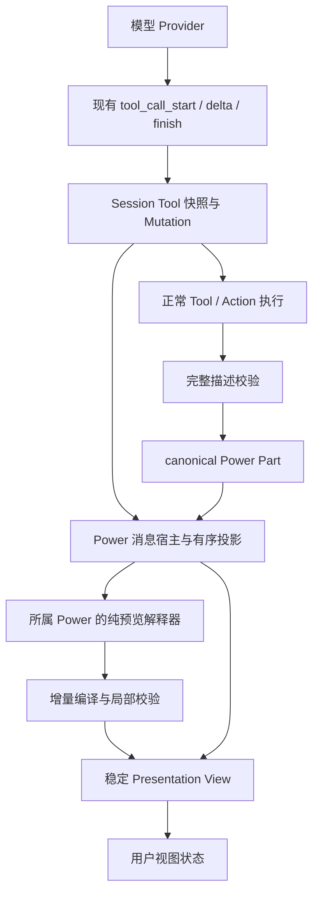

# Presentation 渐进生成体验 PRD 与架构设计

> 状态：设计方案，待原型验证和实施确认。
> 范围：在现有 Presentation 与 Power 消息底座上改善生成体验。
> 本文补充 [Presentation 首版 PRD](presentation-power-prd.md)，不代表功能已经实现。
> 本阶段不替换 Downcity 模型执行器、Session 存储或 Power 体系。

## 1. 目标与差距

用户应在界面描述完成前看到有意义的内容；界面随生成逐步完善，控件不反复重建，参数不会因后续生成丢失。文字、活动与模块继续按明确的消息顺序呈现。

当前链路必须等待完整 show 参数生成、完整校验、Action 执行与消息发布，再显示整个模块。当前 Renderer 以完整 Spec 字符串为 React key，不适合增量更新；加载期间还会显示“暂不可展示”，混淆正常生成与真实失败。

当前 json-render 0.21.1 已具备 createSpecStreamCompiler、createMixedStreamParser 和 compileSpecStream。本项目实验确认增量编译可以先建立容器，再加入子组件，但尚未测量真实 Provider 的时延和生成质量。

## 2. 成功体验

```text
生成开始
 → 原位显示稳定容器与生成状态
 → 标题与说明就绪
 → 控件、图表逐步出现
 → 完整描述通过校验
 → 同一视图进入就绪态
 → 用户操作和后续对话
```

必须区分：

- 提早呈现：缩短没有有意义反馈的等待。
- 局部更新：避免全量卸载、重绘和失去焦点。
- 表达质量：组件、图表、单位、响应式布局与 Downcity 主题一致。

动画不能代替前两项；本期不以追求特效作为完成标准。

## 3. 架构决策

1. 首选复用现有 Tool 输入流形成纯展示预览，不额外发起模型请求。
2. Agent / Session 只处理通用模型与 canonical 消息，不导入 json-render 或解析 Presentation Schema。
3. 业务预览解释器归所属 Power 的浏览器 Renderer，宿主提供可信的 Tool 快照和生命周期。
4. 预览由已有 Tool.input_text 派生，不单独保存为正式成功产物。
5. 正式输出仍走 ActionResult.messages 和完整校验，Session Power Part 是正式内容唯一事实源。
6. 预览到正式内容通过 source_tool_call_id 关联，使用稳定视图身份；不能使用整份 Spec 作为实例 key。
7. 先完成可观测原型，再选定具体流格式；不预先假定 JSONL 一定优于部分 JSON。
8. 模型直接输出文字与 UI 的混合流作为后续研究，不在本期增加另一套内容解析平台。

## 4. 架构关系



解释器只处理展示数据，不执行 Power、读取文件、发起模型请求或直接写入 Session。宿主不通过解析 args.action 等业务字段硬编码 presentation.show；是否支持预览由所属 Power 声明并解释。

## 5. 职责与最小契约

| 模块 | 新增职责 |
| --- | --- |
| City Power Renderer 协议 | 可选、只读的 Tool 预览契约及生成状态 |
| Presentation 浏览器模块 | 识别支持的动作，解析增量输入，产出可安全渲染的部分描述 |
| Desktop 消息投影与宿主 | 来源关联、实例身份、顺序、加载与终态切换 |
| Presentation View | 保持组件、状态与焦点，局部更新 |
| 现有 Session | 继续提供 Tool 输入累计值与标准 Mutation，持久化正式结果 |

预览解释器的概念输入：Tool Call 身份、工具输入累计文本、完整输入（若已具备）、当前 Tool 状态。输出为“本动作无预览”“准备中”“有可展示的业务预览”之一。具体类型放在 types 目录，每个字段写明语义。

只新增实际需要的能力，避免给所有 Renderer 注入执行句柄。若编译器需要增量状态，由消息视图实例拥有；累计输入用于重挂载重建。不能每个 token 都从头解析整份输入而产生平方级成本。实例卸载时释放编译缓存。

## 6. 流格式选择与原型门槛

### 候选 A：现有完整 Spec 的增量解析

保留当前 show 输入格式，从 Tool 参数流中解析已完整闭合的字段与组件。完整对象结束前不使用 JSON.parse 直接解释整段，也不能靠简单补括号推断合法结构。

优点是模型生成结构与现有动作接近。代价是部分 JSON 解析、字段先后顺序和超大数组的增量处理。

### 候选 B：工具参数承载 SpecStream

使用明确的补丁序列构建描述，再在 Action 收口时编译为正式 Spec。模型参数外壳、字符串转义和 Provider 缓冲可能延迟补丁出现，必须实测。

json-render 低层编译器可复用；不要为接入它采用新的会话执行器。首版只开放生成需要的最小补丁集合，逐条校验路径、大小与操作含义，不直接开放所有 RFC 6902 操作。

### 原型比较

同一模型、推理配置与场景，比较当前完整 Spec、候选 A、候选 B。记录输出字符 / token、首个有效组件、完整就绪、解析错误、终态失败和模型续答间隔。长表格、多个模块与中断场景都必须覆盖。

先检查各 Provider 是否真实转发 Tool 增量。若上游直到结束才提供输入，前端编译器不能解决该段等待，应明确记录能力限制。

选择门槛：至少一种方案在真实流中提前显示有效内容、没有增加正确性问题，且解析成本可控。没有达到门槛前，不切换生产协议。

## 7. 生命周期与展示状态

| 状态 | 含义 | 展示 |
| --- | --- | --- |
| preparing | 已识别生成意图，尚无可渲染组件 | 容器、明确生成提示与稳定占位 |
| streaming | 已有合法部分描述，输入仍在增长 | 就绪组件与未就绪区域占位 |
| validating | 输入完成，Action 尚未确认成功 | 保留预览，提交动作不可用 |
| ready | 正式 Power Part 已发布且支持其版本 | 同一实例进入可交互状态 |
| interrupted | Turn 停止或恢复后没有成功结果 | 明确“未完成”，不可误认为正式输出 |
| failed | 工具执行或完整校验失败 | 明确失败，保留可读解释与原位诊断入口 |
| unavailable | 缺少 Renderer 或版本不支持 | fallback_text 与原因 |

正常 loading 与 preparing 不能进入错误边界，也不显示“不可展示”。内置 Renderer 采用已注册定义，不为本来同步可用的实现制造额外加载闪烁。本地插件仍按既有可信 ESM 加载规则处理。

失败的部分预览不能作为可恢复成功 Spec 保存。刷新后的结果依据 Session Tool 终态和正式 Part 决定；进程中断必须沿既有 Tool 恢复规则收敛，不能依赖浏览器本地计时猜测结束。

## 8. 顺序与稳定身份

稳定关联使用 session_id、message_id、source_tool_call_id，最终 Part 仍保留自己的 canonical 身份。同一 Tool 可产生多个正式 Part；预览协议必须显式限定单模块，或提供可对应的输出键，不能默认任意多产物都与一个视图一一对应。

首版 Presentation show 一次对应一个模块。预览与正式输出由同一个宿主位置管理，最终输入通过后不能追加出第二份界面。

必须验证一个尚未解决的边界：预览通常产生在 Tool 位置，正式 Power Part 的 sequence 在工具完成时分配；并发工具或同 Step 后续文字可能出现在两者之间。不能通过最终把模块移到 Tool 前后，悄悄破坏已经确认的 canonical 顺序规则。

原型阶段必须测量实际事件顺序。若存在可见跨越，实施前选择并记录一种明确方案：

- 为生成内容设计 Session 拥有的预留输出位置，预览和正式内容共同占用；需要同步协议、存储与恢复设计。
- 将首版渐进预览限制在能保证顺序的生成路径，存在竞争内容时延迟预览并保持正式 sequence。

不接受“所有情况都不跳动”但没有顺序所有权的实现。本期默认先验证第二种受限路径，只有真实场景证明需要时再扩展 canonical 协议。

工具活动不能先出现一条、成功后突然移除并使内容大幅跳动。确认支持展示预览的工具从开始就由统一生成容器承载其状态；普通工具沿用原位活动。失败与待响应信息必须仍可访问。

## 9. 部分校验

当前完整校验要求全部引用存在与所有绑定初始化，不能原封不动用于生成中的快照。

局部校验需要：

1. 属性只接受目录允许的结构，阻断未知组件、危险路径与超限输入。
2. 缺少尚未到来的引用表示 pending，不能渲染为正式错误。
3. 组件必需属性和绑定类型齐备后才挂载；图表参数不全时显示占位。
4. Submit、外部动作等依赖最终验证的控件在 ready 前禁用。
5. 最终执行完整树、可达性、循环、边界、版本和大小校验。
6. 发现确定非法补丁时停止该预览更新，保留最后有效画面并显示状态；不能反复错误重试。

局部与最终校验共享目录定义，不能形成两套组件属性事实源。

## 10. 状态保护与更新

视图实例 key 使用稳定来源身份，元素 key 使用稳定组件 ID。内容 revision 或 Spec 文本变化不得重置整个视图。

分别维护生成的初始状态和用户实际操作状态：

- 新字段到来时只初始化尚不存在的字段。
- 用户已编辑字段标记为 dirty，后续生成不覆盖。
- 类型或约束改变使用户值失效时，明确提示并提供恢复行为，不静默重置。
- 正式收口确认最终初始值；Reset 恢复正式初始值。
- 正式完成前默认禁用参数编辑；可提前只读展示图表。若原型需要提前编辑，再验证 dirty 合并，不默认开放。
- 本地缓存仅保存 ready 对应的可恢复参数；保留首版大小和淘汰限制。

Renderer 注册表和处理器引用保持稳定，避免父消息文字流每次更新使 Submit / 输入组件重新挂载。修正完整 Spec key 的同时也需检查动态组件函数身份。

## 11. 视觉与交互质量

使用 Downcity 既有组件和语义设计令牌统一输入、按钮、焦点、错误、边框与主题。避免在每个生成模块里独立定义基础表单样式。

优先改善现有场景：

- 年利率显示百分比，内部保持小数；金额有单位与格式。
- 图表轴、刻度、结果摘要、无数据和边界状态可理解。
- 图表与控制器预留合理尺寸，减少完成时整块撑开。
- 窄屏采用纵向布局，宽屏再使用目录明确支持的布局。
- 增量内容可轻量过渡，遵循 reduced-motion，不逐 token 动画。
- 后续内容到来不夺取焦点，不强制把正在查看的用户拉到页面底部。

组件目录扩展以代表性需求为依据，不一次建设任意图形或表达式平台。

## 12. 可观测性与验收

### 记录时间点

- 请求提交、Provider 首事件。
- Presentation Tool 首个输入增量。
- 首个标题 / 有效组件可展示。
- 最后一个输入增量。
- 最终完整校验完成、正式 Part 发布。
- 客户端第一次绘制有效组件和进入 ready。

服务端与客户端分别记录单调时间间隔。跨进程时钟不能直接相减；使用关联 ID 连接日志，必要时采用明确的时钟同步方法。

记录解析 CPU 时间、快照大小、更新次数、组件重挂载次数、错误及视图状态丢失。避免记录敏感参数全文。

### 场景

复利模块、筛选表格、多个穿插模块、长数据、慢流、非法字段、缺少引用、中途停止、断开重连、并发工具和 Renderer 缺失。不同 Provider 独立统计，不把少量样例合成泛化承诺。

### 验收标准

- 完整输入结束前能看到有效组件；Provider 不支持增量时明确降级。
- 不新增模型请求，不重复显示预览和正式模块。
- 已出现内容顺序符合第 8 节规则，不隐式重排。
- 预览到 ready 的组件实例连续，参数、焦点和滚动位置不被意外重置。
- 生成中没有异常闪屏，不暴露未校验动作。
- 中断与失败有确定状态，历史恢复不呈现假成功。
- 本地操作不调用模型，交互与计算仍正确。
- 对比基线报告首个有效组件与最终完成时间的分布；没有测量不宣称提速比例。
- 原型可将本地批次处理到 UI 更新的 p95 100 ms 作为初始预算，确认测试设备与负载后再定正式门槛；该预算不是模型端到端响应承诺。

## 13. 实施阶段与交付

### 阶段 A：基线与技术原型

加入最小诊断，回放真实 Tool 流比较两种解析路径。验证 Provider 增量、输出顺序、一个调用对应一个模块及重挂载问题。交付比较记录、选择理由和明确的降级行为。

阶段 A 不直接启用生产渐进协议，不使用真实业务提交做基准。

### 阶段 B：稳定视图与加载状态

移除完整 Spec key，稳定组件和处理器身份；区分 loading / unavailable；统一基础控件和单位显示。该阶段可以独立验证，无需等待流式协议完成。

### 阶段 C：渐进预览闭环

落实 Renderer 预览契约、局部校验、状态机、正式结果切换及受限顺序策略。覆盖停止、重连和用户状态保护。

### 阶段 D：产品验收

真实 Desktop 会话验证生成、调整、刷新、提交和后续回答。更新 PRD、用户文档与实施记录，按实际公开 API 变化处理包版本。未经明确要求不提交、推送或发布。

## 14. 研究依据与限制

- OpenAI Intelligent UI：https://openai.com/index/gpt-6-for-everyone 。公开描述包含可流式组件库、编译器与界面设计训练；本轮通过官方搜索索引核对，未获取内部协议或真实会话网络时序。
- json-render Streaming：https://json-render.dev/docs/streaming 。JSONL Patch 与低层增量编译器。
- json-render Generation Modes：https://json-render.dev/docs/generation-modes 。Standalone / Inline；示例的文字与 Spec 聚合不能直接代替 Downcity 有序消息模型。
- json-render AI SDK：https://json-render.dev/docs/ai-sdk 。集成示例可参考，不引入其会话管理。
- Tambo：https://tambo.co/blog/posts/introducing-tambo-generative-ui 。参考部分 props、生命周期和状态问题，不替换 Downcity Agent 后端。

未实测 ChatGPT 首屏延迟，不将产品演示和官方描述当作性能基准。当前方案复用同类工程原则，不声称复刻 ChatGPT 内部实现。
