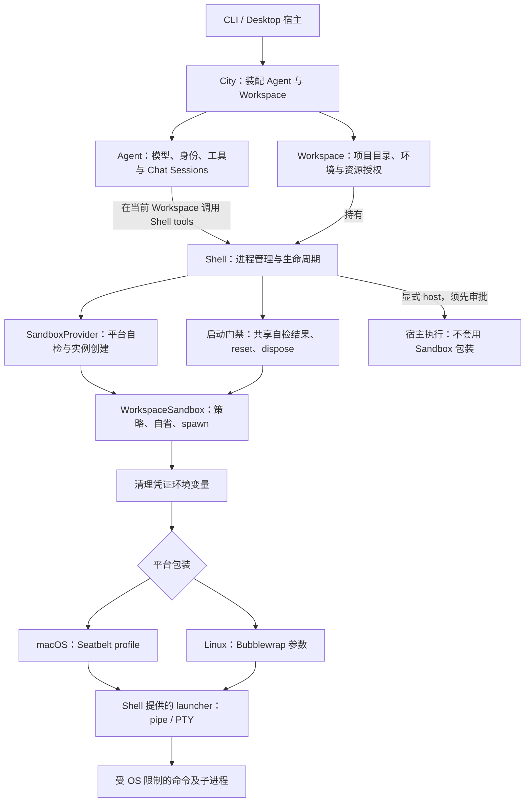
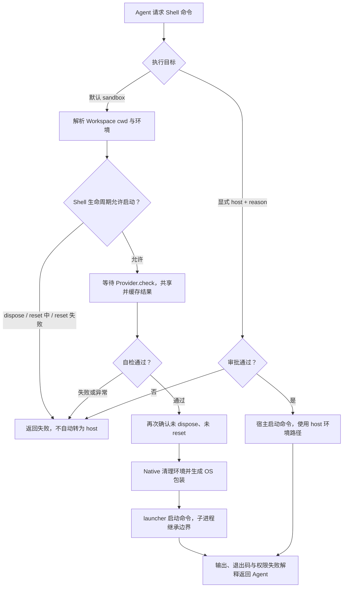
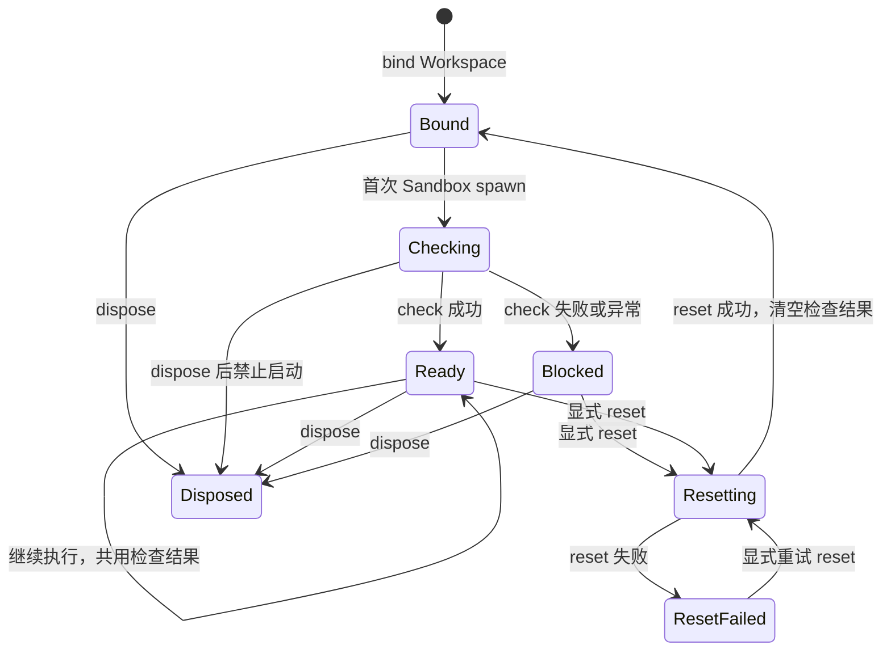

# Sandbox 当前架构与 Agent 场景

本文描述当前实现，而非未来规划。默认 CLI/Desktop 使用 NativeSandboxProvider：在宿主真实工具链上为命令施加 OS 边界。Workspace 持有 Shell，Shell 持有 Provider、WorkspaceSandbox 和 Shell Sessions；Chat Session 不拥有独立虚拟机。

## 架构归属

Provider 协议可替换，仓库还保留 Microsandbox 后端。上图的环境清理和 Seatbelt/Bubblewrap 路径属于 Native 实现。City 不需要理解具体平台隔离参数。

## Agent 一次命令的执行

审批还可能因工具规则等因素出现在 Sandbox 路径中，图中突出的是跨越 Sandbox 的 host 审批。SDK 短命令同样经过 Shell 的 spawn 门禁。直接使用 Provider 的调用方自行负责调用 check；门禁由 Shell 拥有。

## 文件、网络、凭证边界

| 维度 | 当前逻辑 |
| --- | --- |
| 项目路径 | Native 保持宿主绝对路径；不映射为 `/workspace` |
| 默认读取 | 宿主文件可读，平台受保护路径除外；不是 Workspace 读取白名单 |
| 默认写入 | Workspace、runtime、平台临时目录、设备支持规则及显式 rw 授权 |
| 只读授权 | read 子树禁止写入，即使位于可写根内部 |
| 受保护内容 | macOS 默认保护 `~/.ssh`、`~/Library/Keychains`；Linux 默认保护 `~/.ssh`、`~/.gnupg` |
| 规则优先级 | 限制优先；deny/read 子树不能通过 write 授权重新开放 |
| Linux 遮蔽 | 受保护内容由空挂载替代；可能读到空内容，不一定返回权限错误 |
| 网络 | allow / deny，默认 allow；没有域名白名单与认证代理 |
| 环境凭证 | Native 按名称过滤 token、secret、password、API key、credential 等及 SSH agent 变量 |
| 凭证例外 | 仅宿主 Provider 配置 allowed_credential_env 精确授权；Downcity 内部令牌不可放行 |
| 文件工具 | read/write/edit/search 等按各自 Workspace 规则执行；OS Sandbox 主要约束 Shell 进程，不覆盖整个 Agent、MCP 或浏览器 |

Native 并未为每个 Workspace 创建独立 HOME、临时目录或机器。默认宿主可读、临时目录共享、macOS mach-lookup 较宽，意味着它不提供敌对多租户隔离。变量清理也无法阻止 login 配置或可读文件重新提供凭证。

## 从 Agent 和用户任务看

| 场景 | 执行与行为 | 可能需要的处理 |
| --- | --- | --- |
| 修改项目、运行测试 | 当前 Workspace 内启动，进程受 OS 边界约束 | 首次运行等待平台自检 |
| 安装项目依赖 | 项目目录可写，默认允许联网 | 用户 HOME 的包缓存未必可写，需要明确授权缓存目录或使用项目内缓存 |
| 读取额外资料 | Shell 可以读取受保护路径以外的宿主文件；内建文件工具仍受 Workspace 规则约束 | 不应将文件工具拒绝理解为所有 Shell 路径都不可读 |
| 使用只读参考目录 | 可以读，不能改写；即使父目录可写也不能覆盖 | 需要改写时由宿主调整绑定，尚无运行中 request_mount 审批流 |
| git status / diff | 可读取仓库，通常在 Sandbox 内运行 | .git 当前并未自动特殊保护，只受所在路径的写权限约束 |
| git push / 私有包安装 | SSH agent 和 token 变量默认被过滤 | 宿主精确放行所需变量，或显式 host 审批；完整凭证代理尚未实现 |
| 写项目外文件、全局安装 | 可写根之外被 OS 拒绝 | 选择允许路径、宿主预先授权目录，或显式申请 host 执行 |
| 本地开发服务 | 使用 Shell Session / PTY；网络 allow 仍不等于所有入站监听都支持 | macOS 对 bind/listen 的能力应另做场景验证 |
| 两个 Agent 共享 Workspace | 使用同一个 Workspace 的 Shell 与文件边界 | Chat Session 身份不产生额外文件隔离，不能作为多租户安全边界 |
| 多个 Workspace | 各自 Shell、检查状态和进程管理独立 | HOME、临时目录和其他显式共享授权仍可能重叠 |
| 平台自检失败 | Shell 缓存失败，后续命令继续拒绝 | 成功 reset 后下条命令重查；不支持 reset 的 Provider 重建 Shell/Workspace |
| 关闭 Workspace | 拒绝新调用，收口在途启动与 Shell Sessions，再 stop Sandbox | Native 没有持久 VM；已写入项目的文件保留 |

## 生命周期

检查是平台级可用性探针，不是所有 Workspace 授权规则的逐项验收。实现及验证详情见 sandbox-policy-hardening.md。当前 macOS 与 Linux 均有真实文件和 TCP loopback 验证，Linux 已在 Node 22.23.4 下通过；完整 CLI/Desktop、PTY、所有网络协议和恶意并发路径替换并未因此自动完成验收。
