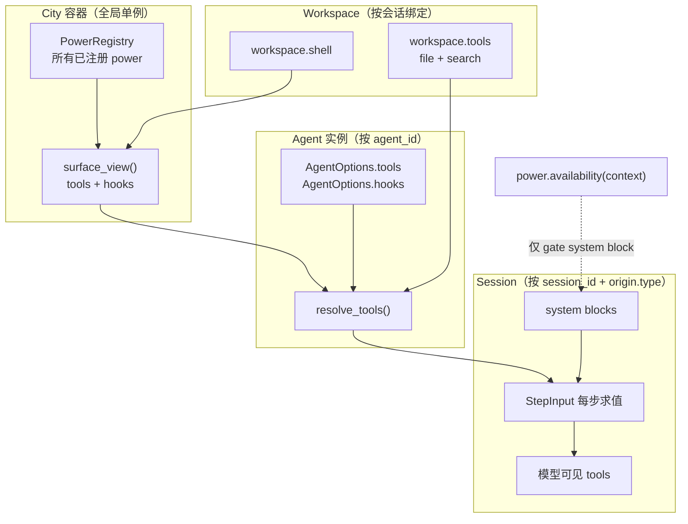

# Session 与 Agent 边界权威定义

> 状态：当前实现的权威边界定义（冻结参数面、来源分区与身份规则、能力边界矩阵）
>
> 适用范围：`@downcity/type`、`@downcity/agent`、`@downcity/city`、`@downcity/powers`、`downcity` CLI、`private/apps/desktop`、`private/apps/chrome-extension`
>
> 更新时间：2026-10-21
>
> 关联输入：[`session-runtime-architecture.md`](./session-runtime-architecture.md)、[`session-architecture.md`](./session-architecture.md)、[`agent-chat-design.md`](./agent-chat-design.md)、[`engineering-design-standard.md`](./engineering-design-standard.md)

## 0. 文档定位

本文独立承载，不并入也不替代既有文档，理由如下。

[`session-runtime-architecture.md`](./session-runtime-architecture.md) 记录的是组件边界与执行不变量（谁拥有 Session 实例、Command 与 Turn 的关系、system 单一组装路径）。它不回答「哪类会话拥有哪些工具和 power」，也不定义 `origin.type` 的取值范围。两份文档的读者与失效条件不同：组件边界随执行链重构而变化，能力边界随产品角色增减而变化。合并会让任一方改动都触发整篇复核。

[`agent-chat-design.md`](./agent-chat-design.md) 是一份把「Session 角色与 Workspace 能力重设计」写成未来时态的设计稿，头部标注「设计稿，待实施」。核实结论是：**该文档的核心主张已经落地**，头部状态已过期。它不应再作为边界定义使用，因为「设计稿」不能承担「当前事实」的权威职责。本文第 2.4 节逐条给出核实结论，并建议该文档改标注为「已实施，实现边界见本文」。

`origin.type` 的取值当前是任意非空字符串（[`SessionOrigin.ts:33`](../packages/type/src/types/session/SessionOrigin.ts)），而 `session-architecture.md` 与 `session-runtime-architecture.md` 都没有列出实际在用的值。这使「新增一个角色」在代码上零成本，在语义上无边界。本文冻结实际取值与其判定点。

阅读须知：本文严格区分两类陈述。

- **确认事实**：已追到实际调用点，给出文件与行号。
- **待验证疑点**：仅有命名或注释支撑，或存在多处不一致，需要产品决策。

第 2 节只写当前实现，第 3 节只写建议收敛。任何建议都不会被写成已实现。

---

## 1. 结论摘要

参数面分三层：`AgentOptions`（构造期、宿主与调用方共同填写）、`SessionOptions`（Session 装配期、由 `AgentSessions` 内部填充，不是 SDK 用户参数）、以及面向 SDK 用户的会话操作入参。真正由外部调用方决定「这是什么会话」的字段只有一个：`AgentCreateSessionInput.origin`。

来源分两层：`category` 封闭为 `chat` / `work` 两个值，同时承担存储分区与身份作用域；
`type` 是具体角色，已知六个（`agent` / `channel` / `group` / `chrome` / `work` / `task`），
全部由 `@downcity/type` 导出常量。自定义角色仍允许，但必须显式给出分类，否则创建失败。

能力判定按分类展开：`chat` 类的会话可以协调其他会话（`session` 系列动作与 `agent.delegate`），
能力判定分两个维度：派发能力按派发深度（`can_delegate_work`，上限 3）判定，与分类无关，任何会话都可派发，但层数用尽后停止；归档只接受 `work` 类。分类仍承担分区职责。

因此当前实现的心智模型是：**所有会话共用一套能力，差别来自「在哪干活」；少数协调类动作再按角色收紧**。这个模型本身是自洽的，但缺少登记与文档，导致「角色」事实上退化成了「分区名」。

---

## 2. 当前实现

### 2.1 参数面清单表

#### 2.1.1 AgentOptions（构造期）

定义于 [`AgentOptions.ts:33`](../packages/agent/src/types/agent/AgentOptions.ts)。这一层由宿主在 `new Agent({...})` 时填写，**不区分会话来源**：所有会话共享同一个 Agent 实例的 `tools`、`model`、`instruction`。

| 字段 | 类型 | 默认值 | 归属层 | 是否稳定 | 备注 |
| --- | --- | --- | --- | --- | --- |
| `callbacks` | `SessionCallbacks` | 无 | 调用方 | 稳定 | 请求级完成回调注册表；prompt 只保存名称与参数 |
| `id` | `string` | 必填 | 调用方 | 稳定 | 决定 `agents/<agent_id>/` 分区；也是 `agent` 会话的 `session_id` |
| `name` | `string` | 回退到 `id` | 调用方 | 稳定 | 模型理解的角色名，同时进入 Group 语义调度 |
| `description` | `string` | 无 | 调用方 | 稳定 | 展示与 Group 调度；不替代 `instruction` |
| `tools` | `Record<string, Tool>` | 无 | 调用方 | 稳定 | Agent 级工具；与 Workspace、Power 工具合并时同名立即失败 |
| `hooks` | `ToolHookSet` | 无 | 调用方 | 稳定 | 与容器 Power hooks 合并，容器在前 |
| `instruction` | `string \| string[]` | 包内最小 core fallback | 调用方 | 稳定 | 只决定 Agent block 中间一段；identity 与 core 由 SDK 注入 |
| `model` | `ModelClient` | 无 | 宿主 | 稳定 | Agent 只持有实例，不选择也不恢复 |
| `workspace` | `WorkspaceRuntime` | 无 | 宿主 | 稳定 | **仅新会话默认目录**，不参与恢复（[`Agent.ts:138`](../packages/agent/src/agent/Agent.ts) 起构造） |
| `resolve_work_workspace` | `(workspace_id) => Promise<WorkspaceRuntime>` | 无 | 宿主 | 稳定 | `session.start` 解析项目目录的唯一入口；未提供时禁止派发项目工作 |
| `prepare_work_session` | `(session, model_id?) => Promise<void>` | 无 | 宿主 | 稳定 | 委派执行前的宿主装配；必须幂等 |
| `resolve_work_model` | `(model_id, workspace?) => Promise<ModelClient>` | 无 | 宿主 | 稳定 | 必须拒绝未知模型 |
| `session_class` | `AgentSessionConstructor` | 内置 `Session` | 宿主 | 稳定 | 仅适用于本地 `Agent` |
| `session_composer` | `SessionComposer` | `DefaultSessionComposer` | 宿主 | 稳定 | Agent 级、被所有 Session 共享，实现必须无状态 |

归属层的判据是「谁拥有该资源的生命周期」。Workspace、Model 由宿主持有，所以它们是宿主字段；`instruction`、`tools` 由调用方声明，所以是调用方字段。这张表里没有「会话来源」相关字段，这是刻意的：角色不是 Agent 属性。

#### 2.1.2 SessionOptions（装配期）

定义于 [`SessionOptions.ts:52`](../packages/agent/src/types/session/SessionOptions.ts)。这一层**不是 SDK 用户参数**，由 `AgentSessions.get_or_create_session()` 在 [`AgentSessions.ts:546`](../packages/agent/src/agent/AgentSessions.ts) 起组装。只有自定义 `session_class` 的实现者需要读它。

| 字段 | 类型 | 默认值 | 归属层 | 是否稳定 | 备注 |
| --- | --- | --- | --- | --- | --- |
| `completions` | `SessionCompletionPort` | 无 | SDK core | 演进中 | Turn 终态前的完成事件写前日志 |
| `archive_session` | `(session_id) => Promise<AgentArchiveSessionResult>` | 无 | SDK core | 演进中 | 由拥有者归档，负责索引与存储清理 |
| `agent_id` | `string` | 必填 | SDK core | 稳定 | |
| `get_agent_name` | `() => string` | 必填 | SDK core | 稳定 | 实时读取，使重配身份立即生效 |
| `get_agent_description` | `() => string` | 必填 | SDK core | 稳定 | 同上 |
| `workspace` | `WorkspaceRuntime` | 无 | 宿主 | 稳定 | 会话当前目录；可通过 `set({ workspace })` 切换 |
| `workspace_path` | `string` | 必填 | SDK core | **待验证** | 仅用于无 Workspace 时的 system 快照与项目根展示；`build_session_system_blocks` 要求非空，见第 4 节 Q4 |
| `origin` | `SessionOrigin` | 必填 | 调用方 | 稳定 | 唯一决定分区与角色身份的字段 |
| `store` | `SessionStorage` | 必填 | SDK core | 稳定 | 本 Session 独占的领域持久化视图 |
| `create_session_store` | `(session_id) => SessionStorage` | 必填 | SDK core | 稳定 | 供 fork 创建子 Session |
| `allocate_session_id` | `() => Promise<string>` | 无 | SDK core | 演进中 | fork 用小写短 ID |
| `register_forked_session` | `(session) => void` | 必填 | SDK core | 稳定 | `AgentSessions` 仍是实例唯一所有者 |
| `session_id` | `string` | 必填 | SDK core | 稳定 | |
| `get_tools` | `() => Record<string, Tool>` | 必填 | SDK core | 稳定 | **每个 Step 检查点重新求值**，见 [`StepInput.ts:292`](../packages/agent/src/session/input/StepInput.ts) |
| `logger` | `Logger` | 必填 | SDK core | 稳定 | |
| `instruction_system_blocks` | `AgentSessionSystemBlock[]` | 必填 | SDK core | 稳定 | 创建时固定，之后不再动态读取 Agent instruction |
| `get_instruction_system_blocks` | `() => AgentSessionSystemBlock[]` | 必填 | SDK core | 稳定 | 仅供 `syncshot()` 重新生成 |
| `get_workspace` | `() => WorkspaceRuntime \| undefined` | 必填 | SDK core | 稳定 | 未绑定时返回 undefined |
| `get_hooks` | `() => ToolHookSet` | 必填 | SDK core | 稳定 | 每个 Step 检查点重新求值 |
| `get_agent_model` | `() => ModelClient \| undefined` | 必填 | SDK core | 稳定 | 会话未设模型时的回退来源 |
| `composer` | `SessionComposer` | Agent 的 composer | SDK core | 稳定 | |

#### 2.1.3 相邻对外参数

| 类型 | 定义位置 | 字段 | 归属层 | 是否稳定 | 备注 |
| --- | --- | --- | --- | --- | --- |
| `AgentCreateSessionInput` | [`SessionTypes.ts:24`](../packages/agent/src/types/agent/SessionTypes.ts) | `origin?: SessionOrigin` | 调用方 | 稳定 | 省略时为 `{ type: "work" }`；**调用方唯一可声明角色的入口** |
| `AgentCreateSessionOptions` | [`AgentSessionCollection.ts:23`](../packages/agent/src/types/agent/AgentSessionCollection.ts) | `workspace?: WorkspaceRuntime` | 宿主 | 稳定 | 省略时用 Agent 默认目录，都没有则该会话无项目上下文 |
| `AgentGetSessionOptions` | [`AgentSessionCollection.ts:29`](../packages/agent/src/types/agent/AgentSessionCollection.ts) | `workspace?: WorkspaceRuntime` | 宿主 | 稳定 | 与持久化值不一致**不再报错**，以传入值为准 |
| `AgentListSessionsInput` | [`SessionTypes.ts:36`](../packages/agent/src/types/agent/SessionTypes.ts) | `origin_type?`, `workspace_id?`, `limit?`, `cursor?`, `query?` | 调用方 | 稳定 | `origin_type` 省略时为 `work`（注释仍写 `chat`，见 2.4） |
| `AgentArchiveSessionInput` | [`SessionTypes.ts:393`](../packages/agent/src/types/agent/SessionTypes.ts) | `id: string`, `origin_type?` | 调用方 | 稳定 | |
| `AgentArchiveSessionsInput` | [`SessionTypes.ts:409`](../packages/agent/src/types/agent/SessionTypes.ts) | `origin_type?`, `workspace_id?`, `limit?` | 调用方 | 稳定 | |
| `AgentSessionSetInput` | [`SessionTypes.ts:78`](../packages/agent/src/types/agent/SessionTypes.ts) | `model?`, `security?`, `workspace?: WorkspaceRuntime \| null` | 宿主 | 稳定 | `null` 表示脱离项目上下文；执行中的 Turn 沿用旧值 |
| `AgentSessionSetOptions` | [`SessionTypes.ts:110`](../packages/agent/src/types/agent/SessionTypes.ts) | `persist_action?`, `publish_mutation?` | 宿主 | 稳定 | 默认 `true`；`publish_mutation` 默认跟随 `persist_action` |
| `RemoteSessionSetInput` | [`SessionTypes.ts:138`](../packages/agent/src/types/agent/SessionTypes.ts) | `model_id?`, `security?` | 调用方 | 稳定 | 远程边界只传可序列化 ID，服务端解析为实例 |
| `AgentSessionInput` | [`AgentSessionInput.ts:12`](../packages/agent/src/types/agent/AgentSessionInput.ts) | `workspace?: WorkspaceRuntime` | 宿主 | 稳定 | `agent.session()` 的入参；已存在时被忽略 |
| `RemoteAgentOptions` | [`RemoteAgentOptions.ts:12`](../packages/city/src/types/remote/RemoteAgentOptions.ts) | `url: string`, `token?: string` | 调用方 | 稳定 | `rpc://` 不读也不发 token |
| `GroupSessionCreateInput` | [`GroupSession.ts:70`](../packages/agent/src/types/group/GroupSession.ts) | Group 名册与调度策略 | 宿主 | 稳定 | 与 Agent 会话角色正交 |

**`session.set()` 的可读键是唯一的状态读取契约**，定义于 [`SessionState.ts:24`](../packages/agent/src/types/agent/SessionState.ts)，实现见 [`Session.ts:299`](../packages/agent/src/session/Session.ts)：`workspace`、`workspace_id`、`model`、`model_label`、`model_context_window`、`approval_mode`、`title`、`timezone`、`created_at`、`updated_at`。其中 `workspace` 与 `model` 是进程内实例，其余可跨进程。新增状态只扩展这张表，不新增 API。

审批模式只有两个值：`"ask"` / `"always-allow"`（[`SessionInteraction.ts:21`](../packages/type/src/types/session/SessionInteraction.ts)），默认 `"ask"`（[`SessionState.ts:43`](../packages/agent/src/session/loop/SessionState.ts)）。它按 Session 持久化，**没有任何按 `origin.type` 的差异化默认值**。

### 2.2 来源分区与身份规则权威表

#### 2.2.1 常量与类型

[`SessionOrigin.ts`](../packages/type/src/types/session/SessionOrigin.ts) 导出两个分类常量与六个角色常量，并且 `category` 在类型层面是封闭联合：

| 符号 | 值 | 含义 |
| --- | --- | --- |
| `SESSION_ORIGIN_CATEGORY_CHAT` | `"chat"` | 顶层分类之一，承担分区与身份作用域 |
| `SESSION_ORIGIN_CATEGORY_WORK` | `"work"` | 另一个顶层分类，也是默认值 |
| `SESSION_ORIGIN_TYPE_AGENT` | `"agent"` | Agent 主会话 |
| `SESSION_ORIGIN_TYPE_CHANNEL` | `"channel"` | 外部聊天 |
| `SESSION_ORIGIN_TYPE_GROUP` | `"group"` | 群聊成员会话 |
| `SESSION_ORIGIN_TYPE_CHROME` | `"chrome"` | 浏览器扩展会话 |
| `SESSION_ORIGIN_TYPE_WORK` | `"work"` | 普通工作会话 |
| `SESSION_ORIGIN_TYPE_TASK` | `"task"` | 任务会话 |

`SessionOrigin.category` 的类型是 `SessionOriginCategory`（两个字面量的联合），`SessionOrigin.type` 仍是 `string`。所有已知角色都在 `ORIGIN_CATEGORY_BY_TYPE` 里登记了所属分类。

自定义角色依然允许，但必须显式给出分类。`normalize_session_origin` 会用登记表推断分类，遇到未知角色且未声明分类时直接报错，而不是静默落到默认分区；分类与已知角色的登记不符时也会报错。这个取舍让「新增角色」仍然零成本，而「新增一个分区」需要显式表达。

前一轮审计记录的「`SESSION_ORIGIN_TYPE_CHANNEL` 导出即零引用」已不复存在：所有判定点都改为引用常量。

#### 2.2.2 权威表

下表列出的每个值都追到了实际调用点。`session_id` 规则与分类映射来自 [`SessionOrigin.ts`](../packages/type/src/types/session/SessionOrigin.ts)，物理分区来自 [`LocalStorePaths.ts`](../packages/agent/src/session/storage/LocalStorePaths.ts)。

| `type` 值 | 分类 | `session_id` 规则 | 物理存储分区 | 创建入口 |
| --- | --- | --- | --- | --- |
| `agent` | `chat` | **等于 `agent_id`**（[`AgentSessionIdentity.ts:27`](../packages/agent/src/agent/AgentSessionIdentity.ts)） | `sessions/chat/<agent_id>/` | `agent.session()`（[`Agent.ts:272`](../packages/agent/src/agent/Agent.ts)）→ `AgentSessions.self()`；Desktop 经 `open_agent_session()` |
| `channel` | `chat` | 12 位随机小写短 ID（[`SessionIdentity.ts:8`](../packages/agent/src/session/SessionIdentity.ts)） | `sessions/chat/<session_id>/` | Messenger 入站路由：[`MessengerRuntime.ts:122`](../packages/implementations/powers/src/messenger/runtime/MessengerRuntime.ts)、[:473](../packages/implementations/powers/src/messenger/runtime/MessengerRuntime.ts)、[:567](../packages/implementations/powers/src/messenger/runtime/MessengerRuntime.ts)、[`MessengerAccountHostActions.ts:383`](../packages/implementations/powers/src/messenger/host/MessengerAccountHostActions.ts) |
| `group` | `chat` | 12 位随机小写短 ID | `sessions/chat/<session_id>/` | `GroupSession.create_member_session()`，每个成员 Agent 一条，附带 `group_id` / `group_session_id` |
| `chrome` | `chat` | 12 位随机小写短 ID | `sessions/chat/<session_id>/` | Chrome 扩展侧 `agent.sessions.create({ origin: { category: "chat", type: "chrome" } })`（[`cityClient.ts:91`](../../private/apps/chrome-extension/src/services/cityClient.ts)） |
| `work` | `work` | 12 位随机小写短 ID | `sessions/work/<session_id>/` | `agent.sessions.create()` 省略 `origin`；委派经 `ensure_work_session()`；Desktop `create_session()`；CLI [`execute.ts:89`](../packages/cli/src/city/agent/http/execute/execute.ts) |
| `task` | `work` | 12 位随机小写短 ID | `sessions/work/<session_id>/` | Task power（[`TaskRunnerSession.ts:41`](../packages/implementations/powers/src/task/runtime/TaskRunnerSession.ts)）：`executor` 与 `user_simulator` 两条，附带 `task_id` / `execution_id` / `role` |

**自定义角色**：仍是任意非空字符串，但必须显式声明 `category`。测试用例把 `automation/daily` 挂在 `work` 分类下跑通完整生命周期（[`agent-store.test.mjs`](../packages/city/test/agent-store.test.mjs)）。只有分类会进入目录名，角色只存在于 `session_state.origin` 里。

#### 2.2.3 物理分区与身份规则

分区是两级目录：`sessions/<category>/<session_id>/`，归档落在 `archived-sessions/<category>/<session_id>/`。物理分区只有 `chat` 与 `work` 两个，每个 Session 目录下是 `session.db`（SQLite，canonical Message 唯一事实源）与附件目录。

三条身份规则值得单列，因为它们决定了「同一个 `session_id` 是否唯一」。

`session_id` 只在分类内唯一，不跨分类唯一。进程内缓存键是 `[agent_id, category, session_id]` 三级拼接。Desktop 侧按 `[agent_id, workspace_id, session_id, category, origin_type]` 组键：分类承担分区，角色额外参与是因为主会话与外部聊天同属 `chat` 且共用 Agent 私有 `main` 目录，只靠分类会把两者当成同一个会话（[`SessionAddressKey.ts`](../../private/apps/desktop/src/main/agent/SessionAddressKey.ts)）。

`origin` 与分区必须一致。读元数据时 `restore_session_origin` 会校验 `origin.category === expected_category`，不一致直接抛错。这是防止「文件在 A 分区、元数据自称 B 分区」的唯一硬校验。

**Workspace 不是身份，也不参与恢复校验。** 宿主注入的 Workspace 直接成为该会话的新当前目录，语义等同 `set({ workspace })`；不注入则沿用内存实例，内存也没有则该会话没有项目上下文。

#### 2.2.4 已废弃与仅存于文档的取值

`chat` 曾是一等角色，现在**在代码中已完全消失**。它只残留在三处：

- [`packages/agent/README.md:37`](../packages/agent/README.md) 与 :39 仍写「默认来源是 `{ type: "chat" }`」与 `origin_type = "chat"`。
- [`SessionTypes.ts:36`](../packages/agent/src/types/agent/SessionTypes.ts) 与 :410 的注释仍写「省略时只查询 `chat`」。
- [`SessionTypes.ts:401`](../packages/agent/src/types/agent/SessionTypes.ts) 注释仍写「省略时使用 `chat`」。

实际默认值一律是 `work`（[`AgentSessions.ts:469`](../packages/agent/src/agent/AgentSessions.ts)、[:486](../packages/agent/src/agent/AgentSessions.ts)、[`Browse.ts:223`](../packages/agent/src/session/storage/Browse.ts)）。`public/packages` 下已无任何 `chat` 作为会话来源的赋值。

另有两个值只出现在测试里，不代表已实现的产品角色：`desktop`（[`messenger-inbound-prompt-parts.test.mjs:149`](../packages/implementations/powers/scripts/messenger-inbound-prompt-parts.test.mjs)）与被当作反例的 `{ type: "work" }` 邻域值。`desktop` 需要产品确认是「计划中的角色」还是「测试占位」。

### 2.3 能力边界矩阵

#### 2.3.1 注入链路

先看工具与 power 是怎么进到会话里的。这条链路决定了矩阵的行为什么大多相同。

关键结论在 [`Agent.ts:462`](../packages/agent/src/agent/Agent.ts) 的 `resolve_tools()`：工具集合 = `workspace.tools` + `host.power_tools` + `AgentOptions.tools`，**三个来源都不读 `origin.type`**。`host.power_tools` 来自容器全局注册表（[`City.ts:182`](../packages/city/src/city/runtime/City.ts)），因此同一个 City 下所有 Agent 的所有会话看到的 power 工具集合完全相同。异构来源（如 Task power、Messenger power）靠「是否安装进这个 City」区分，不靠会话角色区分。

`availability()` **不裁剪工具面**。需要单独强调，因为它容易被误读：`PowerRegistry.tools()` 编译工具时完全不调用 `availability`（[`PowerRegistry.ts:116`](../packages/city/src/power/core/PowerRegistry.ts)），`Power.invoke_tool()` 也不检查它。`availability` 只在 `create_system_handler` 里被读一次，作用是决定该 power 的 `system()` 文本是否注入（[`Power.ts:205`](../packages/city/src/power/Power.ts)）。所以 `SessionPower.availability()` 返回 `available: false` 时，模型**仍然看得见 `session` 工具**，只是 system 里不再出现该 power 的说明；真正拦截发生在执行期的 `require_session_coordinator`。

#### 2.3.2 矩阵

列含义：**工具组**指 Workspace 的 file + search 工具（Shell 不在其中，它只在模型面以 `shell` power 暴露一次，见 [`WorkspaceTools.ts`](../packages/city/src/workspace/tool/WorkspaceTools.ts) 文件注释）；**power** 指容器已注册的全部 power 工具；**workspace 权限**指该角色在真实宿主中能拿到什么目录；**system profile** 指该角色的 system 组成差异；**审批范围**指 `approval_mode` 的取值来源。

| 会话来源 | 工具组 | power | workspace 权限 | system profile | 审批范围 |
| --- | --- | --- | --- | --- | --- |
| SDK 层：无 WS 的任意角色 | 无 | 全部已注册 | 无（无文件工具、无 Shell，纯模型对话可用） | instruction + core + 非 Workspace-prompt 的 power block + session block | per-Session，默认 `ask` |
| `agent`（SDK 直用） | 取决于是否注入 WS | 全部已注册 | 由宿主注入；不注入则无 | 同上 | per-Session，默认 `ask` |
| `agent`（Desktop 宿主） | 有 | 全部已注册 | 固定 `~/.downcity/agents/<agent_id>/main`，**禁止绑定项目 Workspace**（[`AgentController.ts:996`](../../private/apps/desktop/src/main/agent/AgentController.ts)） | 同上 + 平台 prompt 不注入 | per-Session，默认 `ask` |
| `work` | 有 | 全部已注册 | 用户登记的项目 Workspace；未登记即拒绝（[`AgentController.ts:1547`](../../private/apps/desktop/src/main/agent/AgentController.ts)） | 同上 | per-Session，默认 `ask` |
| `channel` | 有 | 全部已注册 | Desktop 下默认共享 Agent 私有 `main`；显式项目目录优先（[`AgentController.ts:1535`](../../private/apps/desktop/src/main/agent/AgentController.ts)） | 额外注入 messenger power prompt + 对应平台 prompt（`channel` 为 `telegram`/`feishu` 时） | per-Session，默认 `ask` |
| `group` | 有（继承 GroupSession 的 WS） | 全部已注册 | 跟随 GroupSession 绑定的 Workspace | 同上；成员身份进入 Group 调度上下文 | per-Session，默认 `ask` |
| `task` | 有（继承创建时的 WS） | 全部已注册 | 跟随创建时的 Workspace | 同上；`executor` / `user_simulator` 由 `origin.role` 区分，不改变能力面 | per-Session，默认 `ask` |
| `chrome` | 无（扩展侧不注入 Workspace） | 全部已注册 | 无 | 同上 | per-Session，默认 `ask` |

矩阵里唯一真正按角色分野的是 workspace 权限列，而它的实现依据是**宿主自己维护的注册表**，不是 SDK 的 `origin.type` 判定。SDK 层无法、也不应该阻止调用方给 `chrome` 会话注入 Workspace——这是宿主责任。

#### 2.3.3 全部按 `origin.type` 判定的点

上面矩阵的「都一样」不是疏漏，而是事实。全仓库按 `origin.type` 做能力判决的位置只有八处，现全部列出，这是本文最需要冻结的清单。

| 位置 | 判定 | 语义 |
| --- | --- | --- |
| [`SessionPower.ts`](../packages/city/src/city/power/builtin/session/SessionPower.ts) `availability` | `can_delegate_work(origin)` | 只 gate 该 power 的 system block |
| [`SessionCaller.ts`](../packages/city/src/city/power/builtin/session/SessionCaller.ts) `require_session_coordinator` | `can_delegate_work(origin)` → 派发深度 < 3 | **真正的硬拦截**：`session.*` 与 `agent.delegate` 的执行期守卫，阻止派发层数失控 |
| [`SessionWork.ts`](../packages/agent/src/agent/SessionWork.ts) `archive` | 分类为 `work` 则允许 | `session.archive` 只接受工作分类 |
| [`SessionWork.ts`](../packages/agent/src/agent/SessionWork.ts) 清单 | 排除角色为 `agent` 的会话 | 会话清单不列「自己」 |
| [`SessionDelegations.ts`](../packages/agent/src/agent/SessionDelegations.ts) `send` | 必须 `work` 分类且有 `workspace_id` | `session.send` 只续接项目工作会话 |
| [`GroupSession.ts`](../packages/agent/src/group/GroupSession.ts) `assert_member_session_origin` | 角色为 `group` 且 `group_id`/`group_session_id` 匹配 | 恢复成员会话时校验归属 |
| [`MessengerEnvironment.ts`](../packages/implementations/powers/src/messenger/runtime/MessengerEnvironment.ts) | 角色为 `channel` 且有 `chat_id` 与有效平台 | 选择平台 prompt、构造本轮环境事实 |
| [`MessengerPower.ts`](../packages/implementations/powers/src/messenger/MessengerPower.ts) | 角色为 `channel` | `turn_committed` 只对外部聊天会话执行自动回复 |

加上两处宿主侧约束：Desktop 的 `rebind_session_workspace` 拒绝给 Agent 主会话绑定项目目录（[`AgentController.ts`](../../private/apps/desktop/src/main/agent/AgentController.ts)），以及 Group 成员会话的归属断言。

协调类能力（前两行）与归档（第三行）按分类判定；剩下的都是角色判定，因为分类不足以区分同一分类内的角色。这就是来源在能力面上的全部权限。

### 2.4 现有文档主张核实

对 [`agent-chat-design.md`](./agent-chat-design.md) 的逐条核实结论。

| 主张 | 核实结果 | 证据 |
| --- | --- | --- |
| 「Workspace 不是 Session 的身份」：`workspace_id` 落盘强校验属范畴错误 | **已采纳并实现** | `AgentSessions.get()` 不再比对持久化 `workspace_id`，以注入值为准（[`AgentSessions.ts:360`](../packages/agent/src/agent/AgentSessions.ts)） |
| 「Workspace 的解析不是 Agent 的职责」：`AgentOptions` 不含 `resolve_workspace` | **已采纳并实现** | `AgentOptions` 只有 `resolve_work_workspace`，且仅服务 `session.start`（[`AgentOptions.ts:112`](../packages/agent/src/types/agent/AgentOptions.ts)）；解析失败走宿主端口（[`Agent.ts:512`](../packages/agent/src/agent/Agent.ts)） |
| 用 `work` 取代 `chat`，`origin_type` 默认值改 `work` | **代码已采纳，文档未跟进** | 默认值为 `work`（[`SessionOrigin.ts:51`](../packages/type/src/types/session/SessionOrigin.ts)、[`AgentSessions.ts:469`](../packages/agent/src/agent/AgentSessions.ts)）；但 README 与类型注释仍写 `chat` |
| 角色常量从 `@downcity/type` 导出 | **部分采纳** | 导出了三个（含文档未提的 `SESSION_ORIGIN_TYPE_CHANNEL`），但 `group` / `task` / `chrome` 没有常量 |
| Agent 自己那条会话的 `session_id` = `agent_id`，一个 Agent 至多一条 | **已实现** | [`AgentSessionIdentity.ts:27`](../packages/agent/src/agent/AgentSessionIdentity.ts)；`self()` 有单飞链（[`AgentSessions.ts:245`](../packages/agent/src/agent/AgentSessions.ts) 起） |
| 主会话也是普通 Session，无专属字段/索引/存储 | **已实现** | 文件注释即此声明；确无专属表或索引 |
| `session.get()` 键表（`workspace_id` / `model_label` / `approval_mode` / `title` / `timezone` / `created_at` / `updated_at`） | **已实现，逐键一致** | [`Session.ts:299`](../packages/agent/src/session/Session.ts) 的 switch 与文档表完全对应 |
| 删除 `get_workspace()` / `set_workspace()` / `workspace_id` 属性 | **未完成** | `get_workspace()` 仍存在于 [`Session.ts:593`](../packages/agent/src/session/Session.ts)；`workspace_id` 仍是 [`SessionActor.ts:83`](../packages/agent/src/types/agent/SessionActor.ts) 的公开只读字段。公开读写入口确已收敛到 `set`/`get` |
| 「主会话与 Channel 会话提供一个 `session` 工具」 | **已实现，但载体是 power 不是 tool** | [`SessionPower.ts:20`](../packages/city/src/city/power/builtin/session/SessionPower.ts) `name = "session"`；四个动作 `start` / `check` / `reply` / `stop`，另加 `send` / `messages` / `archive` |
| 注入依据是「Agent 主会话与 `channel` 会话获得该工具，Work 会话不能递归派发」 | **部分实现** | 执行期守卫到位（[`SessionCaller.ts:9`](../packages/city/src/city/power/builtin/session/SessionCaller.ts)）；但工具**没有被隐藏**，只是 system block 被抑制（见 2.3.1） |
| `session.start` 必须传项目 `workspace_id`，由 `resolve_work_workspace` 校验，禁止继承 main 目录 | **已实现** | [`SessionDelegations.ts:60`](../packages/agent/src/agent/SessionDelegations.ts) 起要求 `query` 与 `workspace_id` 非空；Desktop 端只接受已登记项目（[`AgentController.ts:1547`](../../private/apps/desktop/src/main/agent/AgentController.ts)） |
| 主会话目录固定为 `~/.downcity/agents/<agent_id>/main`，不进入项目列表 | **已实现（Desktop 侧）** | [`AgentMainWorkspace.ts:20`](../../private/apps/desktop/src/main/agent/AgentMainWorkspace.ts)、[:15](../../private/apps/desktop/src/main/agent/AgentMainWorkspace.ts) |
| `Approval` 必须能跨会话送到原会话 | **已实现** | `session.reply` 通过 `select_work` 定位目标会话并校验 Interaction 仍在等待（[`SessionPower.ts:55`](../packages/city/src/city/power/builtin/session/SessionPower.ts)） |

结论是**绝大多数采纳**。把该文档继续标注为「设计稿，待实施」会持续误导读者以为当前实现仍是旧模型。建议的收尾动作在第 3.4 节。

---

## 3. 建议收敛

以下条目中，3.1 / 3.2 / 3.4 已在本次重构中实现；3.3 与第 4 节仍待决策。

### 3.1 来源类型收敛（已实现）

分类与角色拆成两层：`category` 封闭为 `chat` / `work`，角色保留 `string` 并把已知六个值全部导出为常量。自定义角色仍允许，但必须显式给出分类，否则创建失败——「新增角色」仍然零成本，「新增分区」需要显式表达。

相应的迁移：[`OriginCategoryMigration.ts`](../packages/agent/src/session/storage/OriginCategoryMigration.ts) 把历史数据的 `origin` JSON 补上分类并搬迁目录，逐会话幂等、失败不回滚，由下次重跑收敛。本机实测 4 个旧分区（agent / chat / task / work）收敛为 `chat`(2) + `work`(140)，空目录被清掉。

### 3.2 能力判定收敛（已实现）

`SessionPower.availability()` 与 `require_session_coordinator` 现在共用 `can_delegate_work` 一个判据函数，规则不会再漂移。判定依据从「角色是 agent 或 channel」改为「派发深度未达上限」：所有会话都能派发，包括 `work(work)`，但每派发一层深度加一，到达 3 层时停止，避免失控嵌套。

关于「是否要让不可用的 power 工具从模型面消失」，仍保留现状（工具常驻可见，调用时给可读错误），依据是该选择与 core prompt 的「先查可用性」约定一致。

### 3.3 参数面收敛

`AgentListSessionsInput.origin_type` 目前只能查询单个分区，没有任何「跨分区列表」入口。Desktop 的会话列表因此需要为每个分区分别调用，或由宿主自己维护聚合。建议产品明确是否需要「按 agent 列出全部活动会话」，如需要则在 `AgentSessions` 上增加显式的聚合入口，而不是让调用方拼多个请求。

`SessionOptions.workspace_path` 是必填字段，但只在没有 Workspace 时用于 system 快照回退。建议评估它是否应该回调形式（`get_workspace_path()`），与同文件中 `get_workspace()`、`get_agent_name()` 的实时读取风格保持一致，避免出现「装配期定死、之后与实际不符」的字段。

### 3.4 文档收敛（已实现）

[`packages/agent/README.md`](../packages/agent/README.md) 已按新模型重写：分类与角色两层、默认值、自定义角色的约束、物理分区规则都改了。`SessionTypes.ts` 里的 `chat` 残留注释也一并修正。

留给后续的是 [`agent-chat-design.md`](./agent-chat-design.md) 的状态行：它已实施，但头部仍标着「设计稿，待实施」，会持续误导读者。建议改为「已实施，边界定义见本文」。

---

## 4. 开放问题与推荐

以下问题无法仅凭源码判定，需要产品决策。每项给出选项与推荐。

**Q1：`chrome` 是否应成为正式角色？**
现在它只有一个创建点（扩展侧），无常量、无文档、无 SDK 文档条目。选项：(a) 提升为正式角色，补常量与文档；(b) 并入 `work`，扩展侧改为不传 `origin`。
推荐 (a)。扩展会话与项目工作会话的语义确实不同（无 Workspace、单轮问答为主），并入 `work` 会让扩展会话出现在用户的会话列表里，`chrome` 分区正好实现了隔离。若选 (a)，需同时在本文 2.2.2 表内补上正式条目。

**Q2：测试中的 `desktop` 值是否是计划中的角色？**
它只出现在一个测试用例里（[`messenger-inbound-prompt-parts.test.mjs:149`](../packages/implementations/powers/scripts/messenger-inbound-prompt-parts.test.mjs)），用于验证「非 channel 来源不注入平台 prompt」。选项：(a) 确认为占位，改用现有值；(b) 确认为计划角色，登记进权威表。
推荐 (a)。该测试的意图是「非 channel 来源」，用一个真实存在的非 channel 值（如 `work`）表达同一个断言更准确，也避免留下一个语义不明的取值。

**Q3：`group` 成员会话的 Workspace 归属是否有意继承 GroupSession？**
当前 `create_member_session()` 把 GroupSession 的 Workspace 直接传给成员会话（[`GroupSession.ts:500`](../packages/agent/src/group/GroupSession.ts)）。这意味着群聊里每个成员都能读写同一个项目目录。选项：(a) 保持继承，群聊即「协作同一个项目」；(b) 成员各自绑定，群聊只做转发。
推荐 (a)，并在权威表中把这条规则明确写出。从 `group.test.mjs` 的两个断言（按 `workspace_id` 过滤能列出群成员会话）看，(a) 是当前设计意图。

**Q4：无 Workspace 的会话是否应该允许存在？**
`SessionOptions.workspace` 可选，但 `workspace_path` 必填，且 `build_session_system_blocks` 要求 `project_root` 非空否则抛错（[`SessionSystem.ts:136`](../packages/agent/src/session/input/SessionSystem.ts)）。这形成了一个微妙的组合：SDK 允许创建无 Workspace 的会话，但 system 组装需要一条路径。选项：(a) 明确允许，用空目录或占位路径；(b) 要求所有会话必须有 Workspace。
推荐 (a) 并统一语义。`agent-chat-design.md` 已明确「解析失败不是错误，该会话没有项目上下文，但纯模型对话仍可用」，这是有意的设计。(b) 会破坏该设计。需要做的只是把 `workspace_path` 的语义在当前实现中固定下来，避免它成为隐性必填。

**Q5：是否需要「跨分区列出某 Agent 全部会话」的入口？**
见 3.3。选项：(a) 增加显式聚合入口；(b) 保持按分区查询，由宿主聚合。
推荐 (b)。按分区查询是可组合的，而聚合入口会立刻引出「要不要过滤 `agent` 分区」「要不要跨 Workspace」等一串参数。Desktop 已经用 `AgentController` 自己完成了聚合，属于宿主职责。

**Q6：`availability` 不裁剪工具面，是否确认保留？**
见 3.2。选项：(a) 保留，靠执行期守卫与 core prompt 约定；(b) 让不可用 power 的工具从模型面消失。
推荐 (a)。理由是该选择与 core prompt 的「先查可用性」约定一致，且 grep 显示当前没有任何地方依赖工具被隐藏。

---

## 5. 证据索引

按主题给出主要事实来源，行号为 1-based。

来源类型与身份：[`SessionOrigin.ts`](../packages/type/src/types/session/SessionOrigin.ts)（常量 16/19/22、类型 25-40、校验 44-88）、[`AgentSessionIdentity.ts`](../packages/agent/src/agent/AgentSessionIdentity.ts)、[`SessionIdentity.ts`](../packages/agent/src/session/SessionIdentity.ts)、[`LocalStorePaths.ts`](../packages/agent/src/session/storage/LocalStorePaths.ts)、[`AgentSessions.ts`](../packages/agent/src/agent/AgentSessions.ts)（`self` 245、`create` 305、`ensure_work_session` 317、`get` 360、`list` 466、缓存键 619）。

能力注入：[`Agent.ts`](../packages/agent/src/agent/Agent.ts)（`session()` 272、`resolve_tools` 462、工具冲突 634、`restore_work_session` 494）、[`AgentInstructions.ts`](../packages/agent/src/agent/AgentInstructions.ts)、[`SessionSystem.ts`](../packages/agent/src/session/input/SessionSystem.ts)（power block 75、组装 136）、[`StepInput.ts`](../packages/agent/src/session/input/StepInput.ts)（每步求值 292）、[`City.ts`](../packages/city/src/city/runtime/City.ts)（`power_tools` 182、`power_hooks` 187）、[`CityPowerRuntime.ts`](../packages/city/src/city/power/CityPowerRuntime.ts)（`surface_view` 108、句柄 431、`agent_systems` 459）、[`PowerRegistry.ts`](../packages/city/src/power/core/PowerRegistry.ts)（`tools` 116、`hooks` 127、`availability` 413）、[`Power.ts`](../packages/city/src/power/Power.ts)（`availability` 声明 103、system gate 205）。

按来源判定：[`SessionPower.ts`](../packages/city/src/city/power/builtin/session/SessionPower.ts)（74）、[`SessionCaller.ts`](../packages/city/src/city/power/builtin/session/SessionCaller.ts)（9）、[`SessionWork.ts`](../packages/agent/src/agent/SessionWork.ts)（91、161）、[`SessionDelegations.ts`](../packages/agent/src/agent/SessionDelegations.ts)（41）、[`GroupSession.ts`](../packages/agent/src/group/GroupSession.ts)（500、512）、[`MessengerEnvironment.ts`](../packages/implementations/powers/src/messenger/runtime/MessengerEnvironment.ts)（40）、[`MessengerPower.ts`](../packages/implementations/powers/src/messenger/MessengerPower.ts)（37）。

角色创建点：[`TaskRunnerSession.ts`](../packages/implementations/powers/src/task/runtime/TaskRunnerSession.ts)（44、53）、[`MessengerRuntime.ts`](../packages/implementations/powers/src/messenger/runtime/MessengerRuntime.ts)（121、471、564）、[`MessengerAccountHostActions.ts`](../packages/implementations/powers/src/messenger/host/MessengerAccountHostActions.ts)（383）、[`cityClient.ts`](../../private/apps/chrome-extension/src/services/cityClient.ts)（91）。

宿主边界：[`AgentController.ts`](../../private/apps/desktop/src/main/agent/AgentController.ts)（禁绑 main 996、`open_agent_session` 1020、`create_session` 1038、项目校验 1547）、[`AgentMainWorkspace.ts`](../../private/apps/desktop/src/main/agent/AgentMainWorkspace.ts)、[`SessionAddressKey.ts`](../../private/apps/desktop/src/main/agent/SessionAddressKey.ts)、[`execute.ts`](../packages/cli/src/city/agent/http/execute/execute.ts)（89）。

审批与状态：[`SessionInteraction.ts`](../packages/type/src/types/session/SessionInteraction.ts)（21）、[`SessionState.ts`](../packages/agent/src/session/loop/SessionState.ts)（43）、[`Session.ts`](../packages/agent/src/session/Session.ts)（`get` 299、`get_workspace` 593）。

参数面：[`AgentOptions.ts`](../packages/agent/src/types/agent/AgentOptions.ts)、[`SessionOptions.ts`](../packages/agent/src/types/session/SessionOptions.ts)、[`SessionTypes.ts`](../packages/agent/src/types/agent/SessionTypes.ts)、[`AgentSessionCollection.ts`](../packages/agent/src/types/agent/AgentSessionCollection.ts)、[`AgentSessionInput.ts`](../packages/agent/src/types/agent/AgentSessionInput.ts)、[`RemoteAgentOptions.ts`](../packages/city/src/types/remote/RemoteAgentOptions.ts)。
