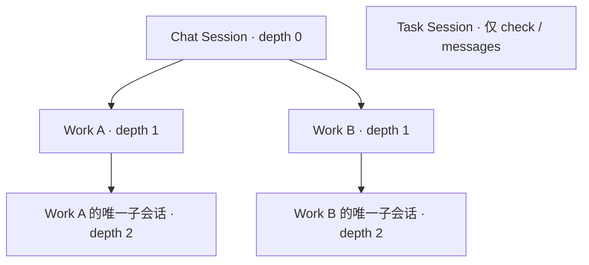
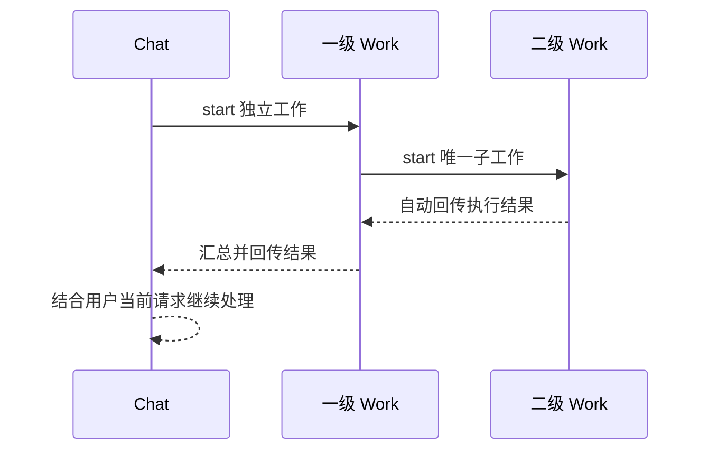

# Session Power 委派与管理设计

> 状态：已确认，核心代码与用户文档已实施，验证说明见第 13 节。
>
> 已确认规则：Chat Session 可以创建多个直接子 Work；一级 Work 生命周期内最多绑定一个二级 Work；二级 Work 不再委派。所有类型均可使用 check/messages，Task 不可创建或控制会话。

## 1. 目标与范围

Session Power 管理当前 Agent 内部的工作协作：创建工作会话、追加工作、查看进度和历史、处理交互、停止与归档。

采用有界的父子会话结构。Chat Session 负责用户对话与协调；一级 Work Session 负责独立工作，并可使用一个二级 Work Session；二级 Work Session 专注执行。Task Session 可以使用 `check` 和 `messages`，不能委派或控制其他会话。所有 Session 类型均可读取当前 Agent 内的会话状态和消息历史，读取能力不受委派深度限制。

本设计覆盖 Session Power、底层 SessionWork 的约束、会话元数据、自动回传及文档同步。Task 调度和跨 Agent 委派仍由各自服务管理。本文的树形限制只约束 Session Power；如果产品需要限制跨 Agent 的整体执行树，需要单独设计，不能假定此处深度限制自动覆盖 agent.delegate。

## 2. 调整前的实现与差异

以下记录调整前的源码行为，作为设计背景：

- `packages/type/src/types/session/SessionOrigin.ts` 定义 `category=chat/work`；Task 的分类也是 work，通过 `type=task` 区分。
- `SESSION_DELEGATION_MAX_DEPTH` 当前为 3；缺失或非法深度按 0 处理。
- `resolve_delegation_blocked_reason` 禁止 Task 委派，并根据深度统一判断权限。
- `packages/city/src/city/power/builtin/session/SessionPower.ts` 的七个动作共用该权限判断。因此达到深度上限时，读取与管理动作也同时不可用。
- Power 绑定当前 Agent 的 SessionWork；仅凭该绑定不能表达“调用方只能操作自己的直接子会话”。
- `packages/agent/src/agent/SessionDelegations.ts` 已按委派记录执行、持久化结果，并自动回传给本次调用方。创建时按调用方深度加一准备工作会话。

实施时应复用现有委派记录、执行队列、请求去重与结果回传，补充关系和权限约束。

## 3. 会话角色和层级

| 会话 | 身份判定 | 深度 | 创建权限 |
| --- | --- | --- | --- |
| Chat Session | 已知对话角色，category=chat | 0 | 可创建多个一级 Work Session |
| 一级 Work Session | type=work，直接父会话为 Chat | 1 | 最多绑定一个二级 Work Session |
| 二级 Work Session | type=work，直接父会话为一级 Work | 2 | 不可创建 |
| Task Session | type=task | 不用于授权 | 不可创建 |

Task 的委派与控制动作优先按角色拒绝，不能因分类为 work 而获得普通 Work 权限；读取动作单独授权。未知自定义角色拥有读取能力，默认不能创建或控制其他会话，必须明确接入写操作授权规则。

“一个”按会话生命周期内的一个子会话解释，不是一个并发执行名额。一级 Work 首次成功创建子会话后，继续使用 `send` 推进该子会话；子会话完成、停止或归档都不释放创建名额。不同一级 Work 各自拥有自己的名额。

创建操作在持久化关系前失败，不消耗名额；关系一旦提交，即使首次执行失败，名额也保持绑定，通过继续原会话恢复工作。

Chat 本轮不新增固定数量上限；实际执行仍受已有队列和资源限制约束。

## 4. 操作权限

读取、创建和控制分别授权。读取取决于可信调用方和 Agent 归属；创建与控制还需要检查调用方角色、委派深度及直接父子关系。

| 调用方 | start | send | check | messages | reply | stop / archive |
| --- | --- | --- | --- | --- | --- | --- |
| Chat | 创建一级 Work | 自己的直接子 Work | 当前 Agent 内的会话 | 当前 Agent 内的会话 | 自己直接子 Work 的待处理交互 | 自己的直接子 Work |
| 一级 Work | 创建唯一二级 Work | 唯一直接子 Work | 当前 Agent 内的会话 | 当前 Agent 内的会话 | 已获有效用户回答的直接子交互 | 唯一直接子 Work |
| 二级 Work | 禁止 | 禁止 | 当前 Agent 内的会话 | 当前 Agent 内的会话 | 禁止 | 禁止 |
| Task | 禁止 | 禁止 | 当前 Agent 内的会话 | 当前 Agent 内的会话 | 禁止 | 禁止 |
| 自定义角色 | 默认禁止 | 默认禁止 | 当前 Agent 内的会话 | 当前 Agent 内的会话 | 默认禁止 | 默认禁止 |

读取规则：

1. 所有 Session 类型均可调用 `check` 和 `messages`，不要求存在子会话，也不受创建名额和委派深度影响。
2. 默认读取范围为当前 Agent 内的所有 Session，目标可以是 Chat、Work 或 Task；允许读取自己、祖先、兄弟和其他 Chat 的会话。此范围作为本设计的默认读取边界，跨 Agent 仍禁止。
3. `check` 不传目标时列出当前 Agent 内的会话，沿用现有分页机制；传目标时返回其状态、近期消息和待处理交互。看到交互不授予答复或审批权。
4. `messages` 按页返回正式历史，包括压缩前历史和归档会话历史；返回内容继续标记为参考数据，不提升为用户指令。
5. 读取目标必须使用包含分类的完整引用，如 `session_category + session_id`，因为 Session ID 只在分类内唯一。禁止只按 ID 在 chat/work 分区之间猜测目标。
6. 读取不创建执行请求，不恢复运行，不触发重试或自动回传，也不改变目标生命周期。

控制规则：

1. `send/reply/stop/archive` 的目标必须属于当前 Agent，并且是调用方的普通直接子 Work。禁止控制自己、祖先、兄弟和其他 Chat 的子会话。
2. 一个一级 Work 用完创建名额后仍可管理已有子会话，所有角色的读取能力始终独立判断。
3. 用户通过产品界面直接控制会话的权限属于用户界面授权，不受模型调用的直接子范围限制。

一级 Work 仍应汇总子会话结果，再向 Chat 回报；Chat 能主动读取后代进度，但读取不会改变结果回传路径。

## 5. start 和 send

### start：创建新的工作容器

输入沿用 `workspace_id`、`query`、可选 `model_id` 和标题。调用方身份、父会话、根 Chat 与深度全部由运行时生成，模型不能传入或覆盖。

执行顺序：识别可信调用方 → 校验角色与深度 → 校验 Workspace 和模型可用性 → 原子校验并绑定子名额 → 持久化新会话关系和委派记录 → 入队执行 → 返回回执。

回执必须区分已接收、已排队与已运行；成功创建不代表工作完成。

一级 Work 再次 `start` 时返回明确的名额错误，并给出已绑定子会话的 ID，便于改用 `send`。不隐式把新的 `start` 转成追加指令。

### send：继续既有工作容器

`send` 不创建 Session，也不改变父会话、根 Chat、Workspace 归属或深度。每次调用形成独立的执行请求和结果回传记录。

通过关系校验后沿用现有队列语义；运行中收到追加指令时，由既有执行队列处理，不启动同一会话的第二个并行执行器。

允许继续已完成或已停止的子会话。归档会话禁止 `send`；本轮不隐式解除归档。一级 Work 归档唯一子会话前应确认工作结束。

## 6. 最小关系数据

沿用 Session 来源元数据和现有存储，增加结构化关系，不新增独立协作平台或第二套会话数据库。

| 字段 | 含义与约束 |
| --- | --- |
| `parent_session_id` | 创建该 Work 的直接父会话 ID；创建后不可修改 |
| `parent_session_category` | 父会话分类；Session ID 仅在分类内唯一，查询父会话必须携带该字段 |
| `root_chat_session_id` | 所属根 Chat 的 ID；由运行时继承，用于工作树展示和定位 |
| `delegation_depth` | Chat 为 0，一级 Work 为 1，二级 Work 为 2；由运行时计算和校验 |
| `child_session_id` | 一级 Work 唯一子会话的持久化绑定；子目标分类固定为 work；可用现有关系存储或原子索引表达，不要求重复写入 origin |

关系必须与当前 Agent 身份共同确定。深度是派生缓存，不能作为唯一授权证据；它必须与父子关系一致。

缺失身份、关系不完整或深度冲突时拒绝创建和追加执行，给出可诊断原因。不能将非法深度回退到 0 后放行。历史会话必须先进行显式关系核对，不能靠运行时猜测补齐。

Work 子名额需要存储层原子约束。两个并发创建请求只能有一个成功；提交会话、占用名额与保存委派记录应处于同一原子边界，或使用现有持久化操作日志完成恢复，避免产生孤儿会话。

## 7. 请求幂等和重启恢复

会话 ID、创建操作 ID 和每次委派 ID 应保持不同职责。一次创建请求的网络重试必须返回原子会话和原回执，不能消耗第二个名额。

优先复用现有工具调用 ID 或请求 ID作为可信幂等键，检查其是否覆盖“调用重试发生在回执返回前”的场景；只有当前链路无法覆盖时，才增加持久化创建请求标识。

重启恢复时先读取已持久化关系，再恢复委派记录。已保存结果只重试投递，不重新执行模型；未完成执行沿用现有稳定 request_id 恢复。

已提交但尚未入队的创建由恢复流程补入队。已有子会话绑定不得因进程重启、归档或执行失败而丢失。

## 8. 结果回传和交互

结果按直接父子链回传：二级 Work → 一级 Work → Chat。

每次 `start/send` 的回传目标由运行时绑定为实际调用方，不能让模型指定任意接收 Session。对重复投递沿用稳定结果请求标识去重。

子会话完成一个执行回合，不代表整棵工作树完成。一级 Work 有未结束子执行时应进入等待协调状态，收到结果后继续，再形成最终结果；父会话退出或停止时应清理仍在执行的子工作。

子结果保留执行状态、错误和引用信息，并继续作为参考数据。Chat 或一级 Work 不能把参考结果当成新的用户授权。

二级 Work 请求用户澄清时，交互沿父链呈现给 Chat。用户的真实回答可以逐级转交；需要审批的操作必须由现有审批机制处理，Work 不能自行批准。`reply` 在服务端验证交互归属、待处理状态和回答来源，不能只依赖提示词约束。

## 9. 停止、归档和失败

| 场景 | 目标行为 |
| --- | --- |
| 停止一级 Work | 停止该会话及其子会话，取消尚未开始的执行请求，保留已保存结果 |
| 停止二级 Work | 一级 Work 收到 stopped 结果并决定后续；不自动把整个父工作判为失败 |
| 子工作失败 | 向直接父会话回传失败和原因；允许父会话决定重试、调整或回报 |
| 父工作失败 | 取消其尚未完成的子工作，避免无人负责的后台执行 |
| 归档一级 Work | 该会话和子树均无运行、排队或待处理交互后才能归档；保留父子关系 |
| 父会话暂不可投递 | 保留结果并按现有回传策略恢复；不自动改投另一条 Chat |
| 进程重启 | 由持久化执行与投递记录恢复，不视作用户取消 |

停止必须覆盖正在创建和正在入队的子请求。子关系提交和父停止操作需要协调：父会话进入停止状态后禁止再提交新子执行。

归档不递归删除会话或结果，也不释放一级 Work 的创建名额。

## 10. 错误与可观察性

沿用现有错误返回结构，提供稳定可识别的错误原因：

| 建议错误标识 | 含义 |
| --- | --- |
| `session_context_required` | 缺少可信调用方 Session |
| `task_session_forbidden` | Task 禁止调用创建与控制动作；check/messages 不受此限制 |
| `delegation_depth_exceeded` | 二级 Work 禁止继续创建 |
| `work_child_limit_reached` | 一级 Work 已绑定子会话 |
| `session_target_forbidden` | 读取目标不属于当前 Agent，或控制目标不是调用方的直接子 Work |
| `session_target_ambiguous` | 读取目标未携带分类，无法确定唯一的会话引用 |
| `session_relation_invalid` | 调用方关系或深度数据不一致 |
| `session_archived` | 目标已归档，不能继续执行 |
| `session_subtree_busy` | 会话或子树仍有未结束工作，不能归档 |

对无权目标不区分“不存在”和“归属他人”，避免暴露会话信息。

日志关联调用方、目标、委派 ID、请求 ID 和策略错误；不记录凭据与不必要的完整消息正文。产品会话树展示父子关系、执行状态、待处理交互及投递状态，便于定位“子工作已结束但父会话尚未收到”的问题。

## 11. 实现边界

| 位置 | 职责 |
| --- | --- |
| SessionOrigin / 关系类型 | 表达角色和父子关系，校验深度一致性 |
| SessionWork 服务层 | 统一执行角色、目标关系、创建名额和生命周期检查，覆盖非 Power 调用入口 |
| SessionDelegations | 复用执行恢复、请求去重和结果投递，保证回传目标与父子关系一致 |
| SessionPower | 发布各动作可用性、解析参数并转发，避免复制业务权限规则 |
| 存储层 | 原子维护唯一子绑定和创建请求幂等 |
| Homepage 文档 | 更新能力说明、权限矩阵、生命周期和错误含义 |

不能继续用一个 `can_delegate_work` 布尔值决定全部动作。需要分别判断读取、创建和已有子会话控制权限，目标授权始终在动作执行时重新检查。读取服务必须支持 chat/work 两个分区及 Task 角色，不能继续假设目标一定是普通 Work。

整个 Power 的 availability 只要求存在可信的 Agent 与 Session 上下文，所有 Session 类型均应保留 Power。若框架支持动作级可用性，按角色与深度暴露允许的动作；若仅支持 Power 级可用性，在各动作执行时返回精确拒绝原因。Task、二级 Work 和自定义角色至少可使用 `check/messages`。读取 Schema 增加完整目标引用，列表和详情返回相同的完整引用，调用方无需猜测分类。

所有关系、幂等和回传规则由服务端执行，提示词只用于解释行为。

## 12. 实施顺序与验收

实施顺序：确认数量与深度语义 → 明确历史会话关系处理 → 实现关系与原子创建 → 收口服务端权限 → 完成停止和回传行为 → 更新 Power 描述及 Homepage 文档。

实施运行已有相关检查，并更新受新参数与授权规则影响的既有检查，不新增测试文件。验收行为如下：

- Chat 能创建两个独立一级 Work；它们可以分别创建一个二级 Work。
- 一级 Work 再次创建被拒绝，继续唯一子会话成功；并发创建仅一个成功。
- 二级 Work 和 Task 不能创建或借助 send 继续其他会话。
- Task、二级 Work 和自定义角色均可使用 check/messages；深度和名额限制不会阻止读取。
- 当前 Agent 内 Chat/Work/Task 的自身、祖先、兄弟、跨 Chat 及归档会话均可读取，完整会话引用能区分不同分类下的同名 ID。
- 跨 Agent 目标不可读取；跨 Chat、兄弟、祖先和自身目标不可控制。读取待处理交互不会获得 reply 或审批权限。
- 重试创建和重启恢复不重复创建、不重复执行已完成工作、不重复注入结果。
- Work 用完名额仍能查询、处理交互、停止和归档自己的子会话。
- 停止父工作覆盖正在创建、排队和运行中的子工作；归档不会留下运行子树。
- 结果按父链回传；审批无法由 Work 自行通过。

## 13. 实施说明与验证

已落地：分动作授权、完整读取引用、活动与归档历史只读查询、固定父子来源、原子唯一子名额、一级 Work 原 Turn 等待子结果、停止与失败取消及输入接收取消信号。Homepage 的中英文管理 Session 与 Agent 会话页面同步更新。

唯一子绑定复用持久化创建委派记录，不新增重复索引；创建与父 Turn 封闭共用文件事务锁。文件历史使用 SQLite readOnly 短连接与现有 canonical 解码器，不初始化目标 Session。内存历史复用现有存储。

历史关系不做猜测迁移；缺少合法深度或父子来源的历史 Work 继续可读，但不能自动获得新的委派与控制权限。

定向构建 type/agent/federation/city 已通过。现有检查首轮 65 项中 61 项通过；更新旧读取参数和旧归档授权夹具后，归档组 3 项通过。剩余两个 Composer 检查使用不足 10k token 的文本却预期发生压缩，与现有 ContextTokenBudget 的保留策略不一致；未修改这部分策略或检查。

一次性内存与文件存储验证覆盖：所有角色读取、Chat 多子会话、并发唯一子名额、深度限制、直接子控制、send、归档历史、读取不运行模型、原 Turn 接收子结果、准备期间取消及迟到提交拒绝。验证未调用外部模型。

实现限制：question 的真实用户回答仍由调用方转交，服务层验证交互归属、状态和类型，但当前协议没有可验证的回答来源凭据；approval 一律拒绝通过 session.reply 批准。多 Agent 委派与产品工作树展示保持独立范围。
