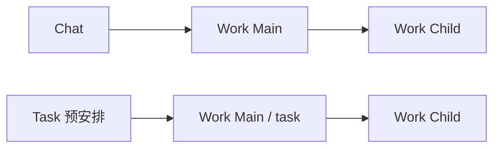

# Session P0 运行时

## 核心关系

Agent 是主体，Session 是执行单元。Chat 承接主体间交互，Work 承接自主执行；Task 是预安排入口，执行器作为来源为 task 的 Work Main。

来源保留 `origin.type`，层级使用现有 `delegation_depth`：Chat=0、Main=1、Child=2。分工由 category、层级、可信创建关系和可用工具共同决定，不因 task 名称拒绝。

Task executor 显式 depth=1，可创建多个 Child；模拟评审器 depth=2，不继续分工。专用执行配置仍控制工具范围。

## 生命周期

- Chat 当前 Turn 停止或失败，不取消已派的自主 Main。
- Main 在本轮有待完成 Child 时等待，输入到达可唤醒下一检查点。
- Main 停止或失败时封闭本轮委派，取消未完成 Child 与未确认投递。
- 跨 Agent 子工作由接单主体保存委派；发起主体通过容器提供的主体集合协调等待和取消。
- Session Power 对控制动作继续要求同主体直接创建关系；跨主体单次委派不授予目标 Session 控制权。

## 结果与问题

委派记录保存执行结果与交付状态。结果使用可信后台输入入口，复用 Session FIFO 和 canonical 请求身份：

| 目标 | 接收 |
| --- | --- |
| 原 Turn 仍活动 | 检查点注入原执行 |
| Main 对 Chat，原 Turn 已正常结束或停止 | 空闲时用明确 runtime 身份启动后续处理 |
| 正在执行无关 Turn | 返回 retry，来源保留投递责任 |
| Child 对 Main，原执行已收口 | 返回 discarded，仅保存结果 |
| 目标已删除或归档 | 结束自动交付，保留来源结果 |

公开问题回传只读投影与原 Interaction 引用；问题状态由 Child canonical Message 唯一持有。公开答案可通过既有 reply/respond 转交，模型不得杜撰用户回答。审批与私密问题仅使用原 Session 受信入口。

交互通知各自等待接收，不串行阻塞整个委派恢复扫描。

Main 后续 Chat 回复与 Shell 唤醒携带原 Turn 的受信背景引用。Messenger 从原完成路由恢复收件目标，不使用最新入站消息猜测。

## Shell

Shell 快照保存可信完成目标，在进程启动前登记；输出和快照通过现有执行目录持久化。快照写入串行且原子，退出不能提前确认通知成功。

Shell 终态事件触发投递，接收端由 City 桥接到 Agent Session。暂时 busy 或临时故障保留待投递；收到 canonical 接收确认才设置 notification_sent。discarded 独立记录，不能伪装为通知成功。

短命令 exec 保持同步结果，不重复发自动完成通知。后台入口在仍运行且未明确禁用时启用回投。独立常驻进程可明确关闭通知。

重启扫描恢复已保存结果投递；没有本实例进程句柄的 starting/running 快照报告监管中断、进程实际状态未知，不伪造退出码，也不重跑命令。

## 恢复后的接收责任

canonical 输入写入即代表接收成功，后续模型执行可以仍未完成。启动时检查 session_background 续轮；若接收后处理中断，保留已收到结果并将后续处理明确标为中断，释放占用，由人查看后决定是否重试，不自动重放未知副作用。

## 实现位置

- type SessionOrigin：分层判据与来源。
- agent SessionWorkPolicy / SessionChildWorkLifecycle：关系与收尾。
- agent SessionDelegations：执行、问题引用与结果可靠回传。
- agent SessionBackgroundInput / SessionBackgroundRecovery：接收与中断收口。
- city ShellCompletionBridge：Shell到Agent的可信桥接。
- city ShellCompletionDelivery / ShellSnapshotStorage：Shell结果投递、原子快照与恢复。
- powers TaskRunnerSession：Main执行器与受限评审器。
- powers MessengerCompletion：原消息路由连续性。
